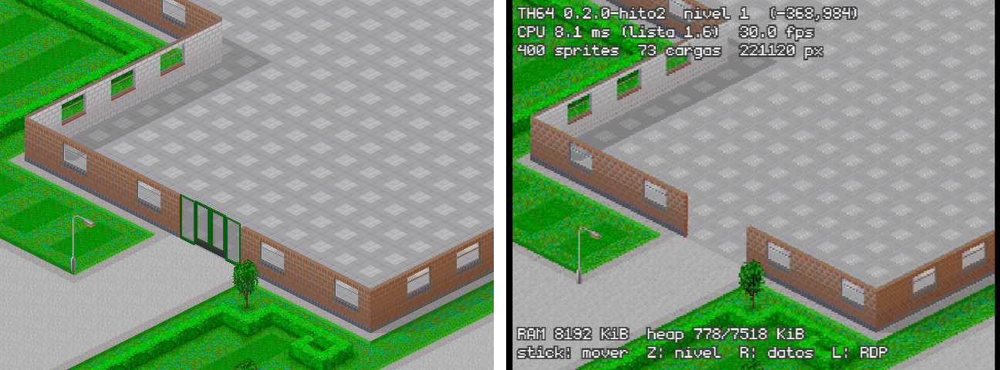
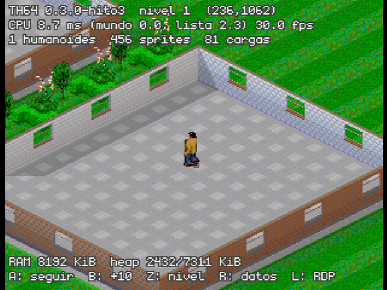
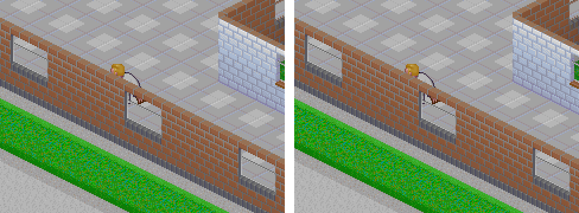
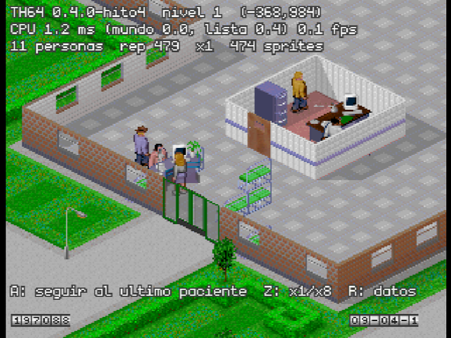

# Fase 5 — Prototipos en N64

Fecha de inicio: 2026-10-23. Estado: **en curso**. Plan: [`PLAN.md`](PLAN.md#fase-5--prototipos-en-n64-solo-tras-aprobar-la-fase-4), con los cambios de [`04_decision.md`](04_decision.md#cambios-al-plan-de-la-fase-5). Cada hito se cierra con un commit, una captura de ares y sus cifras aquí.

## Entorno del motor

**Hecho.** El código está en [`motor/`](../motor/README.md), y [`tools/motor_check.sh`](../tools/motor_check.sh) lo comprueba todo de una vez:

| Comprobación | Resultado |
|---|---|
| Núcleo en el PC con gcc (`-Wall -Wextra -Werror`) | 60.045 comprobaciones, 0 fallos, 0,05 s |
| Lo mismo con ASan y UBSan | 0 fallos |
| ROM de pruebas en ares (modo Homebrew, se cierra sola) | 60.045 comprobaciones, 0 fallos |
| Huella de la simulación de referencia (semilla 1, 10.000 pasos) | `d38fbaef` en el PC y en la N64 |
| ROM normal | Arranca: 8.192 KiB de RDRAM con Expansion Pak, heap usado 588 de 7.865 KiB, DFS correcto |

- **Tamaño.** La ROM ocupa 208 KiB. El código ocupa 245.404 B (`text`), casi todo libdragon: vídeo, RDP, texto y mandos.
- **Tiempo de compilación.** La ROM tarda 0,36 s desde cero y 0,32 s tras tocar un fichero.

*Pantalla de estado de la ROM en ares. El «1 VPS» de la barra de ares se debe al vídeo por software del contenedor, no a la ROM.*

Punto de partida: el núcleo de ejemplo de la fase 4 (`n64/pruebas/nucleo`), con:
- el pool de entidades con asas;
- la coma fija Q16.16;
- el generador xorshift32;
- el marco de pruebas.

## Hito 0 — Conversor

**Hecho.** Solo queda una parte que usa la interfaz (al final de esta sección). Se hizo por partes: primero los gráficos, porque es lo único que necesitaba el hito 1, y después las animaciones, los niveles, las reglas, los textos, las fuentes y el sonido, antes de los hitos 2–4.

**Gráficos: hecho.** [`tools/conv/`](../tools/conv/README.md):
- **RNC.** Un descompresor en Python, portado del de CorsixTH. Da exactamente lo mismo que `rnc_decode` en los 241 ficheros RNC de los datos: 16,3 MB descomprimidos en 11 s. El conversor no necesita compilar CorsixTH.
- **Paletas.** `MPALETTE.DAT` pasa a RGBA5551 con la entrada 255 transparente. Lleva también las dos paletas fantasma de CorsixTH:
  - la gris, que es su mismo cálculo de `makeGreyscaleGhost`;
  - la roja, la tabla 6 de `GHOST1.DAT`.

  Ocupan 1.544 B en total.
- **Hojas.** Las 8 hojas de `DATAM` pasan a TSH1: CI8 con filas de 8 B, la misma numeración que el original y una comprobación de ida y vuelta exacta.

  | Hoja | Sprites | Sin comprimir | En la ROM (aPLib) |
  |---|---:|---:|---:|
  | `MSPR-0` (personajes y objetos) | 4.397 | 1.212.544 B | 392.866 B |
  | `MBLK-0` (suelos y paredes) | 226 | 192.360 B | — |
  | Las otras 6 (panel, reloj, punteros, menús…) | 546 | 309.336 B | — |

  Los píxeles de `MSPR-0` y `MBLK-0` (1.177.352 y 190.536 B) coinciden con lo medido en la fase 4.

**Animaciones: hecho.** Las tablas de `DATAM` (5.186 animaciones, 11.643 fotogramas, 108.607 entradas de lista y 24.983 elementos) pasan al formato TAN1: 481.038 B, dentro de los 0,48 MiB del presupuesto. Cada animación lleva su duración en fotogramas, calculada como `getAnimLength` de CorsixTH. Comprobaciones:
- **El encadenamiento de `DATAM` es idéntico al de `DATA`**, que es el que usa CorsixTH. Las animaciones de baja resolución duran lo mismo.
- **Las duraciones coinciden con las de CorsixTH en 5.183 de 5.186.** Las 3 distintas son los ajustes que hace su Lua: 2348 y 2938 duran 1 fotograma, y 4086 dura 8. Van en las reglas (ver abajo).
- **El desplazamiento de los elementos** (resuelto en el hito 3). CorsixTH solo usa las animaciones de alta resolución y les resta (141, 186). En `DATAM` todas las x crudas son impares y todas las y pares, así que (x − 141)/2 e (y − 186)/2 son exactas: el mismo origen, a media escala.

**Niveles: hecho** (para el hito 2). Los 12 mapas de `LEVELS` pasan al formato TMP1 (`tools/conv/niveles.py`):
- se leen como en `load_from_th_file` de CorsixTH, con su tabla de bloques;
- cada casilla ocupa 10 B: las capas, las banderas del fichero, el objeto, su dirección y la parcela;
- las paredes van dos veces: las actuales y las originales, que incluyen las paredes divisorias entre parcelas (de 0 a 37 por nivel).

Cada nivel ocupa 163.872 B; en la ROM, con aPLib, entre 2.216 y 5.743 B (42.644 B los 12). El conversor no interpreta nada más: lo demás que hace CorsixTH al cargar es lógica del juego y va en el núcleo (hito 2).

**Reglas: hecho** (para el hito 4). Son las definiciones de CorsixTH y la configuración de cada nivel, en el formato TRG1 ([`tools/conv/reglas.py`](../tools/conv/reglas.py)).

- **Extracción.** [`reglas.lua`](../tools/conv/reglas.lua) carga el código de CorsixTH con `lua5.4` de serie y unos stubs mínimos, como en la fase 4, y lo procesa como el juego al arrancar (`Object.processTypeDefinition`). Saca:
  - 60 objetos, 23 salas, 34 enfermedades y 9 diagnósticos;
  - 332 marcadores de animación (272 llamadas, desplegadas como `_unfoldAnims`);
  - las animaciones de caminar de cada clase y la configuración por defecto de CorsixTH;
  - `base_config.lua`;
  - la configuración de los 36 niveles de la campaña (3 dificultades × 12), con la propia `Map:_loadOriginalCampaignLevel` de CorsixTH: `base_config.lua`, encima `FULL00.SAM`, `FULL01.SAM` y, en 5 niveles, el `originalNN.level` de CorsixTH.
- **Las 3 duraciones fijadas en el Lua** se resuelven con las tablas de animación: 2348 y 2938 duran 1 fotograma, y 4086 dura 8, porque es `getAnimLength(2166)`.
- **El aspecto de los pacientes** (`initPatient`, que elige tipo y capas con `math.random`) pasa a una distribución exacta. Se recorren todas las ramas de sus llamadas a `math.random`, ejecutando la propia función de CorsixTH. Después se factoriza: el tipo y, dentro de cada tipo, bloques de capas independientes, comprobado con fracciones. Sale exacto en las 34 enfermedades. Solo los huesos rotos necesitan un bloque de 3 capas (las vendas, 71 combinaciones), y con la configuración por defecto de CorsixTH solo hay hombres con huesos rotos.
- **TRG1** guarda el árbol tal cual, como el de Lua: enteros, reales, cadenas, listas y mapas con las claves ordenadas, y las claves enteras distintas de las de texto. El núcleo ([`th/rules.h`](../motor/core/include/th/rules.h)):
  - valida el fichero entero al abrirlo;
  - busca por búsqueda binaria;
  - lee los reales en Q16.16 solo con enteros;
  - lee lo que necesita al cargar y suelta el fichero.

| Fichero | Sin comprimir | En la ROM | Validar en la N64 |
|---|---:|---:|---:|
| `reglas/definiciones.trg` | 336.868 B | 60.908 B | 50 ms |
| Un nivel (`reglas/full01.trg`…) | 26.936–30.740 B | unos 5.000 B | 4 ms |
| Los 37 | 1.379.440 B | 257.726 B | — |

Comprobaciones:
- **Ida y vuelta:** los 37 ficheros se leen igual que se escribieron, con igualdad estricta (1 no es 1,0).
- **El núcleo frente al conversor:** `th64sim reglas` vuelca cada fichero al mismo JSON canónico, y salen los 37 iguales. En la N64, la ROM de pruebas da la misma huella que el PC (`tools/motor_check.sh`).
- **Contra CorsixTH:** [`volcar_reglas.lua`](../bench/scenarios/volcar_reglas.lua) vuelca, desde dentro del juego, lo que tiene en memoria. [`comparar_reglas.py`](../tools/conv/comparar_reglas.py) lo compara con el extractor, sin contar las cadenas de idioma, que en el juego ya están traducidas:

  | Qué | Iguales |
  |---|---:|
  | Objetos | 60 de 60 |
  | Salas | 23 de 23 |
  | Enfermedades | 34 de 34 |
  | Diagnósticos | 9 de 9 |
  | Configuración de nivel | 36 de 36 |

  Para comprobar el comparador, se metieron 3 cambios a mano (un entero, un entero cambiado por real y una lista más corta), y detectó los 3.

**Textos: hecho.** [`textos.lua`](../tools/conv/textos.lua) ejecuta el `strings.lua` de CorsixTH con `lua5.4`, igual que en el juego: cada idioma hereda de otro y de las cadenas originales (`LANG-0.DAT` el inglés y `LANG-4.DAT` el español). Lo que en el juego es C++ se hace aquí en Lua:
- la lectura de `LANG-x.DAT` (`th_string_list`);
- el paso de CP437 a UTF-8, con la tabla del propio CorsixTH (`Src/cp437_table.h`), que no es CP437 puro: 0x92 pasa a «?».

| Idioma | Cadenas | TRG1 | Validar en la N64 |
|---|---:|---:|---:|
| Inglés | 5.524 | 263.592 B | 18 ms |
| Español | 5.543 | 289.036 B | 18 ms |

Comprobaciones:
- [`volcar_textos.lua`](../bench/scenarios/volcar_textos.lua) carga los dos idiomas dentro de CorsixTH, con su lector en C++. `comparar_reglas.py --textos` da las dos tablas idénticas, cadena a cadena.
- La N64 lee los dos ficheros con la misma huella que el PC.

Las tablas incluyen todo lo que añade CorsixTH: opciones de PC, trucos, errores. Son unas tres veces lo que preveía el presupuesto de RAM (0,10 MiB por idioma). Cuando llegue la interfaz se verá si se quitan las partes que la N64 no usa o si el texto se lee del cartucho.

**Fuentes: hecho.** Las 5 fuentes de baja resolución de `QDATAM` pasan a BMFont, un `.fnt` de texto con su atlas `.png` ([`fuentes.py`](../tools/conv/fuentes.py)), y el Makefile las convierte a `font64` con `mkfont`:
- **Codificación:** cada carácter va por su código Unicode, con la misma tabla que los textos.
- **`FONT100M`:** son las 26 cifras y signos con fondo degradado, en 15 colores; seguramente las del contador del panel. Ocupa 487 B.
- **Las otras 4:** son fuentes completas de un color (rojo, negro, azul y blanco), de 145 caracteres. Ocupan unos 1.540 B cada una.
- **Cobertura:** en inglés no falta ningún carácter. En español faltan Á, Í y Ó, que salen 4 veces en todos los textos.

La ROM de pruebas carga las 5.

**Sonido: hecho** ([`sonidos.py`](../tools/conv/sonidos.py)). Lo pasa a los formatos de libdragon el Makefile, con `audioconv64`.

- **Efectos y locutor.** Cada idioma tiene su `SOUND-n.DAT`, con el número de su `LANG-n.DAT`: `SOUND-0` el inglés y `SOUND-4` el español.
  - Cada sonido se guarda una sola vez, como WAV, aunque esté en los dos idiomas: 191 son comunes, 185 solo del inglés y 197 solo del español.
  - Van en VADPCM sin Huffman, como decidió la fase 4.
  - CorsixTH toca el sonido de un fotograma por su posición en el archivo del idioma cargado, y el orden cambia de un idioma a otro. Por eso cada idioma lleva una tabla de las 746 posiciones, de cada una a su fichero (`sonido/english.trg`).
  - De las 127 posiciones que usan las animaciones, dos suenan distinto según el idioma (la 80 y la 223), igual que en CorsixTH.
- **Música.** Las 8 piezas XMI pasan a MIDI con el `xmi2mid.cpp` de CorsixTH, compilado aquí con `g++`; no hace falta compilar CorsixTH entero.
- **Banco de instrumentos.** Se toca con TimGM6mb, como en la fase 4, recortado a lo que usan las piezas. Es un SF2 nuevo con solo esos presets, sus instrumentos y sus muestras: 28 de 136 presets, 43 instrumentos y 177 de 520 muestras.
  - Comprobación: fluidsynth sintetiza cada pieza con el banco entero y con el recortado, y en las 8 el audio sale idéntico byte a byte (120 MB de WAV a 22.050 Hz).
  - `audioconv64` avisa de que el sintetizador de libdragon no tiene envolvente de modulación (3 instrumentos) ni vibrato (27). En la N64 sonará algo distinto que en fluidsynth.

| Qué | En la ROM | Estimación de la fase 2 |
|---|---:|---:|
| Efectos comunes (wav64) | 1.656.394 B | 1,43 MiB |
| Propios del inglés | 5.628.660 B | 4,88 MiB |
| Propios del español | 4.099.038 B | 3,46 MiB |
| Música (8 piezas en mid64) | 78.482 B | 77 KiB |
| Banco recortado (sf64) | 713.908 B | 1,81 MiB entero |

Los efectos y la voz ocupan entre un 10 y un 13 % más que lo estimado en la fase 2: es el Huffman que se quita, como ya avisó la fase 4. El banco recortado deja libre más de lo que suma eso. La ROM normal ocupa ahora 13.697.024 B.

En la ROM de pruebas, en ares:
- carga el banco recortado, que ocupa **98 KiB de RAM** (la fase 4 estimaba unos 101);
- toca `FORTUNE` 3 s, y a los 3 s va por los 3.258 ms;
- busca a la vez un efecto por su posición en la tabla del idioma (la 10, `FALLOVER.WAV`) y lo hace sonar;
- **el audio se lleva el 4,4 % de la CPU**. Se mide con el método de la fase 4: trabajo fijo hecho con y sin audio, llamando a `mixer_try_play` entre medias.

**Lo que queda del hito 0:**
- **Las posiciones por fotograma de los marcadores.** Solo las usa la interfaz (la ventana del paciente, los iconos de humor) y se calcularán con ella.
- **El mapa de prueba** que preveía el plan ya no hace falta. Las pruebas del núcleo construyen mapas sintéticos, sin datos del juego, y las comparaciones usan los niveles de verdad y el escenario del hito 4.

**Una medida de paso.** La ROM de pruebas con el lector de reglas da 17,59 ms con 50 humanoides en pantalla, frente a 23,73 en la del hito 3, y 5,52 ms en el recorrido del hito 2, frente a 6,41. El dibujo no ha cambiado: es la disposición del código en la caché de instrucciones, que mueve estas cifras hasta un 26 %. El hito 5 tendrá que medir con varias compilaciones, o fijar la disposición del código.

## Hito 1 — La ROM carga los assets y dibuja un sprite con su paleta

**Hecho.**
- **Carga.** La ROM carga `paleta.tpl` y `datam/mspr-0.tsh` del sistema de ficheros de la ROM.
- **Dibujo.** Dibuja con el RDP en CI8, cargando la textura y un rectángulo con APIs estables, como propone [`04_construccion.md`](04_construccion.md#sprites-y-dibujo). Los sprites que no caben en la TMEM pasan por `rdpq_tex_blit`.
- **Visor.** La pantalla muestra un sprite a escala 3 con las tres paletas y reflejado, y una tira con los siguientes. Con la cruceta se cambia de sprite, para verlo en la consola cuando llegue el flashcart.

**Comprobación automática.** Al arrancar, la ROM dibuja el sprite de prueba sobre un fondo conocido y espera al RDP. Después compara cada píxel del framebuffer con el color que le toca según la hoja y la paleta: **598 de 598 píxeles iguales** (sprite 1 de `MSPR-0`, 23 × 26). `tools/motor_check.sh` lo comprueba en cada ejecución.

| Dato | Valor |
|---|---|
| ROM | 688.128 B (`MSPR-0` comprimida con aPLib: 392.866 B) |
| Código (`text`) | 234.904 B |
| Heap usado con `MSPR-0` entera cargada | 1.774 KiB de 7.833 (el presupuesto de la fase 4 cuenta 1,30 MiB para todos los sprites residentes) |

*Hito 1 en ares. La paleta roja es la que usa el juego para paredes, puertas y ventanas en una posición no válida; aplicada a una persona no tiene sentido, pero muestra que la tabla se aplica bien.*

## Hito 2 — Mapa isométrico con scroll a 30 fps

**Hecho.** La ROM carga un nivel y lo dibuja con el RDP. La cámara se mueve con el stick a 30 fps, sin saltar fotogramas en ares. El mapa es exacto: el núcleo coincide con CorsixTH casilla a casilla y, con los mismos gráficos que CorsixTH, la vista coincide píxel a píxel. Solo faltan las entidades (puertas y personal), que llegan en el hito 3.

*Nivel 1 con la cámara inicial: CorsixTH a la izquierda (gráficos de `DATA`) y la ROM en ares a la derecha (gráficos de `DATAM`, ampliada al doble). Falta la puerta de entrada, que es un objeto. Las cifras de CPU de la pantalla son las del visor, que gasta más que el recorrido medido abajo (ver «Rendimiento»).*

### Qué hay

- **Núcleo: [`th/map.h`](../motor/core/include/th/map.h).** El mapa ocupa 128 × 128 casillas de 16 B: 256 KiB, como preveía [`04_decision.md`](04_decision.md#presupuesto-de-ram). Al cargar un nivel hace lo mismo que CorsixTH (`level_map` en `th_map.cpp` y `Map` en `map.lua`):
  - las parcelas que no son del jugador se ven como césped a rayas con adornos;
  - entre parcelas de distinto dueño se ponen paredes divisorias;
  - calcula el tránsito en las cuatro direcciones (los bordes del mapa y las paredes lo cortan) y las sombras (incluido un descuido de CorsixTH, que mira la bandera «alto» de la casilla equivocada);
  - aplica las correcciones de `Map:_fixTiles` (solo el suelo de interior es hospital; dos casillas del nivel 6).

  Comprar una parcela (`th_map_set_parcel_owner`) ya funciona como en CorsixTH, salvo una cosa: cerrar con pared las salas que queden abiertas. Eso llegará con las salas.
- **Vista: [`motor/vista/`](../motor/vista/vista.h).** Es C portable. Genera la lista de sprites que se ven, en el orden de `level_map::draw`:
  1. todos los suelos, cada uno con su sombra;
  2. por cada línea de casillas, las paredes norte de derecha a izquierda y después las oeste de izquierda a derecha.

  La proyección lleva una «unidad»: 32 con los gráficos de `DATA` (los de CorsixTH) y 16 con los de `DATAM` (la N64). Así, el mismo código dibuja lo que CorsixTH y lo que la consola. El rasterizador de referencia (`raster.c`) pinta la lista sprite a sprite.
- **N64: [`mapa_n64.c`](../motor/platform/n64/mapa_n64.c).** El RDP pinta la lista:
  - los suelos, agrupados por bloque: una carga de textura por bloque distinto y un rectángulo por casilla;
  - las sombras, al 25 % con el mezclador;
  - las paredes, en el orden de la lista.

  Dos suelos que caben en su rombo no se pisan, así que da igual en qué orden se pinten. De los 74 bloques de suelo de `MBLK-0`, 7 se salen del rombo; esos cortan la agrupación para conservar el orden de CorsixTH (se vio en la comparación: el bloque 60 tiene un píxel fuera y pisaba al vecino).
- **Visor.**
  - El stick o la cruceta mueven la cámara, limitada al rombo del mapa.
  - Z pasa al nivel siguiente (los 12).
  - R oculta los datos.
  - L mide el RDP en cada fotograma, solo en la consola: ares no emula sus contadores.

### Comprobaciones

| Qué | Contra qué | Resultado |
|---|---|---|
| Las 16.384 casillas de los 12 niveles: suelo, paredes, transitable, hospital, 5 de edificable, 4 de tránsito, 2 de objeto alto, parcela y objeto | Volcado de CorsixTH justo después de `loadLevel` ([`volcar_mapa.lua`](../bench/scenarios/volcar_mapa.lua) y `th64sim mapa`) | **0 diferencias** lejos de los objetos. Hay 103 casillas distintas, todas a 3 casillas o menos de un objeto del mapa: son las banderas que ponen los objetos al colocarse (edificable y objeto alto). Llegan con los objetos |
| Lo que se ve del mapa a 640 × 480 con los gráficos de `DATA`, en 15 posiciones de cámara de los niveles 1, 5 y 12 (sombras sobre paredes, paredes divisorias, parcelas sin dueño y los bordes del mapa) | Capturas de CorsixTH sin ventanas ni cursor ([`tools/oraculo_mapa/`](../tools/oraculo_mapa/README.md)) | De 4.608.000 píxeles: **4.426.872 idénticos**, 142.815 de sombra con 1 o 2 de 255 de diferencia (redondeo de la mezcla) y 38.313 distintos. Todos los distintos están en las entidades que aún no se dibujan: puertas, médicos y las sombras que proyectan las puertas. **7 de las 15 capturas no tienen ningún píxel distinto** |
| Lo que dibuja el RDP en la N64, en 5 vistas de 320 × 240: en el nivel 1, la cámara inicial, una sombra sobre pared, la esquina del mapa y el exterior; en el 12, parcelas sin dueño con paredes divisorias | El rasterizador de referencia, en la misma ROM | **0 píxeles distintos de 384.000.** De los 5.216 píxeles de sombra, 3.443 difieren en 1 de 31: el mezclador del RDP redondea distinto |
| Pruebas del núcleo | — | 60.125 comprobaciones (80 nuevas del mapa: formato, tránsito, sombras, parcelas y correcciones), 0 fallos en el PC, con ASan y UBSan, y en la N64 |

Los 38.313 distintos de la segunda fila son 37.216 que difieren en más de 2 y 1.097 que difieren en 1 o 2 sin ser de sombra; estos últimos están todos a menos de 3 píxeles de una entidad. `tools/motor_check.sh` repite en cada ejecución la tercera y la cuarta fila.

### Rendimiento

Recorrido automático en ares (ROM de pruebas). Son 416 fotogramas a 30 fps, en el nivel 1: la cámara da la vuelta a un rectángulo de 768 × 512 píxeles alrededor de la cámara inicial, a 8 píxeles por fotograma.

| Dato | Media | Máximo |
|---|---:|---:|
| CPU del mapa por fotograma | **5,24 ms** (15,7 % de 33,3) | 6,73 ms |
| — generar la lista | 1,65 ms | — |
| — suelos y sombras (comandos del RDP) | 2,19 ms | — |
| — paredes | 1,39 ms | — |
| Tiempo entre fotogramas | 33,25 ms | 33,45 ms |
| Fotogramas que se saltan (más de 50 ms) | **0** | — |
| Sprites | 379 | 428 |
| Cargas de textura | 48 | 79 |
| Relleno del RDP (píxeles cubiertos, transparentes incluidos) | 196.380 | 236.064 |

- **Con texto encima.** Una segunda vuelta dibuja además las 5 líneas de texto del visor. El mapa cuesta lo mismo (5,29 ms): el texto no le enfría las cachés. El texto suma 1,69 ms (6,98 ms el fotograma entero, 8,28 de máximo).
- **La vista más cargada** es la cámara inicial: 400 sprites y 73 cargas. Con la cámara fija en ella (medido aparte, con el recorrido parado y con el visor), gasta 6,2 ms en la ROM de pruebas y 7,0 en la normal (lista 1,6; suelos 2,7; paredes 2,6). La diferencia es la disposición del código en la caché de instrucciones: se vio lo mismo en la fase 4 ([`04_construccion.md`](04_construccion.md#sprites-y-dibujo)).
- **Lo que se ganó al medir.** La lista se generaba en tres pasadas por todo el mapa visible, que recorren las casillas en diagonal y fallan en caché. Ahora se genera en una sola pasada por línea, llenando la lista por los dos extremos: de 2,69 a 1,65 ms. El resultado es idéntico (las 15 capturas dan lo mismo).
- **El RDP no se puede medir en ares**, que no emula sus contadores de ciclos. Una estimación: 236.064 píxeles en el peor caso, a un píxel por ciclo en el modo de un ciclo y a 62,5 MHz, son 3,8 ms, más la preparación de cada rectángulo; lejos de los 33,3 ms. En la consola, el botón L da la cifra de verdad. Queda para cuando llegue el flashcart.
- **Para el hito 3.** El mapa deja unos 28 ms por fotograma para la simulación, los humanoides, los objetos y la interfaz. El riesgo de CPU de la fase 4 sigue en los humanoides: cada uno tiene unos 14 elementos de animación, cada uno con su textura.

### Memoria y tamaño

| Dato | Valor |
|---|---|
| Mapa (`th_map`, estático) | 256 KiB |
| Lista de dibujo (4.096 elementos de 10 B, estática) | 40 KiB |
| `MBLK-0` en RAM | 192.360 B (28.098 B en la ROM) |
| Heap usado con el nivel cargado | 778 KiB de 7.518, con los 3 framebuffers (450 KiB) |
| ROM | 737.280 B, con los 12 niveles |
| Código (`text`) | 244.216 B |

### Pendiente

- **Objetos del mapa.** Las puertas de entrada y los demás objetos que trae el mapa del nivel: dibujarlos y poner sus banderas (edificable, objeto alto, que cambia sombras). Es lo único que separa el núcleo de CorsixTH en la comparación de casillas. Hito 3 o 4.
- **Banderas de dibujo de las paredes.** CorsixTH guarda en el byte alto de cada capa banderas de dibujo (espejo, transparencia) que pone el Lua al construir salas. Los mapas originales no las traen; harán falta con las salas (hito 4).
- **Límite de la cámara.** El motor mantiene el centro de la pantalla dentro del rombo del mapa. CorsixTH usa un rombo algo distinto (`limitPointToDiamond`), así que en los bordes la cámara puede quedar unos píxeles más allá o más acá. No afecta al dibujo.

## Hito 3 — Un humanoide que camina por el mapa

**Hecho.** En la ROM, un paciente camina por el nivel 1 de una casilla a otra, con el A* de CorsixTH y su animación de caminar. La cámara lo sigue a 30 fps sin saltar fotogramas en ares. Con B se añaden más, que pasean por casillas al azar; con 50 en pantalla sigue a 30 fps. Contra CorsixTH:
- **caminos:** 12.000 de 12.000 iguales, casilla a casilla;
- **caminatas:** 6.522 de 6.522 ticks iguales en 16 caminatas (casilla, desplazamiento, animación, fotograma y banderas);
- **pantalla:** el humanoide se ve igual, salvo diferencias de 5 o menos (de 255) en su interior. Vienen del filtrado lineal con que CorsixTH dibuja las animaciones.

*El visor en ares (320 × 240, ampliada al doble) siguiendo al paciente por el nivel 1. Las cifras de CPU de la pantalla son las del visor, con el texto encima.*

*Escena 4 a 640 × 480 (nivel 1, tick 60 de la caminata de (86,70) a (54,70)), recortada y ampliada al doble: CorsixTH a la izquierda y el motor a la derecha, con los mismos gráficos. El paciente va al oeste (la animación del norte en espejo) por detrás de la pared: la ventana y la pared de delante se vuelven a dibujar encima de él, como en CorsixTH.*

### Qué hay

- **Caminos: [`th/path.h`](../motor/core/include/th/path.h).** Es el A* de CorsixTH (`basic_pathfinder` en `th_pathfind.cpp`), con:
  - el mismo montículo binario y sus mismas comparaciones (`<=` al subir un nodo, `<` al sacarlo);
  - el mismo orden de vecinos (oeste, este, norte, sur);
  - la misma regla de tránsito: desde una casilla transitable solo se pasa a otra transitable.

  Cambia la memoria: nodos de 8 B (128 KiB para el mapa entero, como preveía [`04_decision.md`](04_decision.md#presupuesto-de-ram)) y un mapa de bits de nodos vistos en lugar de la lista de nodos sucios. Con el montículo, 162 KiB estáticos.
- **Animaciones: [`th/anim.h`](../motor/core/include/th/anim.h).** Lee las tablas TAN1 del conversor con las reglas de `animation_manager` (`th_gfx.cpp`): primer fotograma, encadenamiento, listas de elementos y el filtro por capas, incluido el caso especial de la capa 5.
- **Humanoides: [`th/humanoid.h`](../motor/core/include/th/humanoid.h).** La parte de `Entity` y `Humanoid` que hace falta para caminar:
  - las acciones de caminar (`walk.lua`) y de quedarse quieto (`idle.lua`), con su cola. `setNextAction` respeta las acciones que tienen que ocurrir, y una caminata interrumpida acaba antes el paso en curso;
  - el orden de `Entity:tick`: primero avanzan el fotograma y el desplazamiento, después el temporizador. Cada paso dura 8 ticks, a 4 × 2 píxeles por tick;
  - las animaciones de cada clase (`walk_anims` de `humanoid.lua`). Oeste y sur son las de norte y este en espejo;
  - si cambia el tránsito del camino por delante, se busca otro (`recalc_route`).

  El camino va dentro del humanoide, a 2 bits por paso: 256 B para 1.024 pasos (el más largo de los 12.000 caminos tiene 353). Si no cabe, al acabarlo se busca el resto. Cada humanoide ocupa 332 B.
- **Vista.** Las entidades entran en la lista de dibujo en el orden de `level_map::draw`:
  - en cada casilla van después de su pared oeste, por capa de dibujo y, dentro de una capa, la última en llegar primero;
  - de cada fotograma van los elementos de las capas que lleva el humanoide (ropa, pelo, piel), con su espejo y su transparencia;
  - después de cada entidad animada se vuelven a dibujar encima, como en CorsixTH, las entidades de los lados sur y este de las casillas vecinas y, si hace falta, la pared norte y las entidades de la casilla de delante. Sin esto, el humanoide se vería delante de las paredes por las que pasa por detrás.
- **N64: [`mapa_n64.c`](../motor/platform/n64/mapa_n64.c).** El RDP pinta los elementos en la misma pasada que las paredes:
  - el espejo, con un rectángulo de textura con las coordenadas al revés;
  - las transparencias (50 y 75 %), con el combinador y el mezclador.

  `MSPR-0` está entera en RAM, como en el hito 1.
- **Visor.** El mundo avanza un tick cada 54 ms de reloj, como CorsixTH a velocidad Normal, y como mucho 4 por fotograma. Cuando un humanoide llega, elige otra casilla al azar y vuelve a caminar. Hay dos botones nuevos:
  - A sigue al primer humanoide o deja de seguirlo;
  - B añade 10 humanoides.

### Comprobaciones

| Qué | Contra qué | Resultado |
|---|---|---|
| Caminos del A*: 1.000 pares de casillas transitables por nivel, en los 12 niveles | `World:getPath` de CorsixTH ([`caminos.lua`](../bench/scenarios/caminos.lua) y `th64sim caminos`) | **12.000 de 12.000 iguales** casilla a casilla, incluidos los 54 pares sin camino. El más largo tiene 353 pasos |
| Caminatas: 16 caminatas de 16 a 88 pasos en los niveles 1, 5 y 12, tick a tick (casilla, desplazamiento, animación, fotograma y banderas) | Un «Standard Male Patient» que camina en CorsixTH ([`caminata.lua`](../bench/scenarios/caminata.lua) y `th64sim caminata`) | **6.522 de 6.522 ticks iguales** |
| Lo que se ve a 640 × 480 con el humanoide, en 8 escenas de los niveles 1, 5 y 12: de frente, de espaldas, en espejo y junto a paredes. En la escena 4 se vuelven a dibujar paredes encima | Capturas de CorsixTH parado en ese tick ([`escenas.sh`](../tools/oraculo_mapa/escenas.sh) y `th64sim escena`) | De los 7.922 píxeles del humanoide: 6.128 idénticos, 1.767 a 2 o menos y 27 de 3 a 5. **Ninguno difiere en más de 5.** Fuera de él, ver abajo |
| Lo que dibuja el RDP en la N64 con el humanoide, en 5 vistas de 320 × 240 del nivel 1 | El rasterizador de referencia, en la misma ROM | **0 píxeles distintos de 384.000**, 1.328 de ellos del humanoide. En una vista se vuelve a dibujar una casilla |
| Pruebas del núcleo | — | 60.180 comprobaciones, 0 fallos en el PC, con ASan y UBSan, y en la N64. Hay 55 nuevas: el A*, las animaciones y la caminata, con un mapa y unas animaciones sintéticos, sin datos del juego |

Fuera del humanoide, en las 8 escenas:
- 687 píxeles a 2 o menos de su borde difieren en 7 o menos: el filtrado lineal de CorsixTH también tiñe el borde;
- otros 761 difieren en 7 o menos y están a 3 píxeles o menos de entidades que solo dibuja CorsixTH;
- los 23.660 que difieren en más de 7 son todos de entidades que el motor aún no tiene (puertas y un médico). Ninguno está a menos de 3 píxeles del humanoide.

Esta última cifra cambia un poco entre ejecuciones (23.485 en la anterior), porque la captura de CorsixTH de la escena 6 no sale igual cada vez. Lo que dibuja el motor sí sale igual, byte a byte.

`tools/motor_check.sh` repite en cada ejecución la cuarta y la quinta fila, y comprueba que el recorrido siguiendo al humanoide no salta fotogramas. Las tres primeras se repiten con [`tools/oraculo_mapa/`](../tools/oraculo_mapa/README.md), que necesita CorsixTH.

### Rendimiento

Dos recorridos automáticos en ares (ROM de pruebas), en el nivel 1, a 30 fps:
- **siguiendo a un humanoide:** 450 fotogramas, con la cámara pegada a él mientras camina entre casillas al azar;
- **con 50 humanoides en pantalla:** 300 fotogramas con la cámara fija. Los 50 pasean entre casillas al azar a 5 casillas o menos de la cámara.

| Dato | Siguiendo a 1 | Con 50 en pantalla |
|---|---:|---:|
| CPU del dibujo por fotograma | **7,79 ms** (máx. 9,11) | **23,73 ms** (máx. 26,27) |
| — generar la lista | 2,33 ms | 5,82 ms |
| — suelos y sombras | 2,60 ms | 2,64 ms |
| — paredes y entidades | 2,86 ms | 15,25 ms |
| Fotograma entero, con el mundo | 7,87 ms (máx. 10,70) | 24,02 ms (máx. 26,53) |
| Tiempo entre fotogramas | 33,30 ms (máx. 33,45) | 33,37 ms (máx. 33,45) |
| Fotogramas que se saltan | **0** | **0** |
| Sprites por fotograma (de entidades) | 412 (5) | 661 (258) |
| Cargas de textura | 63 (máx. 87) | 334 (máx. 363) |
| Relleno del RDP | 202.618 (máx. 222.464) | 260.358 (máx. 267.719) |
| Mundo: mover a todos, por tick | 0,022 ms | 0,222 ms (4,4 µs por humanoide) |
| Caminos buscados | 2: 1,09 ms de media, 1,94 el más largo | 152: 0,19 ms de media, 0,61 el más largo |

- **La simulación es barata.** A velocidad Normal, un tick del mundo es una hora de juego. Con 50 humanoides, caminar cuesta 4,4 µs por humanoide y tick, unos 410 ciclos. Buscar caminos añade unos 300 por humanoide y hora (152 búsquedas de 0,19 ms en 183 ticks). Juntos son el 10 % de los 7.000 ciclos por humanoide y hora que [`04_decision.md`](04_decision.md#presupuesto-de-cpu) deja a la simulación. Con un solo humanoide el tick cuesta 22 µs, probablemente porque entre tick y tick el dibujo saca su código de la caché.
- **Un camino largo cuesta 1–2 ms.** En el hospital lleno habrá que ver cuántas búsquedas caen en el mismo tick y, si hace falta, repartirlas. Lo mide el hito 5.
- **Dibujar entidades es caro.** Con 50 humanoides, cada elemento de entidad cuesta unos 49 µs (4.600 ciclos) en los comandos del RDP y unos 14 µs (1.300 ciclos) en la lista. Son cifras aproximadas: se descuenta lo que cuestan las paredes y la lista en el otro recorrido. Lo más probable es que sea la carga de la textura, porque cada elemento es un sprite distinto (334 cargas por fotograma frente a 63), pero no se ha medido por separado. Es el riesgo de CPU que preveía la fase 4, y queda para el hito 5.
- **Variación entre compilaciones.** Una ejecución anterior del mismo recorrido con 50, antes de añadir las pruebas nuevas a la ROM, dio 21,38 ms (paredes y entidades, 13,07). Como en el hito 2, la disposición del código en la caché de instrucciones mueve estas cifras en torno a un 10 %.
- **El recorrido del hito 2**, sin entidades, sube de 5,24 a 6,41 ms con los mismos sprites (lista 1,78; suelos 2,56; paredes 2,06). Cada sprite comprueba ahora la hoja, el espejo y la transparencia, y el código ha cambiado de sitio. No se ha separado cuánto pesa cada cosa.
- **El RDP sigue sin poder medirse en ares.** El peor relleno, 267.719 píxeles, son unos 4,3 ms a un píxel por ciclo, más las 363 cargas de textura.

### Memoria y tamaño

| Dato | Valor |
|---|---|
| Buscador de caminos (estático) | 162 KiB: 128 KiB de nodos, 32 KiB de montículo y 2 KiB de mapa de bits |
| Humanoide | 332 B. El visor tiene sitio para 64 (21 KiB) |
| Lista de dibujo (4.096 elementos de 12 B, estática) | 48 KiB |
| Tablas de animación en RAM | 481.038 B (224.888 B en la ROM) |
| Heap usado con el nivel cargado | 2.432 KiB de 7.311. Lo principal: `MSPR-0` (1.184 KiB), los 3 framebuffers (450 KiB), las animaciones (470 KiB) y `MBLK-0` (188 KiB) |
| ROM | 966.656 B |
| Código (`text`) | 299.052 B |

### Pendiente

- **Objetos del mapa.** Siguen pendientes del hito 2: las puertas y los demás objetos del nivel, sus banderas y su dibujo. Son lo que aún queda distinto en las capturas. Hito 4.
- **Puertas al caminar.** `walk.lua` hace pasar a los humanoides por las puertas (`navigateDoor`). Llega con los objetos.
- **Cerrar las salas al comprar una parcela.** Llega con las salas (hito 4).
- **El camino dentro del humanoide.** Ocupa 256 de sus 332 B, y el presupuesto de la fase 4 cuenta 256 B por humanoide en total. Con 384 humanoides serían 125 KiB en lugar de 96. Como no todos caminan a la vez, un almacén de caminos compartido lo arreglaría. Se decide con las cifras del hito 5.
- **El paso del personal.** El personal camina más deprisa o más despacio según su destreza y su cansancio: `walk.lua` tiene un paso el doble de rápido (`speed = "fast"`) y hay animaciones lentas (`slow_animation`). Llega con el personal.
- **Entidades que se dibujan antes que las paredes** (la lista temprana de `level_map::draw`). La usan las puertas, algunos objetos (camas, máquinas) y los humanoides mientras los usan. Llega con los objetos.
- **El coste de dibujar entidades** (ver «Rendimiento»). Hito 5.

## Escenario del hito 4

**Hecho.** El hito 4 se compara con CorsixTH por estadística, y para eso hace falta un escenario propio y validado ([`04_construccion.md`](04_construccion.md#cómo-se-comprueba)). Está en [`tools/oraculo_hito4/`](../tools/oraculo_hito4/README.md).

### Por qué «nunca entraba nadie en la consulta»

En la fase 4, la partida mínima del hito 4 parecía atascada: en 400 horas de juego nadie entraba en la consulta. No era un atasco. Los pacientes aparecen en el borde del mapa y caminan a una casilla cada 8 horas (un paso de `walk.lua`), así que tardan **1.439 horas de media en llegar a la recepción** (entre 908 y 1.984): de 18 a 40 días de juego. Con 400 horas no da tiempo a nada. Una sonda del hospital ([`sonda_hospital.lua`](../bench/scenarios/sonda_hospital.lua)) lo mostró: tras 5 meses, el hospital funcionaba.

Lo de la partida `mediano` (un paciente 300 horas en la consulta con certeza 0) no se ha vuelto a mirar. En este escenario, ninguna visita a la consulta pasa de 572 horas.

### El escenario

Nivel 1 con un mostrador de recepción, 6 bancos, una consulta de GP de 4 × 4, una recepcionista y un médico ([`crear_hito4.lua`](../bench/scenarios/crear_hito4.lua)). Se construye con las mismas ventanas y validaciones que la interfaz, y sin emergencias, VIP, terremotos ni epidemias. Tiene tres ajustes:
- **Llegan 6 pacientes al mes.** Una consulta atiende unos 6 al mes, porque cada visita dura unas 190 horas. Con 40 al mes, la cola de la consulta crecía sin parar: 88 esperando a los 4 meses.
- **Las enfermedades del nivel están descubiertas.** En el nivel 1 no lo están, y sin eso el fax de «no hay más salas de diagnóstico» no deja arriesgar un diagnóstico: nadie llegaba a diagnosticarse.
- **El jugador responde cada fax en cuanto llega**, con la ventana del juego (`UIFax:choice`): arriesga un diagnóstico si puede y, si no, manda al paciente a casa. Un jugador que no responde deja al paciente 60 días esperando.

El ciclo de cada paciente queda así:
1. llega andando desde el borde del mapa;
2. hace cola en la recepción, donde acepta el precio de la consulta (`agreesToPay("diag_gp")`);
3. espera sentado en un banco y llama a la puerta;
4. pasa la consulta: el médico alterna el archivador y la mesa, sube la certeza del diagnóstico (0,59 de media) y cobra 100 $;
5. no hay más salas de diagnóstico: fax, y el jugador arriesga el diagnóstico (199 de 234) o el médico ya lo tenía (35);
6. no hay sala de tratamiento: fax, y el jugador lo manda a casa;
7. vuelve andando al borde del mapa.

### Validación

[`traza_hito4.lua`](../bench/scenarios/traza_hito4.lua) sigue a cada paciente hora a hora y anota cada movimiento de dinero, sin gastar números aleatorios. Con la misma partida, dos ejecuciones dan las trazas idénticas byte a byte.

**10 semillas de 6 meses de juego (9.000 horas) cada una**, 2 min 19 s en total:

| Por semilla | Media | Desviación típica |
|---|---:|---:|
| Pacientes que llegan | 28,6 | 2,4 |
| Pasan por la recepción | 24,6 | 1,8 |
| Pasan por la consulta | 24,0 | 1,8 |
| Diagnosticados | 23,4 | 1,8 |
| Se van a casa | 23,4 | 1,8 |
| Cobrado por la consulta (directo o por seguro) | 2.340 $ | 178 |
| Sueldos | 1.330 $ | 170 |
| Saldo al final, frente al inicial | +620 $ | 308 |

Los pacientes que llegan y no pasan por la recepción siguen andando al acabar.

| Fase (los 286 pacientes de las 10 semillas) | Media | Mediana | p10–p90 | Máximo |
|---|---:|---:|---:|---:|
| Llegar andando a la cola de la recepción | 1.439 h | 1.468 | 948–1.924 | 1.984 |
| Cola de la recepción | 55 h | 59 | 26–100 | 150 |
| Esperar la consulta | 253 h | 143 | 37–616 | 1.305 |
| Consulta | 189 h | 161 | 112–322 | 572 |
| De la consulta a irse | 23 h | 24 | 8–24 | 73 |
| Volver andando al borde del mapa | 1.448 h | 1.411 | 995–1.963 | 2.013 |

Criterios de validez, que se cumplen en las 10 semillas:
- hay diagnósticos en todas (de 21 a 26);
- ninguna consulta se atasca: la visita más larga dura 572 horas;
- la espera no crece: como mucho, 5 pacientes esperan la consulta a la vez;
- nadie muere ni se va por el precio.

### Qué hacen los pacientes

Horas-paciente de las 10 semillas, por acción:

| Acción | Parte del tiempo |
|---|---:|
| Andar (llegar, 46,2 %; irse, 37,3 %; dentro del hospital, 5,9 %) | 89,4 % |
| Usar un objeto: bancos (4,7 %), silla de la consulta (3,8 %) | 8,6 % |
| Aparecer y desaparecer en el borde del mapa | 1,1 % |
| Esperar de pie en la cola de la recepción | 0,7 % |
| Vomitar (la diarrea) | 0,1 % |
| Llamar a la puerta de la consulta | 0,1 % |
| Buscar sala, orinar en el suelo | < 0,01 % |

Esto acota el hito 4.

Lo que el motor tiene que hacer:
- llegadas por mes como `updateSpawnDates`;
- aparecer en un punto del borde y andar;
- buscar la recepción y hacer cola;
- la recepcionista y su temporizador;
- buscar la consulta, la cola de la puerta, los bancos y llamar a la puerta;
- el ciclo del médico y la certeza del diagnóstico;
- el cobro, con el 25 % por seguro, que la aseguradora paga dos meses después;
- las dos decisiones del fax;
- volver al borde y desaparecer;
- los sueldos de fin de mes y las subidas de sueldo: hubo 24 en las 10 semillas, unas 2 por semilla.

Lo que queda fuera, porque pesa menos del 0,2 %: vomitar, orinar y la basura que dejan. La comparación del hito 4 enseñó que, aun así, vomitar y orinar retrasan al 7,5 % de los pacientes en su salida (ver [«De la consulta a irse»](#comparación-con-corsixth)).

## Hito 4 — Bucle mínimo

**Hecho.** En la ROM, el hospital del escenario funciona solo, con el contador de dinero y la fecha abajo. Los pacientes:
1. llegan andando desde el borde del mapa;
2. hacen cola en la recepción y esperan sentados en los bancos;
3. pasan la consulta, donde los diagnostican y les cobran;
4. se van.

La simulación es la de CorsixTH v0.70.1, escrita en C con enteros. Contra CorsixTH:
- **comparación estadística:** 15 cifras por semilla en 40 semillas de 9.000 horas (400 corridas del motor). En 14, la diferencia está dentro del azar: \|t\| < 2. La otra, el tiempo de la consulta a irse, es 2,4 horas más corto (−10 %). Sale de los pacientes que vomitan u orinan por el camino, algo que el motor aún no tiene;
- **el ciclo del médico:** en qué reparte el tiempo y cuánto dura cada uso de la mesa, igual dentro del azar;
- **el escenario:** 16.384 de 16.384 casillas iguales en las 40 semillas;
- **lo que se ve:** los objetos salen como en la captura de CorsixTH, salvo diferencias de 5 o menos en los bordes.

La N64 simula exactamente lo mismo que el PC: tras 3.000 horas, la misma huella del estado.

*La ROM en ares (320 × 240, ampliada), en la hora 4.900: pacientes en el mostrador de recepción y, en la consulta, el médico en su mesa y un paciente. Abajo, el saldo (197.088 $) y la fecha (9 de abril del año 1) con FONT100M, una fuente de contador de `QDATAM` que solo tiene cifras y guion. Es el primer fotograma tras simular las 4.900 horas: por eso marca 0,1 fps.*

### Qué hay

- **Simulación: [`th/sim.h`](../motor/core/include/th/sim.h)** (`sim.c` y `sim_rooms.c`, 2.500 líneas). Es la parte de `World`, `Hospital`, `Room`, `Patient` y `Staff` que usa el escenario, en el mismo orden que `World:onTick`: fin del día y del mes, llegadas, mostrador, humanoides por orden de creación, temperatura y faxes.
  - **Unidades y azar.** Las fracciones van en millonésimas y el azar es un xorshift propio. No es el generador de Lua, así que la comparación con CorsixTH es estadística, con muchas semillas.
  - **Llegadas.** `updateSpawnDates`, con su Poisson y la población. El primer paciente llega por el punto más cercano a un mostrador atendido.
  - **Recepción.** La recepcionista va a su mostrador, y está el temporizador del mostrador. El paciente hace cola y acepta el precio (`agreesToPay`).
  - **Consulta de GP.**
    - El paciente espera en la cola de la puerta, en un banco o de pie, y llama a la puerta.
    - El médico alterna el archivador y la mesa (`doStaffUseCycle`).
    - La certeza del diagnóstico (`completeDiagnosticStep`).
    - `dealtWithPatient` y el cobro: el 25 % por seguro, que la aseguradora paga dos meses después.
  - **Llamadas de personal** (`CallsDispatcher`). El médico deambula por el pasillo hasta que la consulta lo llama, cuando un paciente va hacia ella. Ver «El médico llegaba a la consulta antes».
  - **Faxes y subidas de sueldo.** Los abre y contesta el jugador del arnés de CorsixTH:
    - arriesga el diagnóstico si puede y, si no, manda al paciente a casa;
    - sube el sueldo cuando se lo piden.

    Se modela la puerta de los mensajes del panel inferior (`UIBottomPanel`) y la pausa del arnés, porque deciden cuántas horas pasan hasta la respuesta.
  - **Personal.** Cansancio y felicidad (calor, sueldo frente al justo, sala) y peticiones de subida. Los sueldos se pagan a fin de mes. El paso rápido o lento depende de la destreza y del cansancio.
  - **Reputación.** La baja mandar a un paciente a casa y la mueven los precios.
  - **Temperatura del mapa** (`level_map::update_temperatures`). Da los mismos valores, casilla a casilla, y solo recalcula las casillas que pueden cambiar. Ver «Rendimiento».
- **Acciones de los humanoides: [`th/humanoid.h`](../motor/core/include/th/humanoid.h).** La cola de acciones general de `humanoid.lua`: `must_happen`, interrupciones, `setNextAction`, `queueAction` y temporizadores. Hay 12 acciones:
  - caminar, con puertas y llamada a la puerta;
  - aparecer y desaparecer;
  - quedarse quieto y deambular;
  - buscar la recepción y buscar sala;
  - hacer cola, con bancos;
  - usar un objeto, con uso prolongado y el bucle de la mesa del médico;
  - atender el mostrador;
  - `call_checkpoint` y `answer_call`.
- **Caminos: [`th/path.h`](../motor/core/include/th/path.h).** Además del A*:
  - la casilla libre para esperar (`find_idle_tile`);
  - el recorrido de objetos cercanos (`visit_objects`);
  - las distancias a todo el mapa en una búsqueda en anchura. Dan las mismas longitudes que el A*: el primer paciente busca así su punto de llegada con una búsqueda por mostrador, en lugar de un A* por punto.
- **Vista.** Los objetos del escenario, con su animación, su espejo y su capa:
  - la lista temprana de `level_map::draw`: las puertas de la pared norte y los objetos con `early_list` se dibujan antes que la pared;
  - el recorte por columnas de `thdf_crop` de los objetos de varias casillas (el mostrador, los bancos y la mesa).

  Los objetos no se ven mientras alguien los usa, como en CorsixTH: se ve al humanoide que los usa.
- **N64.** Con el escenario del hito 4 en el cartucho, la ROM abre el hospital en marcha:
  - un tick (una hora de juego) cada 54 ms de reloj, como CorsixTH a velocidad Normal;
  - Z multiplica la velocidad por 8, y A sigue al último paciente que ha llegado;
  - `make HORAS=N` hace una ROM con el hospital N horas adelantado, para las capturas.
- **PC.**
  - `th64sim hito4` corre el escenario y escribe las mismas trazas que `traza_hito4.lua`;
  - `th64sim escena4` dibuja una vista del hospital;
  - [`tools/oraculo_hito4/motor.sh`](../tools/oraculo_hito4/README.md) y `comparar.py` comparan el motor con una campaña de CorsixTH;
  - dos sondas de CorsixTH sirven para buscar diferencias: [`sonda_gp.lua`](../bench/scenarios/sonda_gp.lua), el ciclo del médico, y [`sonda_paciente.lua`](../bench/scenarios/sonda_paciente.lua), la cola de acciones de un paciente.

### Comprobaciones

| Qué | Contra qué | Resultado |
|---|---|---|
| Casillas del escenario de las 40 semillas, cargado en el motor | Lo que exporta CorsixTH de cada partida ([`exportar_escenario.lua`](../bench/scenarios/exportar_escenario.lua) y `th64sim escenario`) | **16.384 de 16.384 iguales** en las 40 |
| El bucle: 15 cifras por semilla en 40 semillas de 9.000 horas, con 10 corridas del motor por semilla | La campaña de CorsixTH ([`traza_hito4.lua`](../bench/scenarios/traza_hito4.lua), `motor.sh` y `comparar.py`) | **14 de 15 con \|t\| < 2.** La otra, ver «Comparación con CorsixTH» |
| El ciclo del médico: qué hace cada hora y cuándo se sienta y se despacha cada paciente, en 5 semillas | [`sonda_gp.lua`](../bench/scenarios/sonda_gp.lua), con la misma partida que la campaña: el mismo saldo final y la misma huella del generador | Igual dentro del azar (tabla abajo) |
| Los objetos a 640 × 480, sin personas, en la escena del escenario 1 | Captura de CorsixTH parado ([`captura_escenario.lua`](../bench/scenarios/captura_escenario.lua) y `th64sim escena4`) | De los 17.513 píxeles de objetos: 12.689 idénticos, 4.694 a 2 o menos y 130 de 3 a 5. **Ninguno difiere en más de 5.** De los 307.200, solo 220 difieren en más de 2, todos en el borde de un objeto o a 1 píxel de él: el filtrado lineal de CorsixTH |
| Lo que dibuja el RDP con el hospital tras las 3.000 horas, con objetos y personas, a 320 × 240 | El rasterizador de referencia, en la misma ROM | **0 píxeles distintos de 76.800**, 4.577 de ellos de entidades |
| La simulación en la N64: 3.000 horas de la semilla 1 | `th64sim hito4` en el PC | **La misma huella** (44923eae) |
| Distancias de la búsqueda en anchura: 40 orígenes y 400 destinos por escenario, en los 40 escenarios | El A* | **640.000 de 640.000 iguales** |
| La pasada de temperatura repartida entre fotogramas: 9.000 horas, avanzando un trozo al azar tras cada tick | La pasada de una vez | La misma huella; 4.979 pasadas las acabó el tick siguiente |
| Hito 3: caminos y caminatas | CorsixTH | Siguen **12.000 de 12.000** caminos y **6.522 de 6.522** ticks iguales |
| Pruebas del núcleo | — | 60.233 comprobaciones, 0 fallos en el PC, con ASan y UBSan, y en la N64. Con ASan y UBSan corren además 3 escenarios de 9.000 horas |

`tools/motor_check.sh` repite en cada ejecución la quinta y la sexta fila, y comprueba que el recorrido del hospital en marcha no salta fotogramas. Las demás se repiten con [`tools/oraculo_hito4/`](../tools/oraculo_hito4/README.md).

### Comparación con CorsixTH

Media y desviación típica por semilla. CorsixTH, 40 semillas; el motor, 400 corridas (10 por semilla, con semillas propias). La t es la de Welch.

| Cifra | CorsixTH | Motor | Diferencia | t |
|---|---:|---:|---:|---:|
| Pacientes que llegan | 28,9 ± 2,3 | 28,4 ± 2,4 | −1,9 % | −1,46 |
| Pasan por la recepción | 24,7 ± 2,2 | 24,2 ± 2,3 | −2,1 % | −1,45 |
| Pasan por la consulta | 23,7 ± 2,9 | 23,1 ± 2,8 | −2,7 % | −1,37 |
| Diagnosticados | 23,1 ± 2,9 | 22,5 ± 2,9 | −2,3 % | −1,12 |
| Se van a casa | 23,1 ± 2,9 | 22,5 ± 2,8 | −2,6 % | −1,23 |
| Llegar andando a la recepción (h) | 1.397 ± 84 | 1.389 ± 82 | −0,6 % | −0,62 |
| Cola de la recepción (h) | 58,5 ± 25,5 | 57,5 ± 24,0 | −1,6 % | −0,23 |
| Esperar la consulta (h) | 322 ± 357 | 302 ± 293 | −6,2 % | −0,35 |
| Consulta (h) | 203,8 ± 79,8 | 199,7 ± 65,4 | −2,0 % | −0,31 |
| **De la consulta a irse (h)** | **23,5 ± 3,3** | **21,1 ± 2,4** | **−10,2 %** | **−4,48** |
| Volver andando al borde (h) | 1.464 ± 88 | 1.442 ± 94 | −1,5 % | −1,51 |
| Cobros de la consulta | 23,1 ± 2,9 | 22,7 ± 2,9 | −2,0 % | −0,97 |
| Cobrado por la consulta ($) | 2.313 ± 290 | 2.266 ± 287 | −2,0 % | −0,97 |
| Sueldos ($) | 1.209 ± 259 | 1.206 ± 250 | −0,2 % | −0,07 |
| Saldo al final, frente al inicial ($) | +734 ± 361 | +689 ± 318 | −6,2 % | −0,76 |

Los 40 escenarios salen de la misma campaña ([`campana.sh`](../tools/oraculo_hito4/campana.sh) con las semillas 1–40). Correr el motor 400 veces tarda 3 min 26 s en el PC.

**De la consulta a irse.** Por paciente, las dos distribuciones tienen los mismos picos y casi las mismas proporciones: 8 horas (12,0 % en CorsixTH y 13,0 % en el motor), 16 (2,3 y 3,0 %), 22–23 (6,6 y 9,9 %) y 24 (66,8 y 70,1 %). Lo que falta en el motor es una cola: el 7,5 % de los pacientes de CorsixTH tarda más de 28 horas (52,8 de media). Sin esos pacientes, la media de CorsixTH es 21,04 horas, y la del motor, 21,03.

La sonda de un paciente ([`sonda_paciente.lua`](../bench/scenarios/sonda_paciente.lua)) enseña la causa, en la semilla 1, paciente 4:
- sale de la consulta en la hora 3.042;
- en la 3.048 empieza a vomitar (`vomit`, que tiene que acabar);
- el jugador arriesga el diagnóstico en la 3.050, pero la acción nueva espera detrás del vómito, que dura hasta la 3.076;
- después el paciente acaba de caminar, busca sala de tratamiento y, con el segundo fax, se va en la 3.093: 51 horas en lugar de 24.

En las 40 semillas, vomitar y orinar suman 1.455 horas-paciente entre la consulta y la salida, y la cola, 2.192 horas de más. El resto es lo que esas acciones interrumpen y repiten (`interruptAndRequeueAction`) y el fax que llega más tarde. El escenario las dejó fuera porque pesan menos del 0,2 % del tiempo de los pacientes, pero retrasan al 7,5 % de ellos en esta fase. Entran con la basura y el bedel.

**El médico llegaba a la consulta antes.** La primera comparación tenía 5 cifras con \|t\| ≥ 2:
- pasan por la consulta, −5,7 % (t = −2,85);
- diagnosticados, t = −3,08;
- se van a casa, t = −3,13;
- cobros de la consulta, t = −3,0;
- de la consulta a irse, t = −3,64.

Las visitas a la consulta duraban 16 horas más en el motor (166 frente a 150 horas en la silla). La sonda del médico enseñó por qué; las cifras son de la semilla 1:
- en CorsixTH el médico pasea por el pasillo unas 1.140 horas, hasta que el primer paciente va hacia la consulta y esta lo llama (`CallsDispatcher`);
- el motor lo mandaba a la consulta en la hora 0, así que se cansaba antes: cansancio medio 0,40 frente a 0,31;
- cansado, va despacio (`slow_animation`) el 13 % del tiempo, frente al 1 %, y las consultas se alargan.

Con las llamadas de personal, las cuatro primeras vuelven al azar. La quinta es la de los vómitos.

| El médico (semillas 1–5) | CorsixTH | Motor |
|---|---:|---:|
| Usa la mesa | 55,9 % | 54,7 % |
| Camina | 32,0 % | 32,1 % |
| Usa el archivador | 6,6 % | 6,2 % |
| Espera de pie | 5,5 % | 7,0 % |
| Va despacio | 0,6 % | 0,0 % |
| Cansancio medio | 0,306 | 0,288 |
| Cada uso de la mesa, mediana | 83 h | 83 h |
| Cada uso de la mesa, media | 86,6 h (289 usos) | 88,4 h (2.766 usos) |
| Del momento en que el paciente se sienta a que lo despacha, mediana | 81 h (121 visitas) | 79 h (1.195 visitas) |

La sonda abre y contesta los faxes igual que la traza: con la misma partida, CorsixTH da el mismo saldo final y la misma huella del generador que en la campaña. En la primera versión no los abría, y en CorsixTH el médico se iba del hospital hacia la hora 4.200: nadie contestaba su petición de subida, y `checkIfWaitedTooLongForRaise` lo despide.

### Rendimiento

Dos medidas en ares con la ROM de pruebas y la semilla 1:
- **3.000 horas del escenario tan deprisa como se pueda**, con la pasada de temperatura entera en cada tick;
- **el hospital en marcha:** 450 fotogramas a 30 fps, con la cámara fija en el hospital y un tick cada 54 ms, como a velocidad Normal. Empieza en la hora 3.000, justo después de un cambio de mes: lo peor para la temperatura (ver abajo).

| 3.000 horas | Media por tick | El tick más largo | Temperatura, por casilla |
|---|---:|---:|---:|
| Todo el mapa en cada tick, como CorsixTH | 29,5 ms | 434,8 ms | — |
| Solo las casillas que pueden cambiar | 22,5 ms | 443,3 ms | 4,13 µs |
| Los datos de cada casilla juntos; el primer paciente, con una búsqueda en anchura | 11,5 ms | 61,2 ms | 2,06 µs |
| Camino rápido si los cuatro vecinos pesan 4 | 8,8 ms | 52,9 ms | 1,53 µs |
| Un puntero por casilla | **5,7 ms** | **44,5 ms** | **0,94 µs** |

| El hospital en marcha (ROM final) | Pasada de temperatura en el tick | Repartida entre fotogramas |
|---|---:|---:|
| Tick, de media | 15,9 ms | 1,9 ms |
| Tick, el más largo | 44,7 ms | 29,4 ms |
| Temperatura entre fotogramas, de media (como mucho) | — | 8,9 ms (13,5) |
| CPU del dibujo por fotograma | 12,6 ms | 12,6 ms |
| Fotograma entero, de media (el más largo) | 22,8 ms (57,7) | 23,0 ms (42,3) |
| Fotogramas que se saltan | 1 | **0** |
| Sprites por fotograma (de entidades) | 471 (45) | 471 (45) |

- **La temperatura era casi todo el tick.** CorsixTH recalcula las 16.384 casillas en cada tick (el 12 % de su CPU en la partida llena, fase 3). Cada cambio de la tabla da la misma huella:
  1. **Solo lo que puede cambiar.** Se recalculan las casillas que cambiaron en la pasada anterior y sus vecinas, más todas las de un tipo si cambia su mezcla (el aire o el radiador). Son 5.319 casillas por tick de media. Sin embargo, durante unas 440 horas tras cada cambio de mes son casi todas: el aire de fuera cambia, y las casillas de fuera se acercan a él un 1 % por hora.
  2. **La caché de datos.** Las dos memorias y los pesos de cada casilla estaban en tres tablas separadas por 32 KiB. Las tres lecturas de una casilla caían en la misma línea de la caché de datos de la VR4300 (8 KiB, de correspondencia directa) y se echaban unas a otras: 390 ciclos por casilla. Juntas en 6 B, la mitad.
  3. **El camino rápido.** Casi todas las casillas tienen los cuatro vecinos con peso 4, y su media es la suma de los cuatro entre 4. Así se ahorran la multiplicación de 64 bits y la lectura de los pesos.
  4. **Un puntero.** El compilador recalculaba la dirección de cada vecina (unas 30 instrucciones por casilla). Con un puntero a la casilla, las vecinas quedan a desplazamientos fijos (±6 y ±768 B). Son 0,94 µs, unos 89 ciclos.
  5. **Repartida entre fotogramas.** Nadie lee la temperatura hasta el tick siguiente, así que la ROM deja la pasada a medias (`temp_defer`) y la sigue tras dibujar cada fotograma, hasta 26 ms después de empezarlo. Si llega el tick siguiente con la pasada sin acabar, la acaba él antes de nada. Da la misma huella.

  Tras un cambio de mes, una pasada entera cuesta unos 15 ms.
- **El primer paciente** buscaba un camino con el A* desde el mostrador a cada uno de los 32 puntos de llegada: 2,1 ms en el PC y unos 380 ms en la N64. Con una búsqueda en anchura, 0,3 ms en el PC.
- **El tick más largo de las 3.000 horas** (44,5 ms, hora 1.616) junta dos cosas:
  - una pasada de temperatura casi entera (16.147 casillas, unos 15 ms);
  - el A* de un paciente que se va a casa: 1,04 millones de instrucciones en el PC, unos 28 ms en la N64.

  Los caminos largos ya estaban pendientes en el hito 3.
- **Frente al presupuesto.** A velocidad Normal hay 5,07 M ciclos por hora de juego, 54 ms ([`04_decision.md`](04_decision.md#presupuesto-de-cpu)):
  - el tick medio (5,7 ms) es el 11 %;
  - las horas tras un cambio de mes, unos 16 ms: el 30 %;
  - sin la temperatura, el tick cuesta 0,71 ms con 10 personas, contando lo fijo: el mapa de bits de lo que hay que recalcular, el mostrador y los faxes.

  A velocidad ×8 (la Z de la ROM), en las horas tras un cambio de mes, la temperatura no cabe: son 8 ticks por fotograma.
- **La caché de instrucciones.** Al crecer `sim.c`, los suelos pasaron de 2,7 a 5,2 ms por fotograma en todos los recorridos, también en el del hito 2, que no simula nada. La causa fue que el código de libdragon va detrás de todo el del motor, y se movió:
  - `dibujar` y `__rdpq_texture_rectangle`, a la que llama en cada sprite, cayeron en las mismas líneas de la caché de instrucciones (16 KiB, de correspondencia directa) y se echaban una a otra en cada llamada;
  - con funciones de 1 KiB y 0,4 KiB, eso pasa en 1 de cada 10 disposiciones del código, más o menos.

  Ahora [`tools/cache_instrucciones.py`](../tools/cache_instrucciones.py) lo detecta en cada ROM y dice cuánto relleno lo evita. El relleno ([`relleno_cache.c`](../motor/platform/n64/relleno_cache.c)) va entre el motor y libdragon: 192 B en la ROM normal y 2.400 B en la de pruebas. `tools/motor_check.sh` falla si hay choques. Con el relleno, los suelos vuelven a 2,6–2,8 ms.

### Memoria y tamaño

| Dato | Valor |
|---|---|
| Simulación (`th_sim`, estática) | 153 KiB: 96 KiB de temperatura (6 B por casilla), 46 KiB de 64 personas y lo demás (objetos, salas, colas, faxes, mapas de bits) |
| Humanoide | 684 B (332 en el hito 3). La cola de 12 acciones de 30 B ocupa 360 |
| Heap con el hospital cargado | 2.813 KiB de 7.025. Las reglas pesan 369 KiB: `definiciones.trg`, entero, son 331 KiB |
| ROM | 13.778.944 B, con el sonido del hito 0 |
| Código (`text`) | 384.580 B (299.052 en el hito 3) |

### Pendiente

- **Las necesidades de los pacientes** (`Patient:tickDay`): vomitar, orinar, bostezar, la basura, la sed y la salud. Es lo único que separa al motor de CorsixTH en la comparación (ver «De la consulta a irse»). Con la basura llegan el bedel y sus llamadas.
- **Los caminos largos.** Un A* de un paciente que se va puede costar unos 28 ms en la N64. Hay que repartirlos o acotarlos. Se mide en el hospital lleno, en el hito 5.
- **La temperatura a velocidades altas.** A ×8, en las horas tras un cambio de mes, se saltan fotogramas. La pasada es un cálculo regular sobre el mapa entero: se podría llevar al RSP.
- **La memoria de cada humanoide.** Con la cola de acciones, 684 B. Con 384 humanoides serían 257 KiB, frente a los 96 KiB del presupuesto de la fase 4. Hay que compactar la acción, que tiene campos que solo usa un tipo.
- **Las reglas en RAM.** `definiciones.trg` se carga entero (331 KiB); basta con las salas, los objetos y las enfermedades del nivel.
- **El despachador de llamadas.** Solo llama a personal para salas que piden a uno. Faltan:
  - reparar, regar y vacunar;
  - las salas con más personal;
  - el `isRoomInDemand` completo.
- **El panel inferior.** El contador usa FONT100M de `QDATAM`; el panel de CorsixTH usa `Font05V` de `QDATA` y un gráfico con el símbolo del dólar. Llega con la interfaz.
