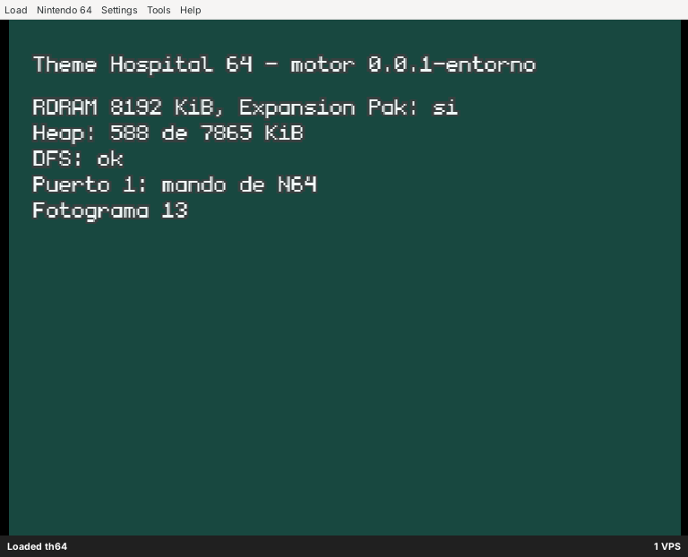
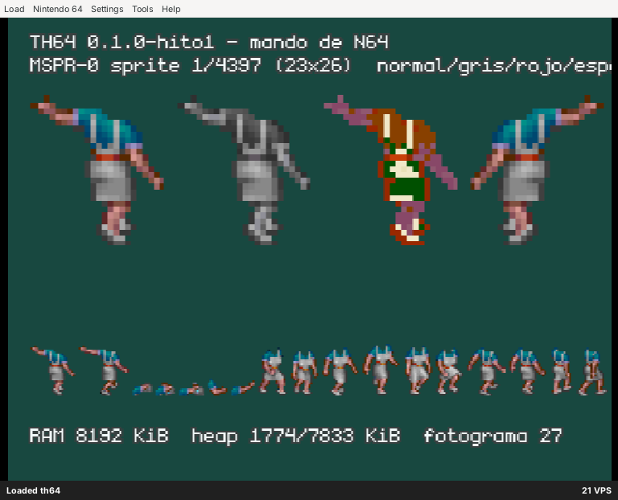

# Fase 5 — Prototipos en N64

Fecha de inicio: 2026-10-23. Estado: **en curso**. Plan: [`PLAN.md`](PLAN.md#fase-5--prototipos-en-n64-solo-tras-aprobar-la-fase-4), con los cambios de [`04_decision.md`](04_decision.md#cambios-al-plan-de-la-fase-5). Cada hito se cierra con un commit, una captura de ares y sus cifras aquí.

## Entorno del motor

**Hecho.** El código está en [`motor/`](../motor/README.md), y [`tools/motor_check.sh`](../tools/motor_check.sh) lo comprueba todo de una vez:

| Comprobación | Resultado |
|---|---|
| Núcleo en el PC con gcc (`-Wall -Wextra -Werror`) | 60.045 comprobaciones, 0 fallos, 0,05 s |
| Lo mismo con ASan y UBSan | 0 fallos |
| ROM de pruebas en ares (modo Homebrew, se cierra sola) | 60.045 comprobaciones, 0 fallos |
| Huella de la simulación de referencia (semilla 1, 10.000 pasos) | `d38fbaef` en el PC y en la N64 |
| ROM normal | Arranca: 8.192 KiB de RDRAM con Expansion Pak, heap usado 588 de 7.865 KiB, DFS correcto |

- **Tamaño.** La ROM ocupa 208 KiB. El código ocupa 245.404 B (`text`), casi todo libdragon: vídeo, RDP, texto y mandos.
- **Tiempo de compilación.** La ROM tarda 0,36 s desde cero y 0,32 s tras tocar un fichero.

*Pantalla de estado de la ROM en ares. El «1 VPS» de la barra de ares se debe al vídeo por software del contenedor, no a la ROM.*

Punto de partida: el núcleo de ejemplo de la fase 4 (`n64/pruebas/nucleo`), con:
- el pool de entidades con asas;
- la coma fija Q16.16;
- el generador xorshift32;
- el marco de pruebas.

## Hito 0 — Conversor (en curso)

El hito 0 se hace por partes. Primero los gráficos, porque es lo único que necesita el hito 1. Las animaciones, las tablas de reglas, los niveles, los textos, las fuentes y el banco de sonidos van después, antes de los hitos 2–4.

**Gráficos: hecho.** [`tools/conv/`](../tools/conv/README.md):
- **RNC.** Un descompresor en Python, portado del de CorsixTH. Da exactamente lo mismo que `rnc_decode` en los 241 ficheros RNC de los datos: 16,3 MB descomprimidos en 11 s. El conversor no necesita compilar CorsixTH.
- **Paletas.** `MPALETTE.DAT` pasa a RGBA5551 con la entrada 255 transparente. Lleva también las dos paletas fantasma de CorsixTH:
  - la gris, que es su mismo cálculo de `makeGreyscaleGhost`;
  - la roja, la tabla 6 de `GHOST1.DAT`.

  Ocupan 1.544 B en total.
- **Hojas.** Las 8 hojas de `DATAM` pasan a TSH1: CI8 con filas de 8 B, la misma numeración que el original y una comprobación de ida y vuelta exacta.

  | Hoja | Sprites | Sin comprimir | En la ROM (aPLib) |
  |---|---:|---:|---:|
  | `MSPR-0` (personajes y objetos) | 4.397 | 1.212.544 B | 392.866 B |
  | `MBLK-0` (suelos y paredes) | 226 | 192.360 B | — |
  | Las otras 6 (panel, reloj, punteros, menús…) | 546 | 309.336 B | — |

  Los píxeles de `MSPR-0` y `MBLK-0` (1.177.352 y 190.536 B) coinciden con lo medido en la fase 4.

**Animaciones: hecho.** Las tablas de `DATAM` (5.186 animaciones, 11.643 fotogramas, 108.607 entradas de lista y 24.983 elementos) pasan al formato TAN1: 481.038 B, dentro de los 0,48 MiB del presupuesto. Cada animación lleva su duración en fotogramas, calculada como `getAnimLength` de CorsixTH. Comprobaciones:
- **El encadenamiento de `DATAM` es idéntico al de `DATA`**, que es el que usa CorsixTH. Las animaciones de baja resolución duran lo mismo.
- **Las duraciones coinciden con las de CorsixTH en 5.183 de 5.186.** Las 3 distintas son los ajustes que hace su Lua: 2348 y 2938 duran 1 fotograma, y 4086 dura 8. Irán con las tablas de reglas.
- **Pendiente para el hito 3:** el desplazamiento de los elementos. CorsixTH solo usa las animaciones de alta resolución y les resta (141, 186); el de `DATAM` se ajustará al dibujarlas sobre el mapa.

## Hito 1 — La ROM carga los assets y dibuja un sprite con su paleta

**Hecho.**
- **Carga.** La ROM carga `paleta.tpl` y `datam/mspr-0.tsh` del sistema de ficheros de la ROM.
- **Dibujo.** Dibuja con el RDP en CI8, cargando la textura y un rectángulo con APIs estables, como propone [`04_construccion.md`](04_construccion.md#sprites-y-dibujo). Los sprites que no caben en la TMEM pasan por `rdpq_tex_blit`.
- **Visor.** La pantalla muestra un sprite a escala 3 con las tres paletas y reflejado, y una tira con los siguientes. Con la cruceta se cambia de sprite, para verlo en la consola cuando llegue el flashcart.

**Comprobación automática.** Al arrancar, la ROM dibuja el sprite de prueba sobre un fondo conocido y espera al RDP. Después compara cada píxel del framebuffer con el color que le toca según la hoja y la paleta: **598 de 598 píxeles iguales** (sprite 1 de `MSPR-0`, 23 × 26). `tools/motor_check.sh` lo comprueba en cada ejecución.

| Dato | Valor |
|---|---|
| ROM | 688.128 B (`MSPR-0` comprimida con aPLib: 392.866 B) |
| Código (`text`) | 234.904 B |
| Heap usado con `MSPR-0` entera cargada | 1.774 KiB de 7.833 (el presupuesto de la fase 4 cuenta 1,30 MiB para todos los sprites residentes) |

*Hito 1 en ares. La paleta roja es la que usa el juego para paredes, puertas y ventanas en una posición no válida; aplicada a una persona no tiene sentido, pero muestra que la tabla se aplica bien.*
