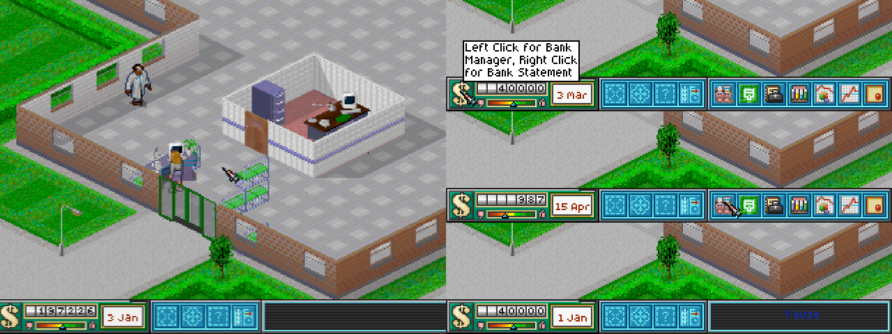
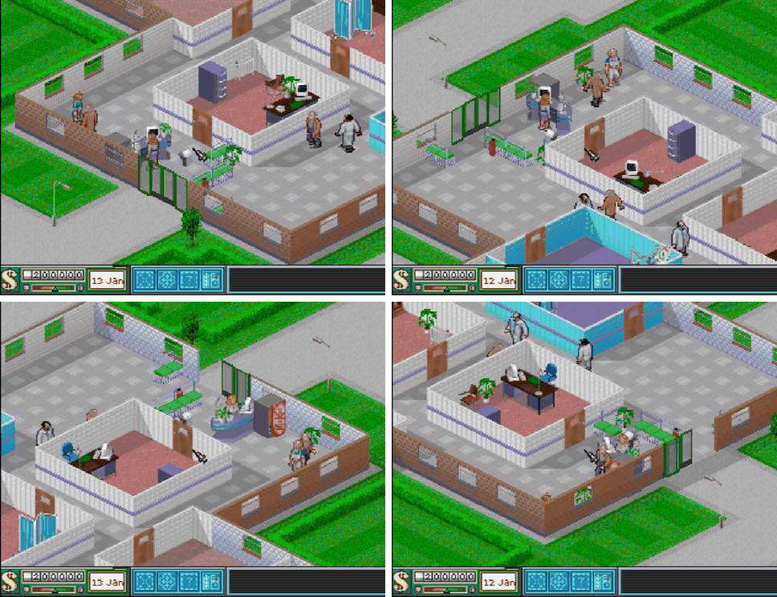
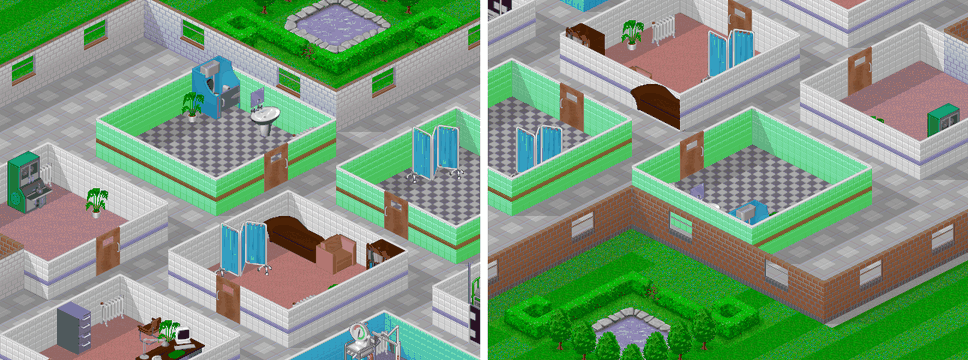
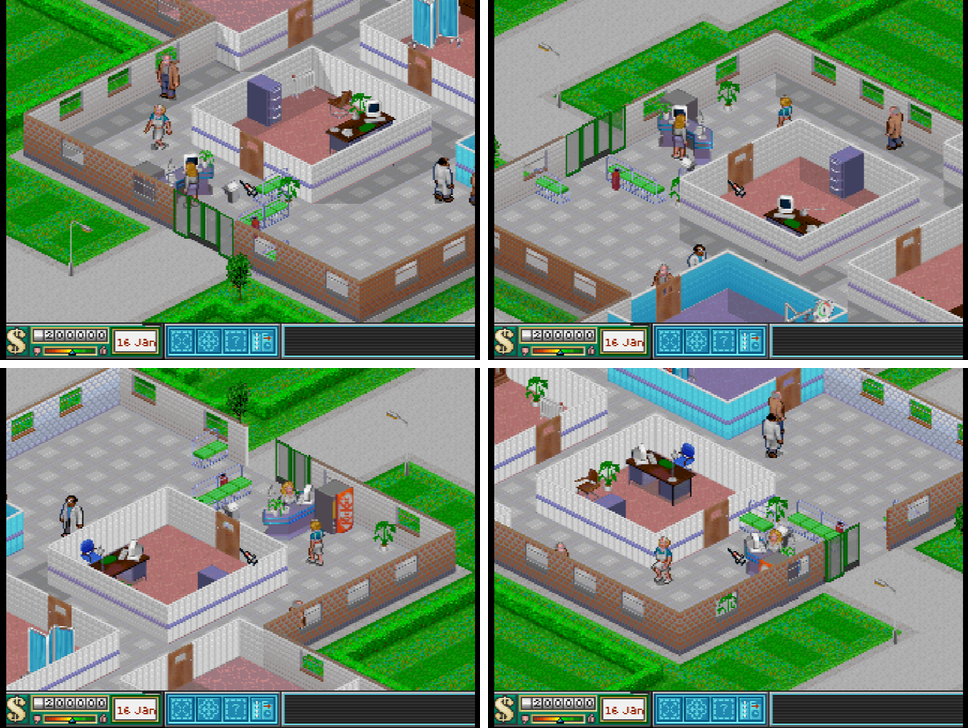
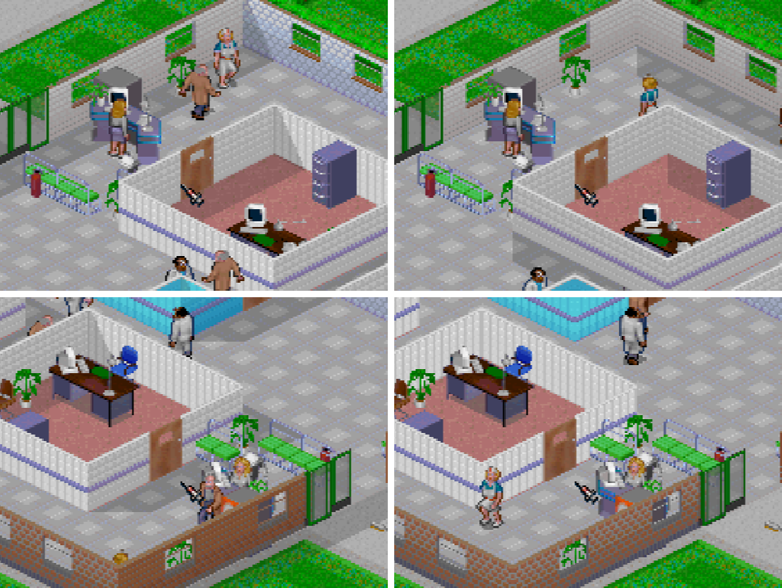
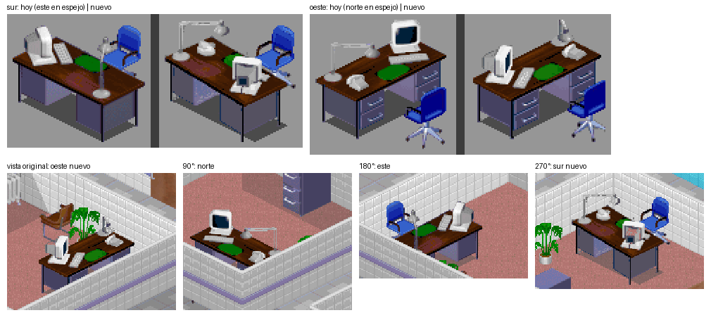

# Fase 6 — Juego base: el nivel 1 jugable

Fecha de inicio: 2026-10-27. Estado: **hitos 6.1, 6.2 y 6.2b hechos, el importador de arte nuevo y el paso 1 del hito 6.3** (los objetos en el mapa). Plan, hitos y criterios: [`06_plan.md`](06_plan.md).

## Hito 6.1 — Puntero y panel

**Hecho.** En la ROM, el hospital tiene el panel inferior de Theme Hospital y un puntero que mueve el stick o el ratón de N64:
- **el panel sale igual que en CorsixTH.** A 640 × 480, con los gráficos de alta resolución, el motor dibuja lo mismo que CorsixTH en 11 estados: dinero, fecha y reputación distintos, en pausa, con los botones de gestión a la vista, con un botón hundido y con descripciones;
  - **letras y recuadros: 0 píxeles distintos de 14.222;**
  - **piezas del panel: ninguna difiere en más de 7 de 255.** CorsixTH las dibuja con filtrado lineal (ver abajo);
- **en la N64 se dibuja como la referencia:** el RDP y el rasterizador de referencia dan 0 píxeles distintos en 5 estados de la interfaz, en la ROM de pruebas;
- **cuesta 0,95 ms de CPU por fotograma** el panel con el puntero, dentro de los 1,5 ms del plan. Con una descripción a la vista, de 1,4 a 1,9 ms;
- **CorsixTH no tiene el panel de baja resolución.** El de la N64 sale de los gráficos de `DATAM`, que el juego de PC traía para su modo de 320 × 200 (ver «La disposición de 320»).

*A la izquierda, la ROM normal en ares con el hospital del hito 4: el panel inferior y el puntero en el centro. A la derecha, el panel de 320 × 240 dibujado con el rasterizador de referencia (`th64sim panel baja`): la descripción del banco, los botones de gestión con el puntero encima y la pausa.*

### Qué hay

| Parte | Fichero | De CorsixTH |
|---|---|---|
| Ventanas, paneles y botones: el sprite hundido mientras se pulsa, la pulsación que pasa al botón por el que se arrastra, los botones de dos estados y las zonas con descripción | [`ui/ui.c`](../motor/ui/ui.c) | `window.lua`: `addPanel`, `makeButtonOnPanel`, `onMouseDown`, `onMouseUp`, `onMouseMove`, `getTooltipAt` |
| Texto con las fuentes de mapa de bits: una línea, varias con corte en los espacios y las descripciones con su recuadro | [`ui/texto.c`](../motor/ui/texto.c) | `bitmap_font::draw_text` y `draw_text_wrapped` (`th_gfx_font.cpp`), `l_font_draw` y `l_font_draw_tooltip` (`th_lua_gfx.cpp`) |
| Formato de las cadenas: `%%`, `%s`, `%d`, `%1%` y `%2:months%` | [`ui/texto.c`](../motor/ui/texto.c) | `TH.stringProxy.format` (`string_extensions.lua`) |
| UTF-8 a CP437 | [`ui/texto.c`](../motor/ui/texto.c) | `next_utf8_codepoint` y `unicode_to_codepage_437` (`th_strings.cpp`) |
| El panel inferior: el banco, el dinero, la reputación, la fecha, los botones de construir, amueblar, editar y contratar, la barra de información con «Pause», los 7 botones de gestión al pasar el puntero, la puerta de los faxes y las descripciones | [`ui/panel_inferior.c`](../motor/ui/panel_inferior.c) | `UIBottomPanel` (`bottom_panel.lua`) |
| El puntero: el stick con aceleración, el ratón y el desplazamiento de la vista en el borde de la pantalla | [`ui/puntero.c`](../motor/ui/puntero.c) | `GameUI:onMouseMove` y `tick_scroll_mult` (el borde) |
| La capa de la N64: las hojas de baja resolución, los mandos leídos en cada barrido y el dibujo por el mismo camino que el mapa | [`platform/n64/interfaz.c`](../motor/platform/n64/interfaz.c) | — |

Los botones del panel se hunden y los de dos estados se quedan pulsados, pero todavía no abren nada: las ventanas llegan con los hitos siguientes.

**En la ROM normal**, con el hospital:
- el stick mueve el puntero: zona muerta de 8, y de 1 a 8 píxeles por fotograma, que crecen con el cuadrado de la inclinación. Con Z mantenido, 2,5 veces más deprisa;
- A y B son los botones izquierdo y derecho del ratón;
- los botones C y la cruceta desplazan la vista. También el puntero al tocar un borde: de 6,5 a 13 píxeles por fotograma en 0,9 s, lo que hace CorsixTH a 640 × 480;
- la descripción sale tras 16 fotogramas con el puntero encima (los 30 ticks de 18 ms de CorsixTH). Al pasar a otro botón, la nueva sale sin esperar;
- Start pausa, L alterna entre x1 y x8, y R enseña los datos de depuración.

**El ratón de N64.** libdragon lee los mandos en cada barrido (60 por segundo), y `joypad_poll` solo copia la última lectura. El ratón da el movimiento desde la lectura anterior, así que leyendo a 30 fps se perdería la mitad. `interfaz.c` lee los mandos en cada barrido, acumula el movimiento y el bucle toma de ahí los botones. No se ha podido probar: ares corre sin dispositivo de entrada.

### La comparación con CorsixTH

[`captura_panel.lua`](../bench/scenarios/captura_panel.lua) carga el nivel 1 en CorsixTH, deja solo el panel inferior y lo captura en 11 estados. Fija el dinero, la reputación y la fecha, y lleva el puntero, los botones del ratón y la descripción con los métodos de las propias ventanas. `th64sim panel alta` dibuja lo mismo con la interfaz del motor y los gráficos de alta resolución, y [`comparar_panel.py`](../tools/hito6/comparar_panel.py) compara donde pinta la interfaz ([`tools/hito6/panel.sh`](../tools/hito6/panel.sh)):

| Píxeles de la interfaz, en 11 capturas | Cuántos | Iguales | A 1–2 | A 3–7 | A más de 7 |
|---|---:|---:|---:|---:|---:|
| Letras y recuadros: dinero, fecha, «Pause» y descripciones | 14.222 | **14.222** | 0 | 0 | 0 |
| Piezas del panel | 328.027 | 220.373 (67,2 %) | 107.581 | 73 | **0** |

- **CorsixTH dibuja las piezas de las ventanas con filtrado lineal.** Cada píxel sale mezclado con sus vecinos: un mismo color de la paleta acaba como dos o tres colores distintos. Las letras van sin filtrar (`thdf_nearest`) y salen idénticas, igual que los suelos y paredes del mapa en el hito 2.
- **Una pieza descolocada daría diferencias grandes en bloque**, y no hay ninguna de más de 7. Eso cubre:
  - el termómetro de la reputación (un sprite de 7 × 7);
  - la puerta de los faxes;
  - los botones hundidos;
  - los 7 botones de gestión.
- **Las descripciones usan otra paleta en CorsixTH** (`Pref01V.pal`, texto negro sobre blanco). El rasterizador de referencia admite ahora una paleta por hoja.
- **Una trampa del arnés:** poner la fecha en la hora 0 del 1 de enero hace que CorsixTH vuelva a abrir la presentación del nivel. Las capturas usan la hora 1.

### La disposición de 320

CorsixTH nunca usó el panel de `DATAM`, y no es el de alta reducido a la mitad: sus piezas tienen otras proporciones. El fondo con el dinero, la reputación y la fecha mide 89 × 25 píxeles, frente a 166 × 48. La disposición sale de los propios gráficos:
- **las piezas van una detrás de otra**, como en la de 640: 21 + 89 + 21 + 18 + 18 + 21 = 188 píxeles, y la barra de información rellena hasta 320 (3 + 25 × 5 + 4). Los 7 botones de gestión ocupan de 188 a 320;
- **las cifras del dinero van en las casillas del fondo**, en x = 22 + 7·i, y = 4. La fuente FONT100M trae la casilla dibujada en cada cifra, y encaja píxel a píxel con las del fondo;
- **el termómetro** va de x = 31 a 62, y la marca (5 × 4) se mueve 33 píxeles, frente a 65 en la de 640;
- **la fecha** va centrada en la libreta, de x = 78 a 105, y la puerta de los faxes, en la ranura de x = 96 a 107.

| Fuente | 640 (CorsixTH) | 320 (N64) |
|---|---|---|
| Dinero | Font05V | FONT100M (cifras en casillas) |
| Fecha | Font16V | FONT101M (roja), con el espacio de 2 píxeles: el suyo mide 1, y «3 Jan» salía pegado. «28 Sep», la fecha más ancha, ocupa justo los 27 píxeles de la libreta |
| Barra de información | Font01V | FONT132M (blanca) |
| Pausa | Font124V | FONT131M (azul) |
| Descripciones | Font00V con `Pref01V.pal` | FONT130M (negra), con la paleta del juego |

Las 5 fuentes de `QDATAM` encajan una a una con las 5 que usa CorsixTH. Como no hay con qué comparar, la disposición de 320 se ha revisado a ojo en los 11 estados (`th64sim panel baja`).

### Comprobaciones

| Qué | Contra qué | Resultado |
|---|---|---|
| El panel inferior a 640 × 480, 11 estados | Capturas de CorsixTH | Letras y recuadros: **0 de 14.222 píxeles distintos**. Piezas: 0 a más de 7 |
| La interfaz en la N64, 5 estados (pausa, botones de gestión, botón hundido, dos descripciones) | El rasterizador de referencia, en la ROM de pruebas | **0 píxeles distintos** |
| Lo que ya había: mapa, humanoides y hospital | La referencia, en la ROM de pruebas | 0 píxeles distintos, como antes |
| `tools/motor_check.sh` | Pruebas, huellas y píxeles | Todo bien: 60.233 comprobaciones, 0 fallos. Ahora también comprueba la interfaz |

### Coste y memoria

| Dato | Valor |
|---|---|
| CPU del panel y el puntero, por fotograma | 0,95 ms (60–65 elementos, 25–33 cargas de textura) |
| Con una descripción de 3 líneas | 1,93 ms (120 elementos, 86 cargas: una por letra) |
| Hojas de la interfaz en RAM: panel, punteros y 5 fuentes | 91 KiB |
| Textos en inglés en RAM | 257 KiB |
| Código: `ui/` y `interfaz.c` | 15 KiB, y 10 KiB de datos estáticos (la lista de dibujo de la interfaz) |
| Relleno de la caché de instrucciones | Pasa a 0 B en las ROM normal, de horas y de pruebas: con el código nuevo ya no chocan `dibujar` y rdpq |

**Los textos se pasan del presupuesto.** La fase 4 contaba 0,10 MiB para los textos de un idioma, y `english.trg` ocupa 257 KiB en RAM: lleva toda la tabla `_S` de CorsixTH, con sus claves. Basta con las cadenas que use el juego.

### Pendiente

- **Probar el ratón de N64** en la consola: ares no tiene dispositivo de entrada.
- **Recortar los textos** a las cadenas que se usan (257 KiB frente a 0,10 MiB).
- **Las letras cuestan una carga de textura cada una:** 86 cargas en una descripción de 3 líneas. Si las ventanas de gestión, con mucho texto, se pasan de tiempo, habrá que juntar las letras de una fuente en una textura o guardar el texto ya dibujado.
- **La barra de información** (lo que hay bajo el puntero en el mapa) llega cuando el puntero sepa señalar casillas, en el hito 6.2.
- **El español:** las fuentes de baja resolución no tienen Á, Í ni Ó (fase 4).

## Hito 6.2 — Las cuatro vistas y el menú de la ROM de prueba

**Hecho.** La cámara gira 90° con la cruceta, como en RollerCoaster Tycoon, en la ROM y en el PC:
- **el hospital girado sale como CorsixTH lo dibujaría girado.** CorsixTH no gira la cámara, así que se gira el hospital dentro de CorsixTH y se compara con el motor. En 40 capturas (10 zonas del nivel 1 en las 4 vistas, con las 8 salas del nivel), **ningún píxel del mapa difiere en más de 5 de 255** (11.116.959 de 11.117.094 iguales), y los objetos, en más de 7 (el filtrado lineal de CorsixTH, como en el hito 3);
- **la vista original no cambia:** 200 listas de dibujo idénticas a las de antes (hospitales de los hitos 4 y 5, 10 cámaras, 5 momentos, 320 × 240 y 640 × 480), y cuesta lo mismo;
- **en la N64 se dibuja como la referencia:** el RDP y el rasterizador de referencia dan 0 píxeles distintos en las tres vistas giradas, y la lista de dibujo de cada una es la misma que en el PC;
- **girar no encarece la lista de dibujo:** con 50 pacientes, 3,6–3,8 ms en las vistas giradas frente a 4,1 ms en la original;
- **la ROM arranca en un menú** que abre el hospital del hito 4, el del hito 5, un hospital con las 8 salas del nivel 1 para ver las vistas, y el visor de niveles. Desde la partida se vuelve al menú.

*La ROM en ares, con el hospital de las vistas (las 8 salas del nivel 1) a las 300 horas, en las cuatro vistas. Arriba, la original y girada 90°; abajo, 180° y 270°. La consulta, la recepción, la entrada y los bancos son los mismos en las cuatro.*

### Qué hay

| Parte | Fichero |
|---|---|
| La geometría de las vistas: casillas, direcciones, desplazamientos y la cámara, que gira sin mover lo que hay en el centro de la pantalla | [`vista/girar.c`](../motor/vista/girar.c), `th_view_rotate` en [`vista/vista.c`](../motor/vista/vista.c) |
| La pieza girada de cada bloque del mapa: suelos, paredes y decorado (ver abajo) | [`vista/girar.c`](../motor/vista/girar.c) |
| El mapa girado: para cada casilla de la vista, el suelo, las paredes de sus bordes norte y oeste con la cara que ve la cámara, el decorado y las sombras recalculadas, como `th_map_update_shadows` | `th_rot_map_update` en [`vista/girar.c`](../motor/vista/girar.c) |
| La lista de dibujo de la vista girada: el mismo orden de CorsixTH, leyendo el mapa girado. El bucle de una línea de casillas se compila dos veces, una para cada mapa, y la vista original no paga nada | `scene_line` en [`vista/vista.c`](../motor/vista/vista.c) |
| Los objetos, las personas y la basura girados, con los sustitutos | [`vista/objetos.c`](../motor/vista/objetos.c) |
| El puntero que señala casillas en las cuatro vistas (`Map:ScreenToWorld`) | `th_view_pick` en [`vista/vista.c`](../motor/vista/vista.c) |
| El menú, el giro con la cruceta y la casilla bajo el puntero | [`platform/n64/main.c`](../motor/platform/n64/main.c) |

**Cómo se gira.** La rotación r lleva la casilla (x, y) del mundo a (127 − y, x) con r = 1, y la dirección d a d + r. El núcleo no sabe nada de esto, como se decidió en la fase 4: solo la vista lee el mapa girado.
- **Suelos.** Los que no tienen dirección se quedan como están. Los que la tienen se describen por familias. Al girar, se busca la pieza con la descripción girada; si no está, la que la tiene en espejo, dibujada en espejo; y si tampoco, la más parecida:
  - **césped y camino con bordillo** (bloques 6 a 14 y 61 a 63): por lo que hay en cada esquina, como en «marching squares». Las 14 combinaciones que se usan están todas;
  - **el estanque** (59, 60, 65, 68, 77 a 80): igual, con agua y césped. Están las 8 orillas;
  - **las carreteras** (41 a 58): en los 12 niveles van todas de norte a sur. Giradas 90°, son la misma pieza en espejo; giradas 180°, la pieza con las marcas al otro lado. 4 marcas de aparcamiento no tienen pareja y salen al revés.
- **Paredes.** Van por bordes. Cada bloque es de un juego de `walls/*.lua` (las salas blancas, amarillas, azules y verdes, y las de fuera del hospital), con su cara (la de dentro o la de fuera de la sala), su borde y, en las ventanas de dos casillas y las puertas batientes, su mitad. Al girar:
  - el borde pasa al borde girado;
  - si en la vista es el sur o el este de la casilla, es el norte o el oeste de la vecina, y la cámara lo ve desde el otro lado: cambia la cara;
  - las mitades cambian si el borde se recorre al revés en pantalla.
  Son 83 bloques: 56 de las salas, 18 de las paredes de fuera y 8 pilares del final de una pared.
- **Decorado** (setos, árboles, farolas): va en su casilla. Los setos se describen por los bordes por los que siguen; los 11 tipos que se unen están todos. Los 4 setos con algo encima van solos, con su espejo.
- **Sombras.** Se recalculan con las paredes de la vista, igual que las calcula CorsixTH. En el oráculo las calcula el propio CorsixTH, así que esto queda comprobado. *Desde el hito 6.2b ya no: el sol no gira con la cámara ([abajo](#hito-62b--el-sol-fijo)).*
- **Objetos.** Se colocan como CorsixTH los colocaría en el hospital girado: con la orientación girada, en el sitio en el que su huella cubre las casillas giradas. Las puertas, en el borde girado.
- **Personas.** Van en su posición girada, con la animación que mira a la dirección girada. Caminar, estar quieto, llamar a una puerta y cruzarla van por parejas (norte y este, con su espejo), como en `walk_anims`. Quien usa un objeto se coloca como lo haría `use_object` con el objeto girado. La basura solo cambia de casilla.

### Los sustitutos

**Un objeto que solo se dibujó de cara a la cámara** (40 de los 60; 13 en las salas del nivel 1, ver el [plan](06_plan.md#las-cuatro-vistas)) quedaría de espaldas en 2 de las 3 vistas giradas. En esas dos se pone con la orientación opuesta, de frente, sobre las mismas casillas. Quien lo usa va al otro lado de su huella, donde lo pondría ese objeto.

**Las demás piezas sin dibujo:**
- las animaciones de las necesidades (vomitar, orinar, bostezar, mirar el reloj, dar golpecitos con el pie) solo miran al este o al sur: si tocaría mirar al norte o al oeste, se usa la dirección opuesta;
- las farolas tienen el brazo hacia el norte o el oeste, y en las demás vistas se quedan como están.

En el hospital de las vistas, los sustitutos son 10 objetos en la vista girada 90° y 12 en la de 180°.

*Los aseos (arriba) y la psiquiatría (abajo), en la vista original y girados 180°. Girado, el váter y el lavabo quedan contra la pared de delante y salen de frente, casi tapados por ella; en la psiquiatría, el diván también sale de frente. Es lo que hay que mirar: si estos sustitutos se pueden aceptar o hace falta dibujar las espaldas.*

### La comparación con CorsixTH

**Cómo se monta.** [`captura_girada.lua`](../bench/scenarios/captura_girada.lua) carga en CorsixTH una partida con un hospital y lo gira:
- quita a las personas y los objetos del mapa;
- vuelve a poner las casillas, llevando cada pieza a su sitio girado. Es la lógica contraria a la del motor, que busca, para cada casilla de la vista, lo que le toca. Las paredes se giran con las tablas de `walls/*.lua` de CorsixTH;
- crea de nuevo los objetos, con `World:newObject`, en la casilla y con la orientación girada, o la opuesta (el sustituto). Los dibuja CorsixTH;
- deja que CorsixTH calcule las sombras, y hace una captura de 640 × 480.

Lo único que sale del motor es la pieza girada de los suelos, del decorado y de los pilares, que CorsixTH no sabe girar ([`tools/hito6/vistas.sh`](../tools/hito6/vistas.sh)).

**El hospital.** Es el nivel 1 con sus 8 salas, creado en CorsixTH ([`crear_vistas.lua`](../bench/scenarios/crear_vistas.lua)): 55 objetos, entre ellos 12 de los que solo miran a la cámara (de 10 tipos) y las puertas batientes de la enfermería. Las 10 zonas cubren:
- las salas;
- la recepción y la entrada;
- los dos estanques y los setos del jardín;
- las carreteras de tres bordes del mapa.

[`comparar_giro.py`](../tools/hito6/comparar_giro.py) separa tres zonas: las entidades (con 2 píxeles alrededor), las sombras y el resto del mapa.

| 40 capturas (10 zonas × 4 vistas) | Píxeles | Iguales | A 1–2 | A 3–5 | A más de 5 |
|---|---:|---:|---:|---:|---:|
| Mapa: suelos, paredes y decorado | 11.117.094 | **11.116.959** | 97 | 38 | **0** |
| Sombras | 627.996 | 46.191 | 581.725 | 80 | **0** |
| Entidades (objetos) | 542.910 | 455.310 | 83.628 | 3.972 (de 3 a 7) | **0** a más de 7 |

- **Las diferencias del mapa** son píxeles sueltos en el borde de una sombra, de 3 a 5 de 255, y alguno junto a un objeto que una pared tapa en el motor.
- **Las sombras** difieren por el redondeo de la mezcla, como en el hito 2.
- **Las entidades** difieren por el filtrado lineal con el que CorsixTH dibuja las animaciones, como en el hito 3.

**Lo que encontró el oráculo.**
- **Un error que también estaba en la vista original.** Los objetos partidos en columnas, cuya primera parte no está en su casilla de origen, se dibujaban desplazados: la cama mirando al sur, el carro de paradas, el sofá mirando al sur y el ultraescáner. CorsixTH coloca cada parte respecto a la primera (`Object:setPosition`) y suma el desplazamiento de la animación. En los hospitales de los hitos 4 y 5 no había ninguno, así que no salía.
- **Las puertas batientes** (la enfermería) no se cargaban en el núcleo: la de la derecha es la puerta de su sala (`room.door`) y ahora cuenta como puerta. Como en CorsixTH (`SwingDoor` es una `Door`), las dos van en la lista temprana mirando al norte.

**Las personas no están en el oráculo:** CorsixTH no puede ponerlas en un hospital girado. Se han revisado a ojo en las cuatro vistas, con el hospital del hito 5 a las 2.200 horas: caminando, en la cola, sentadas en los bancos, en la consulta y tras el mostrador.

### En la N64

| Qué | Contra qué | Resultado |
|---|---|---|
| El hospital del hito 4 tras 3.000 horas, en las tres vistas giradas | El rasterizador de referencia, en la ROM de pruebas | **0 píxeles distintos** de 230.400 |
| Sus tres listas de dibujo | `th64sim lista --giro=r` con la misma cámara | **Las mismas huellas** (`tools/motor_check.sh`) |
| La vista original | Las listas de antes del hito | 200 de 200 iguales |
| Las vistas, en el PC | Las pruebas del núcleo | 940 comprobaciones nuevas, 0 fallos: las rotaciones se deshacen, girar dos veces es sumar los giros, las piezas vuelven a la misma tras 4 giros |
| `tools/motor_check.sh` | Pruebas, huellas y píxeles | Todo bien: 61.173 comprobaciones, 0 fallos. Ahora también comprueba las vistas giradas y que la ROM normal arranca en el menú |

### Coste y memoria

Medido en la ROM de medida (ares), con el hospital del hito 5 a la hora 3.833: 50 pacientes, 71 entidades en pantalla.

| Dato | Original | Giradas (90°, 180°, 270°) |
|---|---:|---:|
| Lista de dibujo, por fotograma | 4,07 ms | 3,64 / 3,74 / 3,77 ms |
| Pasar la simulación a entidades, por tick (en la corrutina) | 0,41 ms | 1,05 / 0,92 / 0,88 ms |
| Hacer el mapa girado, al girar | — | 37,9 / 36,9 / 42,4 ms |

- **La lista no se encarece.** La vista girada tiene casi los mismos elementos (de 518 a 543, frente a 535) y lee el mapa girado, de 6 B por casilla, en lugar del mapa del mundo, de 16.
- **Pasar la simulación a entidades cuesta el doble** en las vistas giradas. Al principio costaba seis veces más, por buscar la huella de cada objeto en las reglas en cada instantánea; ahora se guarda mientras el objeto no cambie. A velocidad Normal hay un tick cada 1,6 fotogramas: +0,3 ms por fotograma.
- **Hacer el mapa girado tarda unos 40 ms**, una vez al girar: se pierde un fotograma. Son 16.384 casillas a unas 100 instrucciones cada una. Habrá que rehacerlo también cuando cambie el mapa, al construir (hito 6.3).

| Memoria | Cuánto |
|---|---|
| El mapa girado (6 B por casilla), en el heap, solo mientras la vista está girada | **96 KiB** |
| Tablas de piezas giradas y colocaciones guardadas | 8 KiB estáticos |
| Código nuevo | unos 14 KiB: 6 del giro del mapa, 5,5 de los objetos y las personas, y el menú |
| Heap usado con 8 MiB, con un hospital cargado | 2.813 KiB de 6.738 (2.909 con la vista girada) |
| **La demo (4 MiB)** | Las vistas giradas piden 96 KiB más mientras están activas: unos 4,1 MiB sin recortes y unos 3,7 con los recortes aceptados. Si no caben, en la demo se puede quitar el giro o hacer el mapa girado por trozos (hito 6.10) |

### El menú de la ROM de prueba

La ROM normal arranca en un menú con texto de depuración: el hospital del hito 4, el del hito 5, el de las vistas y el visor de niveles. La cruceta o el stick eligen y A abre. Desde el hospital, Start pausa y, en pausa, Z vuelve al menú; desde el visor, Start. Al volver, la simulación acaba el tick que tuviera a medias y se suelta la memoria de la vista girada.

**Los controles nuevos:**
- la cruceta izquierda y derecha gira la cámara, en el hospital y en el visor;
- la cruceta arriba y abajo y los botones C siguen desplazando la vista;
- con los datos a la vista (R), la casilla bajo el puntero se resalta en azul y sale su número en el mundo, en cualquiera de las cuatro vistas.

**En el hospital, la cámara gira cuando lo hacen las entidades.** Las entidades salen de la instantánea que toma la simulación al acabar cada tick. Si la simulación está a medio tick, la instantánea girada llega con el tick siguiente; si no, al momento, también en pausa. Así no se dibuja un fotograma con el mapa girado y las personas sin girar.

**La ROM de capturas** (`make HORAS=N MODO=m GIRO=r`) abre un modo con la cámara girada sin pasar por el menú: así se han hecho las capturas de arriba.

### Pendiente

- **Los sustitutos.** Eduardo los vio el 2026-10-28 y pide dibujar las espaldas, con IA, y poder colocar en las cuatro direcciones los objetos que hoy solo miran a la cámara ([plan](06_plan.md#arte-nuevo-las-espaldas-con-ia)). El conversor admitirá hojas de sprites propias.
- **La barra de información** (lo que hay bajo el puntero): el puntero ya señala casillas en las cuatro vistas. Falta señalar las personas y los objetos, que llega con sus ventanas (hito 6.4).
- **El mapa girado** cuesta un fotograma al girar. Si al construir en una vista girada (hito 6.3) se nota, se puede rehacer solo la zona que cambia.
- **Las personas usando objetos sustitutos** van al otro lado de la huella: pueden quedar al otro lado de una pared. Solo se ve en las dos vistas en que el objeto es un sustituto.

## Hito 6.2b — El sol fijo

**Hecho.** Eduardo vio en las capturas del hito 6.2 que la luz giraba con la cámara: las sombras caían siempre hacia el mismo lado de la pantalla. Ahora **el sol de Theme Hospital, al suroeste, se queda quieto en el mundo** en las cuatro vistas, sin arte nuevo:
- **las sombras son las del mundo**, en las mismas casillas en las cuatro vistas, dibujadas con su forma girada;
- **cada pared se dibuja con la luz que le toca**: la pieza normal o la de su pareja en espejo, según la cara que ve la cámara esté al sol o a la sombra;
- **el hospital girado sigue saliendo como CorsixTH lo dibujaría girado**, ahora con las paredes con la luz de la vista: en 40 capturas, ningún píxel del mapa difiere en más de 5 de 255;
- **la vista original no cambia** (200 listas de dibujo idénticas a las de antes), y en la N64 las vistas giradas salen como la referencia (0 píxeles distintos);
- de paso, **los suelos y setos en espejo de la N64 caen donde deben**: con los gráficos de baja resolución quedaban una columna a la izquierda.

*La ROM en ares, con el hospital de las vistas a las 300 horas, en las cuatro vistas (arriba, la original y girada 90°; abajo, 180° y 270°). Con el sol al suroeste, en la vista de 90° todas las paredes están a la sombra y en la de 270°, todas al sol.*

*La consulta, girada 90° (arriba) y 270° (abajo): a la izquierda, el hito 6.2, con la luz girada; a la derecha, con el sol fijo. Arriba, la sombra de la sala pasa del lado izquierdo al derecho y las paredes quedan a la sombra; abajo, las paredes quedan al sol y las sombras caen detrás de las paredes de delante, donde no se ven.*

### Dónde está el sol

**En los datos**:
- las paredes de borde oeste proyectan sombra hacia el este y hacia el norte (`update_shadows` de CorsixTH: media casilla en la propia, la entera al norte y la esquina);
- las piezas de borde norte, cuya cara mira al sur, están pintadas más claras que las de borde oeste, cuya cara mira al este: 169 frente a 129 de brillo medio en las azules (bloques 86 y 87) y 165 frente a 128 en las de ventana (94 y 95).

El sol está al suroeste, como vio Eduardo («dan la sensación de ser las 2 o 3 de la tarde»).

**Con la cámara girada r veces**, la cámara ve de cada pared la cara que mira al sur o al este de la vista: en el mundo, la que mira al sur o al este menos r. Están al sol las que miran al sur o al oeste:

| Vista | Caras que se ven (en el mundo) | Paredes de borde norte de la vista | Paredes de borde oeste de la vista |
|---|---|---|---|
| 0, la original | sur y este | al sol: la pieza norte | a la sombra: la pieza oeste |
| 1 (90°) | este y norte | a la sombra: la pieza oeste en espejo | a la sombra: la pieza oeste |
| 2 (180°) | norte y oeste | a la sombra: la pieza oeste en espejo | al sol: la pieza norte en espejo |
| 3 (270°) | oeste y sur | al sol: la pieza norte | al sol: la pieza norte en espejo |

### Qué hay

| Parte | Fichero |
|---|---|
| La regla de la luz (`th_rot_wall_flip`) y la pareja en espejo de cada pared (`th_wall_mirror`) | [`vista/girar.h`](../motor/vista/girar.h), [`vista/girar.c`](../motor/vista/girar.c) |
| El mapa girado: las sombras del mundo y, en cada borde, la pieza con la luz de la vista. Ya no recalcula las sombras con las paredes de la vista | `th_rot_map_update` en [`vista/girar.c`](../motor/vista/girar.c) |
| La media sombra girada, las paredes en espejo, la sombra sobre una pared oeste y la corrección de los espejos de baja resolución | [`vista/vista.c`](../motor/vista/vista.c) |
| El bloque 226, la sombra sobre una pared oeste, generado por el conversor | `con_sombra_oeste` en [`tools/conv/hojas.py`](../tools/conv/hojas.py) |
| El oráculo, con la luz de la vista y sin sombras | [`captura_girada.lua`](../bench/scenarios/captura_girada.lua), [`tools/hito6/vistas.sh`](../tools/hito6/vistas.sh) |
| Las pruebas del sol | `test_sol` en [`tests/test_vista.c`](../motor/tests/test_vista.c) |

**Las paredes.** La pareja en espejo de una pared es la misma pieza en el otro borde (norte u oeste), con la mitad de pantalla cambiada, porque en espejo la izquierda pasa a la derecha. Las 82 paredes tienen pareja. ¿Tiene la pareja en espejo la forma de la pieza? Contando los píxeles opacos, con los sprites alineados por el pie:
- **en `DATA`**, 64 de las 82 son idénticas. Las otras 18 difieren en menos de un 7 %: las puertas batientes (52 de 780 píxeles), las paredes divisorias de fuera (32 de 1.888) y un pilar de dentro (12 de 680);
- **en `DATAM`**, 40 son idénticas, entre ellas todas las lisas de las salas. Las otras 42 difieren en 2 a 26 píxeles, como mucho un 14 % en las puertas batientes: el arte de baja resolución no es simétrico en las ventanas y en los ladrillos de fuera.

El oráculo de CorsixTH no ve estas diferencias, porque CorsixTH dibuja la misma pareja en espejo: son lo que se aleja la pareja de una pieza dibujada a propósito para ese borde.

La luz depende solo de la vista y de si el borde es norte u oeste. Así que el mapa girado guarda ya la pieza que se dibuja, y la vista la pone en espejo en los bordes que toca: no hace falta ninguna bandera más por casilla.

**Las sombras.** Son las del mundo (`th_map_update_shadows`, como CorsixTH), y el mapa girado las copia a la casilla de la vista. La sombra entera (el bloque 74, todo el rombo) es igual en todas las vistas. Las demás cambian de forma:
- **La media sombra.** En el mundo es el triángulo de las esquinas noroeste, suroeste y noreste: el bloque 75, la mitad de arriba del rombo. Con la cámara girada, ese triángulo es la mitad derecha del rombo (vista 1), la de abajo (2) o la izquierda (3). Se dibuja el bloque 74 recortado a esa mitad, con los recortes que ya tenía la lista de dibujo.
- **La sombra sobre la pared** (el bloque 156) cae en la cara sur de la pared norte del mundo, junto a la esquina noroeste. Esa cara solo se ve en la vista original y en la 3, donde es una pared oeste de la vista con la esquina a la izquierda. Para esa vista, el conversor añade el **bloque 226**: el 156 cortado y desplazado columna a columna, la misma altura sobre el pie de la pared y la misma distancia a la esquina. Ocupa 1,6 KiB en la N64 (32 × 51 píxeles). En las vistas 1 y 2 esa cara queda de espaldas y no se dibuja.

**Los espejos de baja resolución.** El espejo de un sprite le da la vuelta dentro de su rectángulo: la columna c pasa a la w − 1 − c.
- En `DATA` el rombo de una casilla ocupa las columnas 1 a 62 de 64, así que coincide con su espejo.
- En `DATAM` ocupa de la 1 a la 31 de 32, y el espejo quedaba una columna a la izquierda: los suelos y los setos en espejo del hito 6.2 (carreteras y bordillos en las vistas giradas) no casaban con sus vecinos en la N64. Ahora se dibujan una columna a la derecha. La columna se mide en el bloque 74 al cargar la hoja.
- Las paredes no la necesitan: su pareja en espejo casa sin moverla, en las dos resoluciones.

### Comprobaciones

| Qué | Contra qué | Resultado |
|---|---|---|
| El hospital de las vistas girado, sin sombras (40 capturas: 10 zonas × 4 vistas) | CorsixTH, con el hospital girado y en cada pared la pieza con la luz de la vista (la pareja en espejo, por los nombres de `walls/*.lua`) | Mapa: **11.744.796 de 11.745.090 píxeles iguales**, 219 a 1–2, 75 a 3–5, **ninguno a más de 5**. Entidades: 467.432 de 542.910 iguales, ninguno a más de 7 (el filtrado de CorsixTH, como en el hito 6.2) |
| Las sombras con la cámara girada | Las del mundo, en una sala, una pared suelta y una esquina sintéticas: pruebas del núcleo | En las tres vistas, las mismas casillas con sombra que en el mundo; la sombra sobre la pared, solo en la vista 3 y sobre la pared que toca |
| La luz y las parejas | Las pruebas del núcleo | Para cada vista y cada borde, la pieza dibujada tiene la luz de su cara; las 82 parejas se deshacen |
| La vista original | Las listas de dibujo del hito 6.2 | **200 de 200 iguales** (hospitales de los hitos 4 y 5, 10 cámaras, 5 momentos, 320 × 240 y 640 × 480) |
| Las tres vistas giradas en la N64 | El rasterizador de referencia, en la ROM de pruebas | **0 píxeles distintos** de 230.400; las listas, las mismas que en el PC |
| `tools/motor_check.sh` | Pruebas, huellas y píxeles | Todo bien: **208.743 comprobaciones, 0 fallos** (147.570 nuevas, casi todas de las sombras casilla a casilla) |

**Las sombras no se pueden comparar con CorsixTH:** CorsixTH las calcula con las paredes que tiene delante, así que en el hospital girado salen con la luz girada. El oráculo las quita en los dos lados: CorsixTH las calcula sin paredes y después se vuelven a poner las paredes, y el motor dibuja con `--sin-sombras`. Que se dibujan donde toca (la sombra entera, los recortes de la media sombra y el bloque 226) se ha revisado a ojo, en las capturas de arriba y en las de `vistas.sh`, que deja también la vista del motor con sombras.

### Coste y memoria

ROM de medida en ares, con el hospital del hito 5 a la hora 3.833 (50 pacientes, 71 entidades en pantalla), como en el hito 6.2:

| Dato | Original | Giradas (90°, 180°, 270°) | En el hito 6.2 |
|---|---:|---:|---|
| Lista de dibujo, por fotograma | 3,89 ms | 3,64 / 3,89 / 3,83 ms | 4,07; 3,64 / 3,74 / 3,77 ms |
| Hacer el mapa girado, al girar | — | **32,8 / 31,7 / 37,8 ms** | 37,9 / 36,9 / 42,4 ms |

- **El mapa girado se hace unos 5 ms antes:** ya no recalcula las sombras, solo las copia.
- **La lista de dibujo cuesta lo mismo.** Las paredes en espejo pasan por el camino con banderas, algo más lento, y las vistas 2 y 3 suben 0,06–0,15 ms. En la vista original no cambia nada del código: su diferencia con el hito 6.2, como el +10 % de pasar la simulación a entidades en todas las vistas, es la disposición del código en la caché de instrucciones, que cambia al crecer.
- **La ROM de pruebas volvía a tener el choque de la caché de instrucciones** del hito 4 de la fase 5 (`dibujar` con una función de rdpq): `motor_check.sh` lo detectó y su relleno pasa de 0 a 4.576 B. Las demás ROM no chocan.
- **Memoria:** el bloque 226 (1,6 KiB en la hoja de bloques) y la tabla de parejas (256 B). El mapa girado sigue en 6 B por casilla: dos banderas del hito 6.2 que solo servían para recalcular sombras dejan sitio a la de la sombra sobre la pared oeste.

### Pendiente

- **Que Eduardo mire las vistas con el sol fijo**, sobre todo la de 90°, con todas las paredes a la sombra. Si queda demasiado oscura, se puede probar un tono intermedio.
- **Los objetos y las personas llevan su luz pintada**, de un sol al suroeste en la vista original: en las giradas no casa del todo, pero se nota mucho menos que en las paredes. Sin arte nuevo no se puede hacer más.
- **Más adelante**, si se quiere: la sombra según la hora, el día y la noche, las estaciones… (apuntado en el [plan](06_plan.md#el-sol-fijo-hito-62b)).

## Arte nuevo: el importador

**Hecho.** Las vistas que Theme Hospital no dibujó, o dibujó en espejo, se pueden hacer fuera del juego (a mano o con IA) y meterlas en el motor sin tocarlo. El primer caso es el **escritorio de la consulta** en sur y oeste, que el juego dibuja con el este y el norte en espejo: el ordenador cambiaba de lado al girar la cámara. Eduardo los sacó con PixelLab (rotación de 8 vistas) a partir del norte y el este originales.

- **El arte nuevo no va al repositorio:** se deriva del arte de TH. Los PNG viven en `$TH64_WORK/arte` con un manifiesto (`arte.json`) que dice qué objeto, qué orientación y qué imágenes ([`tools/arte`](../tools/arte/README.md#el-arte-nuevo)). La imagen de abajo es una vista previa, como las capturas de los demás hitos.
- **El conversor lo añade al final** de la hoja de sprites y de las tablas de animación, así que no cambia ningún índice del juego, y apunta en las reglas de cada objeto qué animación usar en cada orientación. Esos tres pasos (`graficos`, `animaciones` y `reglas`) van siempre juntos, para que salgan del mismo manifiesto; por eso los tres necesitan siempre CorsixTH y `lua5.4`, como las reglas.
- **La vista la dibuja sin espejo** en la vista original y en las giradas, si la animación está en las tablas cargadas. Si no lo está, vuelve al espejo de siempre: así los gráficos del oráculo de CorsixTH, que se hacen sin arte, siguen comparándose igual.
- **La simulación no cambia:** la animación de reposo de un objeto solo la usa la vista.

*Arriba, el sur y el oeste del escritorio: lo que dibuja hoy el juego (el este y el norte en espejo) y el arte nuevo, ya en los colores del juego y con su sombra semitransparente. Abajo, el escritorio de la consulta del hospital de las vistas en las cuatro vistas, con los gráficos de alta resolución: está orientado al oeste, así que la vista original y la de 270° enseñan el arte nuevo, y el ordenador queda siempre a la izquierda del médico.*

### Cómo se convierte una vista

[`importar.py`](../tools/arte/importar.py), en cada resolución (`DATA` para el oráculo, `DATAM` para la N64):
1. **La referencia** es lo que el juego dibuja hoy en esa orientación: la animación de reposo o la de su espejo, con sus piezas opacas y sus sombras de suelo por separado. Del dibujo se quitan las motas (manchas sueltas de hasta 16 píxeles a más de 6 de las manchas del dibujo, contadas en el PNG que se da) y se comprueba la escala: tiene que medir entre 1/1,5 y 1,5 veces lo que el juego dibuja hoy.
2. **El color de sombra.** PixelLab recibe la sombra del escritorio como un gris opaco, (81, 81, 81), y la devuelve igual. Tiene color de sombra lo que está más cerca de ese gris que de cualquier color opaco del objeto.
3. **La posición** es la que más casa con la silueta de la referencia, sin lo que tiene color de sombra, buscando hasta 12 píxeles en cada dirección. Los desplazamientos se guardan como en las tablas de TH: con origen en (141, 186) y a la escala de 640, también en `DATAM`, y con el redondeo hacia cero del motor.
4. **La sombra pintada se quita:** las manchas de color de sombra que tocan la huella de la sombra de la referencia, enteras, aunque se salgan de ella, y las migas sueltas que quedan en su borde (hasta 3 píxeles, o 12 si la imagen sale de la baja ampliada al doble). Queda la sombra de la referencia, semitransparente. Si el objeto usa el mismo gris que su sombra (la «sombra ambigua»: 4 de los 6 objetos con sombra de suelo, 16 de sus 24 orientaciones), lo que cae sobre la silueta de la referencia se queda, porque puede ser del objeto.
5. **Los colores** pasan a los de los sprites opacos del objeto: 88 en `DATA` y 77 en `DATAM`, del escritorio.
6. **La animación nueva** es un fotograma con las sombras de la referencia (ya sin espejo) y el sprite nuevo.

Basta con la imagen de una de las dos resoluciones: la que falte sale de la otra, sin sus motas. La baja es la alta recortada a su caja con lados pares y reducida a la mitad exacta, así que no depende del margen del PNG; la alta es la baja ampliada al doble. Con el escritorio, la de baja resolución sale de la de alta.

| Escritorio | Sur | Oeste |
|---|---:|---:|
| Sprite en `DATA` / `DATAM` | 93 × 87 / 47 × 43 | 94 × 87 / 47 × 44 |
| Silueta frente a la referencia, sin el color de sombra (intersección sobre unión), `DATA` / `DATAM` | 0,773 / 0,774 | 0,793 / 0,779 |
| Sombra pintada quitada, `DATA` / `DATAM` | 541 / 105 píxeles | 523 / 104 píxeles |
| … de ella, fuera de la huella de la referencia | 110 / 19 | 1 / 4 |
| Migas del borde quitadas | 10 / 11 | 4 / 3 |
| Animación y sprite nuevos | 5186 y 4397 | 5187 y 4398 |

La silueta casa en un 77–79 %: el arte nuevo no es el espejo, así que la silla y el ordenador están en otro sitio, pero las patas apoyan en el mismo sitio. Con los arreglos (colocarlo sin el color de sombra, quitar el borde de la sombra y reducir a la mitad exacta), el sprite final casa mejor con la referencia: 0,775 y 0,783 en el sur (`DATA` y `DATAM`) y 0,794 y 0,781 en el oeste, frente a 0,757, 0,766, 0,781 y 0,764 con la primera versión.

**La vuelta completa** (`importar.py --comprobar`) prueba el importador con el arte del juego: cada orientación de cada objeto, con su sombra pintada en opaco, pasa por el importador como si fuera arte nuevo de esa orientación, y tiene que salir el mismo sprite en el mismo sitio. Son 216 orientaciones de 59 objetos, 98 de ellas en espejo. 24 tienen sombra de suelo. Otras 10, de 5 objetos, tienen partes semitransparentes que no son sombra: el cristal de 4 puertas y los rotores del helicóptero. El importador las rechaza. Las 206 restantes pasan por cuatro pruebas:
- **tal cual**;
- **con ruido**, lo que trae el arte de verdad: el borde de la sombra hasta 3 píxeles fuera de su huella, migas sueltas de 1 a 3 píxeles junto a él y una mota lejos del dibujo, en diagonal;
- **al doble**, solo en `DATAM`: el dibujo con ruido de la baja, sacado al doble como una alta que sale de la baja (sin sus motas), contra la misma escala al doble;
- **la escala**: el dibujo al doble y a la mitad tiene que dar el error de escala.

| Vuelta completa | `DATA` | `DATAM` |
|---|---:|---:|
| Orientaciones que salen iguales, píxel a píxel y en su sitio, tal cual | **206 de 206** | **206 de 206** |
| … con ruido | **206 de 206** | **206 de 206** |
| … al doble | | **206 de 206** |
| … y que dan el error de escala al doble y a la mitad | **206 de 206** | **206 de 206** |
| Rechazadas (cristal o rotores) | 10 | 10 |
| Quitado con ruido: sombra pintada (de ella, fuera de la huella), migas y motas | 18.626 (6.978), 131 y 206 píxeles | 6.706 (3.822), 66 y 206 píxeles |
| Con la primera versión del importador (las 216, tal cual) | 190 de 216 | 194 de 216 |

Las que fallaban con la primera versión eran justo aquellas en las que un gris de lo semitransparente es también un color opaco del objeto: las 16 con sombra de suelo ambigua y 10 de cristal o rotores (6 en `DATAM`). La sombra no se quitaba (546 píxeles de sombra opaca en la mesa de operaciones, 342 en el billar, 509 en el ecógrafo) o se quitaba solo en parte (las puertas), y el helicóptero salía en otro sitio.

Para saber si la prueba mide algo, se estropea el importador a propósito, en `DATAM`, y se cuentan las orientaciones que siguen saliendo bien:

| Estropeado | Tal cual | Con ruido | Al doble | Escala |
|---|---:|---:|---:|---:|
| Nada | 206 | 206 | 206 | 206 |
| Sin las manchas enteras (solo lo que cae en la huella) | 206 | 182 | 182 | 206 |
| Creciendo la sombra un solo paso | 206 | 182 | 182 | 206 |
| Sin migas | 206 | 182 | 182 | 206 |
| Migas de 1 píxel como mucho | 206 | 188 | 188 | 206 |
| Las migas sin crecer con la imagen | 206 | 206 | 182 | 206 |
| Sin quitar las motas | 206 | 0 | 0 | 206 |
| Sin proteger la sombra ambigua | 194 | 194 | 194 | 206 |
| Sin límite de escala | 206 | 206 | 206 | 0 |
| Colocando el dibujo con la sombra pintada dentro | 206 | 206 | 206 | 206 |

Lo único que no nota es lo último: con el mismo dibujo que la referencia, el sitio bueno gana igual. Eso lo dice el escritorio (arriba).

### Comprobaciones y coste

| Qué | Resultado |
|---|---|
| `tools/motor_check.sh` con el arte | Todo bien: 208.743 comprobaciones, 0 fallos; la huella de la simulación, la misma (`d38fbaef`, y `8fefaa13` el hospital del hito 4); reglas y textos, 39 de 39 ficheros (37 de reglas y 2 de textos) iguales en el núcleo y en el conversor. Las vistas giradas de la N64, 0 píxeles distintos de la referencia y las mismas listas que en el PC. Lo que cambia frente a la primera versión del importador son los píxeles de entidades de las dos vistas que enseñan el escritorio nuevo: la original del hito 4, con el oeste nuevo (5.161 → 5.163), y la de 270°, con el sur nuevo (4.959 → 4.950): primero sin la raya del borde de la sombra y después con la mitad exacta |
| El oráculo de CorsixTH de las vistas (40 capturas), con las reglas con arte y los gráficos de alta sin arte | **Las mismas cifras que antes del importador:** 11.744.796 píxeles del mapa iguales de 11.745.090 y 467.432 de entidades de 542.910; 0 capturas con diferencias fuera de lo esperado. El informe sale idéntico, línea a línea, al de la primera versión |
| Las reglas frente a CorsixTH (`comparar_reglas.py`), con arte | Iguales: 60 de 60 objetos, 23 de 23 salas, 34 de 34 enfermedades, 9 de 9 diagnósticos y 36 de 36 niveles. La clave `arte` no cuenta: CorsixTH no la tiene |
| Hoja `MSPR-0` | 4.397 → 4.399 sprites, +4.192 B (1.216.736 B) |
| Tablas de animación | 5.186 → 5.188 animaciones, +60 B (481.098 B) |
| Heap de la ROM normal con 8 MiB | 2.445 → 2.449 KiB |

Los hospitales de prueba tienen el escritorio al oeste (el del hito 4 y los dos del de las vistas) o al sur (el del hito 5), así que la ROM ya enseña el arte nuevo en la vista original. De las rondas de arreglos (abajo), la segunda no cambió ningún asset, y la tercera solo los dos sprites de baja del escritorio, por la mitad exacta: 1.491 bytes de la hoja `MSPR-0`. Las tablas y las reglas salen idénticas byte a byte, y el oráculo de CorsixTH no los usa (dibuja con los gráficos de alta sin arte), así que sus cifras siguen valiendo.

### Las revisiones

**La primera** (3 revisores: el importador, el motor y la documentación) encontró 15 problemas distintos. Se verificaron por separado 6 (en 8 verificaciones) y todos eran reales; el del borde de la sombra se confirmó después con las mismas cifras. Están todos atendidos:

| Problema | Arreglo |
|---|---|
| Pedir solo uno de los pasos `graficos`, `animaciones` o `reglas`, o hacerlo con otro manifiesto, desincronizaba la hoja, las tablas y las reglas sin aviso: el armario desaparecía (598 píxeles distintos) o salía con el arte del escritorio (1.726) | Los tres pasos van siempre juntos |
| La vuelta al espejo del motor solo mira las tablas, no la hoja de sprites | Con los tres pasos juntos, la hoja y las tablas ya no pueden separarse |
| La sombra pintada no se quitaba si su gris era también un color opaco del objeto (26 orientaciones de 34 con partes semitransparentes) | El gris de la sombra no cuenta como opaco al buscarla; la silueta de la referencia protege el objeto |
| El borde de la sombra pintada que salía de la huella se quedaba como una raya oscura: 72 y 30 píxeles en el sur, 14 y 12 en el oeste | Se quitan las manchas enteras y las migas |
| En los objetos sin sombra de suelo la sombra pintada se queda entera | No hay con qué reconocerla: documentado (hay que borrarla del PNG) |
| La posición se buscaba con la sombra pintada dentro | Se busca sin el color de sombra |
| `comparar_reglas.py` daba 59 de 60 objetos con arte | No cuenta la clave `arte` |
| `conv.py` y `alta.py` pedían numpy y Pillow aunque no hubiera arte | numpy, solo con arte; Pillow, con arte y, como antes, para el paso `fuentes` y `--vistas` |
| `graficos` y `animaciones` necesitan CorsixTH y `lua5.4`, y no se decía | Documentado; si falta alguno, se dice antes de escribir nada |
| Una imagen a otra escala (1.200 × 1.200) gastaba 6 GB antes de fallar con un error de numpy | Error en 4 s, con 132 MiB: «mide 13.6 veces lo que el juego dibuja hoy» |
| Un manifiesto con solo la imagen de baja resolución paraba el importador y `alta.py --arte` | La alta sale de la baja ampliada al doble |
| Dos entradas del mismo objeto y orientación metían en la ROM una animación sin usar | Error: vistas repetidas |
| La imagen de este documento lleva los sprites nuevos, píxel a píxel | Se queda, como las capturas de los demás hitos: es una vista previa, no el arte (los PNG y el manifiesto no se suben) |
| Este documento: las 39 reglas eran 37 de reglas y 2 de textos, faltaban las animaciones de la enfermera en el este, y la «silueta» incluía la sombra pintada | Corregido |

Al arreglarlo apareció uno más: la referencia dibujaba los elementos con capa, que el motor no dibuja en un objeto (la luz del visor de rayos X). Ya no los dibuja.

**La segunda** revisó esos arreglos (3 revisores y 9 verificaciones). Dio 15 hallazgos, que son 10 problemas distintos; se verificaron por separado 7 (en 9 verificaciones) y todos eran reales. Están todos atendidos:

| Problema | Arreglo |
|---|---|
| Lo semitransparente no siempre es sombra: el cristal de 4 puertas y los rotores del helicóptero (10 orientaciones) se tomaban por sombra pintada, y se cambiaban por los de la referencia en el sitio de la referencia | Solo son sombra los sprites de sombra de suelo (580 y 2536); esas 10 vistas se rechazan con un error claro |
| La comprobación de escala no veía ni el doble ni la mitad: la planta de `DATA` puesta como baja entraba al doble | Escala en los dos sentidos |
| Una mota suelta en el PNG movía el dibujo (18 píxeles más arriba) y agrandaba el sprite | Las motas se quitan antes de colocarlo |
| `--comprobar` no ejercitaba el borde, las migas ni las motas | La segunda pasada, con ruido, y la prueba de estropearlo a propósito |
| Con solo la baja, la alta ampliada conservaba el borde de la sombra (cada miga, 4 píxeles) | Las migas y las motas crecen con la imagen |
| `graficos` y `animaciones` necesitan CorsixTH y `lua5.4` aunque no haya arte (van con `reglas`), y la documentación decía «con arte» | Corregido; se comprueba antes de escribir nada |
| Sin `lua5.4` salía una traza de Python | Mensaje claro, en `conv.py` y en el importador |
| Un paso mal escrito dejaba escritos los anteriores y sin hacer los añadidos | Los pasos se comprueban antes de empezar y van siempre en el mismo orden |
| Los errores del manifiesto o de un PNG salían como trazas, a veces sin decir qué objeto | Un error en una línea, con el objeto, la orientación y la resolución |
| La documentación decía que Pillow solo hace falta con arte | Corregido (arriba) |

**La tercera** comprobó esos arreglos uno a uno, repitiendo los escenarios de la segunda (3 comprobadores y 9 verificaciones): los 10 quedaron bien. Dio otros 13 hallazgos, que son 12 problemas distintos (uno lo encontraron dos comprobadores); se verificaron por separado 5 (en 6 verificaciones) y todos eran reales. Están todos atendidos, con uno más que encontró la vuelta nueva:

| Problema | Arreglo |
|---|---|
| Con solo la alta (el manifiesto del escritorio), la baja decidía las motas en sus propios píxeles: el mismo PNG daba sprites distintos en la ROM y en el oráculo (en 46 de 72 casos de prueba) | Las motas se deciden una vez, en el PNG que se da, y se quitan antes de sacar la otra resolución |
| Una mota lejos del dibujo daba el error de escala en vez de quitarse | La comprobación gruesa cuenta lo opaco, no la caja; la mota se quita antes de medir la escala |
| En un objeto diminuto (la ratonera de `DATAM`, 3 × 4) no había mancha «del dibujo» y la mota no se quitaba (lo encontró la vuelta nueva) | Si no hay manchas grandes, el dibujo es la mancha mayor |
| Las motas se medían desde la mancha mayor, no desde el dibujo: se quitaba una pieza pegada a otra parte suelta | Se miden desde todas las manchas del dibujo |
| La baja no era la mitad exacta (93 → 46) y cambiaba con el margen del PNG (cuatro sprites distintos con 0 a 3 píxeles de margen) | Recortada a su caja con lados pares y reducida a la mitad exacta. Cambian los dos sprites de baja del escritorio |
| `--comprobar` ponía un borde de 1 píxel y migas de 1: no notaba crecer la sombra un solo paso ni migas de 1, que estropean el escritorio; tampoco probaba la escala ni la alta sacada de la baja | Ruido como el del arte de verdad, y las pasadas «al doble» y «escala» (tabla de arriba) |
| `conv.py` decía «lo que falte se dice antes de escribir nada», pero sin Pillow, numpy, g++ o el SoundFont escribía media conversión y salía una traza | Lo comprueba todo antes de escribir nada |
| Un PNG roto o enorme salía como traza, sin decir qué fichero | Un error en una línea, con el objeto y la ruta del PNG |
| Con solo la baja, el error de escala hablaba de la alta y de un tamaño que el PNG no tiene | El error dice de dónde sale la imagen («sacada de la baja ampliada al doble») |
| Este documento: «lo único que no nota» la prueba, «sin quitar las motas salta el error de escala», los 53 objetos que conservan la sombra pintada (son 48: los otros 5 se rechazan) y los 9 verificados de la segunda | Corregido |

### Lo que no cubre todavía

- **El objeto en uso.** Mientras alguien usa un objeto, el objeto no se dibuja: lo dibuja la animación de la persona, que lo lleva dentro, como en CorsixTH. Las animaciones del médico sentado al escritorio (56, 72, 718 y 64 en norte; 58, 74 y 66 en este) y las de la enfermera (3240, 3256 y 3248 en norte; 3242, 3258 y 3250 en este) llevan los sprites del escritorio y de la silla. Así que con alguien sentado vuelve el escritorio en espejo. Arreglarlo es el problema de la gente usando objetos: animaciones de uso nuevas, o separar el escritorio de la persona en las que ya hay. Tampoco pasan a la animación nueva los elementos con capa, como la luz del visor de rayos X durante la operación.
- **Los objetos sin sombra de suelo** (48 de los 59, como el banco, el váter o la recepción; los otros 5 sin sombra se rechazan, abajo): no hay huella con la que reconocer una sombra pintada, así que se queda en los colores del objeto. Hay que mirar la vista previa y, si sobra, borrarla del PNG.
- **Las partes semitransparentes que no son sombra** (el cristal de las puertas de la entrada y de vaivén, y los rotores del helicóptero): esas 10 vistas se rechazan. Convertirlas pide sacar del dibujo esas partes como un sprite semitransparente propio.
- **Los objetos partidos en columnas** (cama, banco, carro de paradas, sofá y ultraescáner en alguna orientación) se dibujan recortados por columnas. En la N64, un sprite que no cabe en la TMEM (2.048 téxeles) va por `rdpq_tex_blit`, que no recorta. El importador rechaza esos casos hasta que el sprite se parta.
- **Colocar en cuatro direcciones** los objetos que solo tienen norte y este necesita sus huellas al sur y al oeste (hito 6.3); hasta entonces, su arte nuevo no se usa porque la vista pone el sustituto.

## Hito 6.3, paso 1 — Los objetos en el mapa

**Hecho.** El núcleo ya sabe qué ocupa cada objeto en el mapa, como CorsixTH. Es la base para construir (los pasos siguientes, en el [plan](06_plan.md#construir-hito-63-por-pasos)):
- **cada casilla lleva su lista de objetos**, como `map_tile.objects` de CorsixTH, y **las puertas de la entrada se colocan al cargar el nivel** (`World:createMapObjects`). Las de una parcela sin dueño esperan a que se compre;
- **el módulo nuevo `objects.c` ocupa y libera casillas con la huella de cada objeto**, como `Object:setTile` y sus variantes de las puertas, y repite `resetSideObjects` e `isTilePartOfNearbyObject`;
- **con solo sus salas y sus objetos, el núcleo rehace los 52 hospitales exportados de CorsixTH: 851.968 casillas, 0 distintas**, con todas las columnas de `getCellFlags`;
- **los 12 niveles recién cargados salen iguales que en CorsixTH: 0 casillas distintas.** Antes, 103 casillas junto a las puertas de la entrada quedaban fuera de la comparación;
- **la huella de la simulación incluye ahora el mapa, los objetos y las salas.** La simulación es la misma: las trazas de tres hospitales son idénticas a las de antes;
- **una revisión adversarial encontró 5 fallos más, que ya están arreglados** ([La revisión](#la-revisión)). Ninguno se notaba en los hospitales de hoy: salían al cargar partidas con dos objetos en una casilla, al vender o mover objetos y al comprar parcelas.

### Qué hay

| Parte | Fichero |
|---|---|
| La lista de objetos de cada casilla: añadir al final, quitar el primero igual (`removeObjectType`), vaciarla (`eraseObjectTypes`), hasta 5 por casilla y 64 casillas con más de uno. Qué casillas tienen lista en `world.objects` (un bit por casilla). Los objetos del nivel, colocados al cargar o al comprar la parcela, que dice cuáles coloca. La huella del mapa, con las salas y las listas | [`core/include/th/map.h`](../motor/core/include/th/map.h), [`core/src/map.c`](../motor/core/src/map.c) |
| Ocupar y desocupar según la clase: los objetos normales, los de borde (`SideObject`), las puertas (`Door`), la puerta doble (`SwingDoor`) y las de la entrada (`EntranceDoor`). También `resetSideObjects`, `isTilePartOfNearbyObject`, el primer objeto de una casilla (`getObject`) y el objeto de un objeto del nivel (`World:_createMapObject`) | [`core/include/th/objects.h`](../motor/core/include/th/objects.h), [`core/src/objects.c`](../motor/core/src/objects.c) |
| `th_object` pasa a `objects.h`, con su clase, si cortó el paso (`set_passable_flags`), si es la hoja maestra y su orden en la casilla (`world.objects`) | `objects.h` |
| `findObject` de cualquier tipo (thob 0) e `isReachableFromHospital` | [`core/src/path.c`](../motor/core/src/path.c) |
| La huella de la simulación, con el mapa, los objetos y las salas. La carga de un escenario deja las listas de cada casilla como las deja CorsixTH al cargar una partida (`World:resetAnimations`) | `th_sim_hash` y `load_object_lists` en [`core/src/sim.c`](../motor/core/src/sim.c) |
| El exportador de escenarios saca además el sitio de cada objeto en la lista de su casilla y las casillas que tienen lista | [`exportar_escenario.lua`](../bench/scenarios/exportar_escenario.lua) |
| `th64sim banderas` (rehace un hospital y lo compara) y `th64sim mapa --comparar` | [`platform/pc/th64sim.c`](../motor/platform/pc/th64sim.c) |
| La comparación entera, de una vez (unos 17 s) | [`tools/hito6/banderas.sh`](../tools/hito6/banderas.sh) |
| En CorsixTH: el nivel recién cargado con todas las columnas, y las rarezas | [`celdas_nivel.lua`](../bench/scenarios/celdas_nivel.lua), [`rarezas_objetos.lua`](../bench/scenarios/rarezas_objetos.lua) |
| Las pruebas: ocupar y desocupar con definiciones escritas en JSON, y la lista de la casilla y los objetos del nivel | [`tests/test_objects.c`](../motor/tests/test_objects.c), [`tests/trg_json.c`](../motor/tests/trg_json.c), [`tests/test_map.c`](../motor/tests/test_map.c) |

**Cómo se rehace un hospital** (`th64sim banderas`). Se carga el nivel y se le ponen, del volcado de CorsixTH, solo las capas (suelo y paredes), la bandera `room` y el número de sala: las paredes y las salas son del paso 3. Después:
1. se rehace el tránsito;
2. se colocan los objetos del escenario en el orden de `world.entities`. Las puertas de la entrada ya las puso el mapa al cargar;
3. tras las puertas de cada sala, se rehace el tránsito y se llama a `resetSideObjects`, como al terminar una sala en CorsixTH;
4. se comparan las 16.384 casillas con el volcado.

Todo lo demás lo calcula el núcleo: `passable`, `buildable` y sus cuatro bordes, el tránsito, las puertas, `tall`, `doNotIdle` y el primer objeto de cada casilla.

### Las rarezas de CorsixTH que se copian

Para que las banderas salgan iguales una a una, se copian también los fallos. Los cuatro primeros se han visto en CorsixTH con `rarezas_objetos.lua`, que coloca y quita objetos en el nivel 1, y las pruebas del núcleo esperan lo mismo:
1. **`resetSideObjects` con dos objetos de borde en la misma casilla.** Recorre la lista de la casilla con `ipairs` mientras la cambia: el primero pasa dos veces y el segundo ninguna. Con un radiador y un extintor, el primer objeto de la casilla pasa a ser el extintor (thob 43). Si antes se rehízo el tránsito (al terminar una sala), el que no pasa pierde su corte: en CorsixTH, el borde del radiador vuelve a dejar pasar.
2. **Dos radiadores en el mismo borde, uno a cada lado.** Solo el primero apunta que cortó el paso. Al quitarlo, el borde se abre aunque el otro siga ahí, hasta el siguiente `resetSideObjects`.
3. **`isTilePartOfNearbyObject` solo mira el primer objeto de cada casilla.** Si en el origen de un banco hay antes un radiador, la casilla de uso del banco no cuenta como suya: al quitar otro banco que la compartía, vuelve a ser construible.
4. **Las casillas de uso compartidas** (dos bancos frente a frente) siguen sin construir al quitar uno de los dos. Esto no es un fallo: es para lo que sirve la búsqueda anterior.
5. **La búsqueda solo llega a 10 pasos.** Un objeto con la casilla de uso más lejos no la protege (las pruebas lo comprueban con uno inventado).
6. **La papelera mirando al este ocupa el borde oeste.**
7. **Al desocupar, se restauran todas las casillas de la huella**, también las opcionales que no se ocuparon.

**Lo que no es igual:**
- CorsixTH recorre las casillas en `resetSideObjects` en el orden de `pairs()` de una tabla de Lua, y el núcleo, por su índice. Solo cambia algo con dos objetos de borde que cortan el mismo borde desde las dos casillas: cuál de los dos apunta el corte.
- Al comprar una parcela, CorsixTH crea sus puertas de la entrada en el orden de `pairs()`, y el núcleo, en el del fichero. Cada puerta está en su casilla, así que solo cambia su orden en `world.entities`.

### Comprobaciones

| Qué | Contra qué | Resultado |
|---|---|---|
| Los 12 niveles recién cargados | Los volcados de CorsixTH del hito 2: capas, 13 banderas, parcela y objeto | **196.608 casillas, 0 distintas.** Antes, 103 casillas junto a las puertas de la entrada quedaban fuera de la comparación |
| El nivel 1 recién cargado | `getCellFlags` entero: 17 banderas, sala, parcela, primer objeto y dueño | **16.384 casillas, 0 distintas** |
| 52 hospitales rehechos desde sus salas y objetos: 40 de la campaña del hito 4, el de su README, 10 de la del hito 5 y el de las vistas | Los volcados de CorsixTH (`celdas.tsv`), con todas las columnas | **851.968 casillas, 0 distintas.** 718 objetos (104 puertas de la entrada y 614 colocados por el núcleo, 10 de ellos de borde) y 59 salas. El de las vistas tiene 8 salas, una con puerta doble, y 53 objetos de 25 tipos |
| Las rarezas 1 a 4 | CorsixTH (`rarezas_objetos.lua`) | Las cuatro, como esperan las pruebas |
| Dos objetos en una casilla, en una partida cargada (la de la revisión: radiador y extintor, guardada tras `resetSideObjects`) | CorsixTH, en los cuatro casos de la revisión: vender uno, vender el otro, y rehacer el tránsito con y sin un `resetSideObjects` antes | **Los cuatro, iguales**: banderas, primer objeto, lista de la casilla y orden de `world.objects`. Antes de los arreglos fallaban tres |
| La simulación | El motor de antes, en los hospitales de los hitos 4 (3.000 horas) y 5 (9.000 horas) y en el de las vistas (2.000 horas) | **Trazas idénticas** (pacientes, dinero, días y acciones), también tras los arreglos. Solo cambia la huella: hito 4, 8fefaa13 → **be247db1**; hito 5, b5d2aeee → **6f4b8530**; vistas, 8f86d688 → **08b587f9** |
| Pruebas del núcleo | — | **209.104 comprobaciones, 0 fallos** (283 nuevas con el paso y 78 más con los arreglos) |
| `tools/motor_check.sh` | Pruebas, huellas y píxeles, en el PC y en la N64 | Todo bien, también tras los arreglos: **209.104 comprobaciones, 0 fallos** también en la N64 y con ASan y UBSan. La huella de referencia (d38fbaef) y la del hito 4 (be247db1), iguales en el PC y en la N64. **0 píxeles distintos** en todas las comparaciones de dibujo, y las listas de las vistas giradas, iguales |

Las pruebas encontraron un fallo antes de esta tabla: la puerta de la entrada colocada por `objects.c` entraba dos veces en la lista de su casilla.

### La revisión

Después del commit, una revisión adversarial buscó diferencias con CorsixTH desde cuatro ángulos: la huella de los objetos, las puertas, el mundo (`world.objects` y sus búsquedas) y el C. Un verificador por ángulo intentó refutar cada hallazgo, probándolo en CorsixTH y en el núcleo. De **12 hallazgos se confirmaron 6**; sin los repetidos, **5 fallos**. Los cinco están arreglados, cada uno con su prueba, y las pruebas fallan si se deshace el arreglo: de **8 mutaciones** de los arreglos, **las 8 se detectan**.

| Fallo | Arreglo |
|---|---|
| **`resetSideObjects` se saltaba los objetos de borde de una casilla con la lista de tipos vacía.** Al cargar un escenario, la lista solo traía el primer objeto, así que al vender el radiador de una casilla con radiador y extintor, el extintor dejaba de cortar su borde | El recorrido va por los objetos de borde, no por la lista de tipos. Y la carga rehace las listas como `World:resetAnimations`, con todos los objetos en el orden de `world.entities` |
| **El orden de `world.objects` de cada casilla salía, al cargar, del de `world.entities`.** No es el mismo tras `resetSideObjects`, ni en los objetos dobles: la esclava de la mampara de rayos X va antes que la maestra en `world.entities` y después en `world.objects` | El exportador saca el sitio de cada objeto en la lista de su casilla («orden») y la carga reparte con él el orden de los objetos de cada casilla |
| **Una casilla que tuvo un objeto volvía a admitir basura cuando el objeto se iba.** En CorsixTH, `world.objects` deja ahí una lista vacía que nunca se borra, y `Patient:setTile` no tira basura donde hay lista | Un bit por casilla (2 KiB) dice si tiene lista. Se abre al colocar, mover o adoptar un objeto y al tirar basura, y no se cierra. El exportador saca también esas casillas («listas») |
| **`th_sim_object_at` devolvía objetos que ya no estaban en el mapa**: al quitar un objeto, el núcleo deja en él su casilla vieja | Solo mira los objetos del mapa y, si hay varios, el primero de `world.objects`, como `getObject`. El recuento de extintores y el dibujo también se saltan los que no están en el mapa |
| **Al comprar una parcela, sus puertas de la entrada no tenían objeto**, así que `isTilePartOfNearbyObject` no las veía: en el nivel 2, quitar un banco junto a una de ellas dejaba construible una de sus casillas de paso | `th_map_set_parcel_owner` dice qué objetos del nivel coloca, y `th_object_init_map_object` crea el objeto de cada uno, como hace `World:setPlotOwner` |

Además, el traductor de JSON de las pruebas truncaba sin avisar las listas de más de 64 elementos (ahora falla), y la prueba de las casillas opcionales no comprobaba que solo cambiase la primera que vale ni la rareza 7 (ahora sí).

**En los hospitales de hoy, ninguno de los cinco cambia nada**: ninguno vende ni mueve objetos, compra parcelas o tiene dos objetos en una casilla. Para comprobarlo, **51 de los 52 hospitales se han vuelto a exportar** con el exportador nuevo:
- salen con las mismas casillas y el mismo escenario;
- tienen **705 objetos y 705 listas**, con **0 listas sin objeto** y **0 casillas con varios objetos**.

El que falta es el hospital del README del hito 4: su partida guardada no es la que se exportó entonces, y el exportador falla en ella con una sala sin casilla de puerta.

**No se arregla todavía**: si se llena la tabla de casillas con varios objetos, el objeto queda fuera de la lista y solo lo cuenta `thob_lost`. Hoy no puede pasar: la interfaz de CorsixTH no deja poner dos objetos con el mismo origen, salvo los objetos dobles. Con la basura en las listas (paso 2), los vómitos sí se amontonan, así que habrá que medirlo y tratarlo entonces.

### Coste y memoria

- **El mapa:** 2.724 B más (265.072 B). La tabla de casillas con más de un objeto ocupa 512 B; la de objetos del nivel, 160 B, y el bit de las listas de `world.objects`, 2.048 B.
- **Los objetos:** `th_object` pasa de 20 a 24 B, 384 B más con los 96 de la simulación (215.744 B).
- **La ROM:** el mapa estático pasa de 256 a 258 KiB, y el montón libre, de 6.854 a 6.851 KiB.
- **La simulación cuesta lo mismo en la N64.** En la ROM de pruebas, con los arreglos y frente al `motor_check` de antes del paso:
  - el hospital del hito 4 tarda 6,12 ms por tick de media en sus 3.000 horas (antes, 6,09 ms) y 49,2 ms el tick más largo (antes, 47,6 ms);
  - en los 275 ticks del recorrido, 0,626 ms (antes, 0,631 ms);
  - la temperatura entre fotogramas baja de 9,71 a 9,65 ms.

  Por tick solo cambian el buscador de objetos, que ahora recorre la lista de la casilla, y la basura de los pacientes, que mira un bit en vez de recorrer los objetos y la basura. Las diferencias son de un 1 a un 3 %, y van en los dos sentidos.
- **Construir aún no se ha medido en la N64.** Ocupar y desocupar es barato. Lo que puede costar es desocupar una casilla de paso (una búsqueda de hasta 10 pasos) y `resetSideObjects`, que recorre todos los objetos una vez por cada casilla con objetos de borde. Solo pasa cuando el jugador hace algo, así que se medirá con las órdenes (paso 2).

### Pendiente

- **La basura no entra todavía en las listas de su casilla**, salvo para abrir la de `world.objects`. En CorsixTH entra en las dos (thob 62): cambia el primer objeto de la casilla, tapa en `isTilePartOfNearbyObject` a los objetos de su casilla y cuenta en el `ipairs` de `resetSideObjects`. Hará falta en el paso 2, cuando colocar un objeto tenga que quitar la basura de debajo (`prepareFootprintTilesForBuild`). Entonces habrá que tratar también la tabla llena ([La revisión](#la-revisión)).
- **La simulación sigue cargando las banderas que calculó CorsixTH.** Podría rehacerlas como `th64sim banderas`, pero de los objetos de borde no se sabe si cortaron el paso. Cambiará con las órdenes, cuando el motor mueva objetos.
