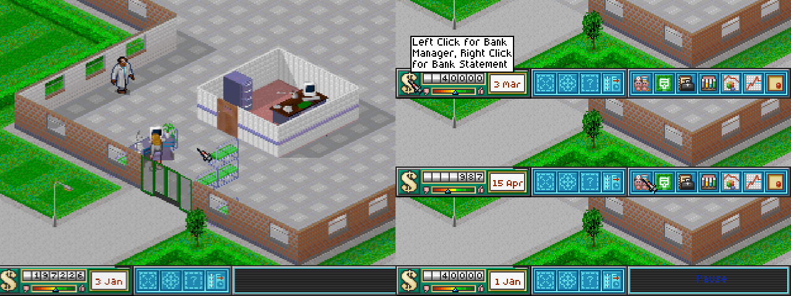
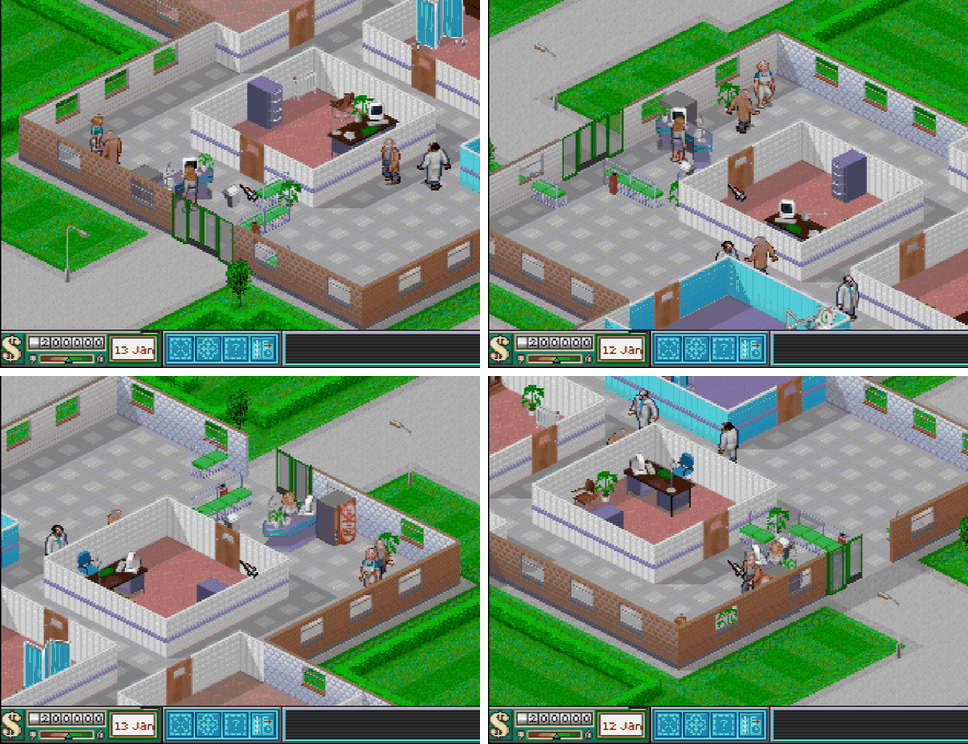
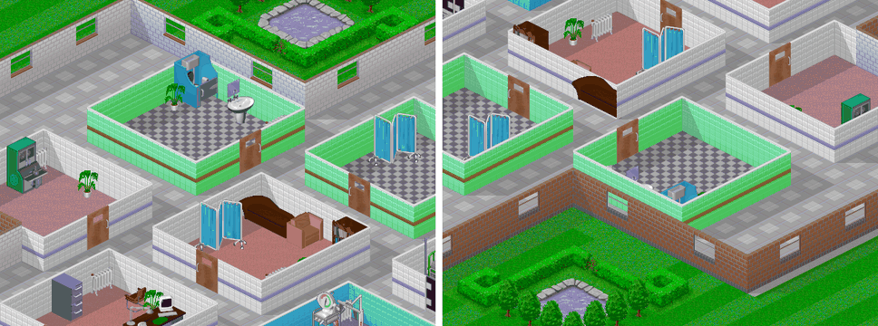

# Fase 6 — Juego base: el nivel 1 jugable

Fecha de inicio: 2026-10-27. Estado: **hitos 6.1 y 6.2 hechos**. Plan, hitos y criterios: [`06_plan.md`](06_plan.md).

## Hito 6.1 — Puntero y panel

**Hecho.** En la ROM, el hospital tiene el panel inferior de Theme Hospital y un puntero que mueve el stick o el ratón de N64:
- **el panel sale igual que en CorsixTH.** A 640 × 480, con los gráficos de alta resolución, el motor dibuja lo mismo que CorsixTH en 11 estados: dinero, fecha y reputación distintos, en pausa, con los botones de gestión a la vista, con un botón hundido y con descripciones;
  - **letras y recuadros: 0 píxeles distintos de 14.222;**
  - **piezas del panel: ninguna difiere en más de 7 de 255.** CorsixTH las dibuja con filtrado lineal (ver abajo);
- **en la N64 se dibuja como la referencia:** el RDP y el rasterizador de referencia dan 0 píxeles distintos en 5 estados de la interfaz, en la ROM de pruebas;
- **cuesta 0,95 ms de CPU por fotograma** el panel con el puntero, dentro de los 1,5 ms del plan. Con una descripción a la vista, de 1,4 a 1,9 ms;
- **CorsixTH no tiene el panel de baja resolución.** El de la N64 sale de los gráficos de `DATAM`, que el juego de PC traía para su modo de 320 × 200 (ver «La disposición de 320»).

*A la izquierda, la ROM normal en ares con el hospital del hito 4: el panel inferior y el puntero en el centro. A la derecha, el panel de 320 × 240 dibujado con el rasterizador de referencia (`th64sim panel baja`): la descripción del banco, los botones de gestión con el puntero encima y la pausa.*

### Qué hay

| Parte | Fichero | De CorsixTH |
|---|---|---|
| Ventanas, paneles y botones: el sprite hundido mientras se pulsa, la pulsación que pasa al botón por el que se arrastra, los botones de dos estados y las zonas con descripción | [`ui/ui.c`](../motor/ui/ui.c) | `window.lua`: `addPanel`, `makeButtonOnPanel`, `onMouseDown`, `onMouseUp`, `onMouseMove`, `getTooltipAt` |
| Texto con las fuentes de mapa de bits: una línea, varias con corte en los espacios y las descripciones con su recuadro | [`ui/texto.c`](../motor/ui/texto.c) | `bitmap_font::draw_text` y `draw_text_wrapped` (`th_gfx_font.cpp`), `l_font_draw` y `l_font_draw_tooltip` (`th_lua_gfx.cpp`) |
| Formato de las cadenas: `%%`, `%s`, `%d`, `%1%` y `%2:months%` | [`ui/texto.c`](../motor/ui/texto.c) | `TH.stringProxy.format` (`string_extensions.lua`) |
| UTF-8 a CP437 | [`ui/texto.c`](../motor/ui/texto.c) | `next_utf8_codepoint` y `unicode_to_codepage_437` (`th_strings.cpp`) |
| El panel inferior: el banco, el dinero, la reputación, la fecha, los botones de construir, amueblar, editar y contratar, la barra de información con «Pause», los 7 botones de gestión al pasar el puntero, la puerta de los faxes y las descripciones | [`ui/panel_inferior.c`](../motor/ui/panel_inferior.c) | `UIBottomPanel` (`bottom_panel.lua`) |
| El puntero: el stick con aceleración, el ratón y el desplazamiento de la vista en el borde de la pantalla | [`ui/puntero.c`](../motor/ui/puntero.c) | `GameUI:onMouseMove` y `tick_scroll_mult` (el borde) |
| La capa de la N64: las hojas de baja resolución, los mandos leídos en cada barrido y el dibujo por el mismo camino que el mapa | [`platform/n64/interfaz.c`](../motor/platform/n64/interfaz.c) | — |

Los botones del panel se hunden y los de dos estados se quedan pulsados, pero todavía no abren nada: las ventanas llegan con los hitos siguientes.

**En la ROM normal**, con el hospital:
- el stick mueve el puntero: zona muerta de 8, y de 1 a 8 píxeles por fotograma, que crecen con el cuadrado de la inclinación. Con Z mantenido, 2,5 veces más deprisa;
- A y B son los botones izquierdo y derecho del ratón;
- los botones C y la cruceta desplazan la vista. También el puntero al tocar un borde: de 6,5 a 13 píxeles por fotograma en 0,9 s, lo que hace CorsixTH a 640 × 480;
- la descripción sale tras 16 fotogramas con el puntero encima (los 30 ticks de 18 ms de CorsixTH). Al pasar a otro botón, la nueva sale sin esperar;
- Start pausa, L alterna entre x1 y x8, y R enseña los datos de depuración.

**El ratón de N64.** libdragon lee los mandos en cada barrido (60 por segundo), y `joypad_poll` solo copia la última lectura. El ratón da el movimiento desde la lectura anterior, así que leyendo a 30 fps se perdería la mitad. `interfaz.c` lee los mandos en cada barrido, acumula el movimiento y el bucle toma de ahí los botones. No se ha podido probar: ares corre sin dispositivo de entrada.

### La comparación con CorsixTH

[`captura_panel.lua`](../bench/scenarios/captura_panel.lua) carga el nivel 1 en CorsixTH, deja solo el panel inferior y lo captura en 11 estados. Fija el dinero, la reputación y la fecha, y lleva el puntero, los botones del ratón y la descripción con los métodos de las propias ventanas. `th64sim panel alta` dibuja lo mismo con la interfaz del motor y los gráficos de alta resolución, y [`comparar_panel.py`](../tools/hito6/comparar_panel.py) compara donde pinta la interfaz ([`tools/hito6/panel.sh`](../tools/hito6/panel.sh)):

| Píxeles de la interfaz, en 11 capturas | Cuántos | Iguales | A 1–2 | A 3–7 | A más de 7 |
|---|---:|---:|---:|---:|---:|
| Letras y recuadros: dinero, fecha, «Pause» y descripciones | 14.222 | **14.222** | 0 | 0 | 0 |
| Piezas del panel | 328.027 | 220.373 (67,2 %) | 107.581 | 73 | **0** |

- **CorsixTH dibuja las piezas de las ventanas con filtrado lineal.** Cada píxel sale mezclado con sus vecinos: un mismo color de la paleta acaba como dos o tres colores distintos. Las letras van sin filtrar (`thdf_nearest`) y salen idénticas, igual que los suelos y paredes del mapa en el hito 2.
- **Una pieza descolocada daría diferencias grandes en bloque**, y no hay ninguna de más de 7. Eso cubre:
  - el termómetro de la reputación (un sprite de 7 × 7);
  - la puerta de los faxes;
  - los botones hundidos;
  - los 7 botones de gestión.
- **Las descripciones usan otra paleta en CorsixTH** (`Pref01V.pal`, texto negro sobre blanco). El rasterizador de referencia admite ahora una paleta por hoja.
- **Una trampa del arnés:** poner la fecha en la hora 0 del 1 de enero hace que CorsixTH vuelva a abrir la presentación del nivel. Las capturas usan la hora 1.

### La disposición de 320

CorsixTH nunca usó el panel de `DATAM`, y no es el de alta reducido a la mitad: sus piezas tienen otras proporciones. El fondo con el dinero, la reputación y la fecha mide 89 × 25 píxeles, frente a 166 × 48. La disposición sale de los propios gráficos:
- **las piezas van una detrás de otra**, como en la de 640: 21 + 89 + 21 + 18 + 18 + 21 = 188 píxeles, y la barra de información rellena hasta 320 (3 + 25 × 5 + 4). Los 7 botones de gestión ocupan de 188 a 320;
- **las cifras del dinero van en las casillas del fondo**, en x = 22 + 7·i, y = 4. La fuente FONT100M trae la casilla dibujada en cada cifra, y encaja píxel a píxel con las del fondo;
- **el termómetro** va de x = 31 a 62, y la marca (5 × 4) se mueve 33 píxeles, frente a 65 en la de 640;
- **la fecha** va centrada en la libreta, de x = 78 a 105, y la puerta de los faxes, en la ranura de x = 96 a 107.

| Fuente | 640 (CorsixTH) | 320 (N64) |
|---|---|---|
| Dinero | Font05V | FONT100M (cifras en casillas) |
| Fecha | Font16V | FONT101M (roja), con el espacio de 2 píxeles: el suyo mide 1, y «3 Jan» salía pegado. «28 Sep», la fecha más ancha, ocupa justo los 27 píxeles de la libreta |
| Barra de información | Font01V | FONT132M (blanca) |
| Pausa | Font124V | FONT131M (azul) |
| Descripciones | Font00V con `Pref01V.pal` | FONT130M (negra), con la paleta del juego |

Las 5 fuentes de `QDATAM` encajan una a una con las 5 que usa CorsixTH. Como no hay con qué comparar, la disposición de 320 se ha revisado a ojo en los 11 estados (`th64sim panel baja`).

### Comprobaciones

| Qué | Contra qué | Resultado |
|---|---|---|
| El panel inferior a 640 × 480, 11 estados | Capturas de CorsixTH | Letras y recuadros: **0 de 14.222 píxeles distintos**. Piezas: 0 a más de 7 |
| La interfaz en la N64, 5 estados (pausa, botones de gestión, botón hundido, dos descripciones) | El rasterizador de referencia, en la ROM de pruebas | **0 píxeles distintos** |
| Lo que ya había: mapa, humanoides y hospital | La referencia, en la ROM de pruebas | 0 píxeles distintos, como antes |
| `tools/motor_check.sh` | Pruebas, huellas y píxeles | Todo bien: 60.233 comprobaciones, 0 fallos. Ahora también comprueba la interfaz |

### Coste y memoria

| Dato | Valor |
|---|---|
| CPU del panel y el puntero, por fotograma | 0,95 ms (60–65 elementos, 25–33 cargas de textura) |
| Con una descripción de 3 líneas | 1,93 ms (120 elementos, 86 cargas: una por letra) |
| Hojas de la interfaz en RAM: panel, punteros y 5 fuentes | 91 KiB |
| Textos en inglés en RAM | 257 KiB |
| Código: `ui/` y `interfaz.c` | 15 KiB, y 10 KiB de datos estáticos (la lista de dibujo de la interfaz) |
| Relleno de la caché de instrucciones | Pasa a 0 B en las ROM normal, de horas y de pruebas: con el código nuevo ya no chocan `dibujar` y rdpq |

**Los textos se pasan del presupuesto.** La fase 4 contaba 0,10 MiB para los textos de un idioma, y `english.trg` ocupa 257 KiB en RAM: lleva toda la tabla `_S` de CorsixTH, con sus claves. Basta con las cadenas que use el juego.

### Pendiente

- **Probar el ratón de N64** en la consola: ares no tiene dispositivo de entrada.
- **Recortar los textos** a las cadenas que se usan (257 KiB frente a 0,10 MiB).
- **Las letras cuestan una carga de textura cada una:** 86 cargas en una descripción de 3 líneas. Si las ventanas de gestión, con mucho texto, se pasan de tiempo, habrá que juntar las letras de una fuente en una textura o guardar el texto ya dibujado.
- **La barra de información** (lo que hay bajo el puntero en el mapa) llega cuando el puntero sepa señalar casillas, en el hito 6.2.
- **El español:** las fuentes de baja resolución no tienen Á, Í ni Ó (fase 4).

## Hito 6.2 — Las cuatro vistas y el menú de la ROM de prueba

**Hecho.** La cámara gira 90° con la cruceta, como en RollerCoaster Tycoon, en la ROM y en el PC:
- **el hospital girado sale como CorsixTH lo dibujaría girado.** CorsixTH no gira la cámara, así que se gira el hospital dentro de CorsixTH y se compara con el motor. En 40 capturas (10 zonas del nivel 1 en las 4 vistas, con las 8 salas del nivel), **ningún píxel del mapa difiere en más de 5 de 255** (11.116.959 de 11.117.094 iguales), y los objetos, en más de 7 (el filtrado lineal de CorsixTH, como en el hito 3);
- **la vista original no cambia:** 200 listas de dibujo idénticas a las de antes (hospitales de los hitos 4 y 5, 10 cámaras, 5 momentos, 320 × 240 y 640 × 480), y cuesta lo mismo;
- **en la N64 se dibuja como la referencia:** el RDP y el rasterizador de referencia dan 0 píxeles distintos en las tres vistas giradas, y la lista de dibujo de cada una es la misma que en el PC;
- **girar no encarece la lista de dibujo:** con 50 pacientes, 3,6–3,8 ms en las vistas giradas frente a 4,1 ms en la original;
- **la ROM arranca en un menú** que abre el hospital del hito 4, el del hito 5, un hospital con las 8 salas del nivel 1 para ver las vistas, y el visor de niveles. Desde la partida se vuelve al menú.

*La ROM en ares, con el hospital de las vistas (las 8 salas del nivel 1) a las 300 horas, en las cuatro vistas. Arriba, la original y girada 90°; abajo, 180° y 270°. La consulta, la recepción, la entrada y los bancos son los mismos en las cuatro.*

### Qué hay

| Parte | Fichero |
|---|---|
| La geometría de las vistas: casillas, direcciones, desplazamientos y la cámara, que gira sin mover lo que hay en el centro de la pantalla | [`vista/girar.c`](../motor/vista/girar.c), `th_view_rotate` en [`vista/vista.c`](../motor/vista/vista.c) |
| La pieza girada de cada bloque del mapa: suelos, paredes y decorado (ver abajo) | [`vista/girar.c`](../motor/vista/girar.c) |
| El mapa girado: para cada casilla de la vista, el suelo, las paredes de sus bordes norte y oeste con la cara que ve la cámara, el decorado y las sombras recalculadas, como `th_map_update_shadows` | `th_rot_map_update` en [`vista/girar.c`](../motor/vista/girar.c) |
| La lista de dibujo de la vista girada: el mismo orden de CorsixTH, leyendo el mapa girado. El bucle de una línea de casillas se compila dos veces, una para cada mapa, y la vista original no paga nada | `scene_line` en [`vista/vista.c`](../motor/vista/vista.c) |
| Los objetos, las personas y la basura girados, con los sustitutos | [`vista/objetos.c`](../motor/vista/objetos.c) |
| El puntero que señala casillas en las cuatro vistas (`Map:ScreenToWorld`) | `th_view_pick` en [`vista/vista.c`](../motor/vista/vista.c) |
| El menú, el giro con la cruceta y la casilla bajo el puntero | [`platform/n64/main.c`](../motor/platform/n64/main.c) |

**Cómo se gira.** La rotación r lleva la casilla (x, y) del mundo a (127 − y, x) con r = 1, y la dirección d a d + r. El núcleo no sabe nada de esto, como se decidió en la fase 4: solo la vista lee el mapa girado.
- **Suelos.** Los que no tienen dirección se quedan como están. Los que la tienen se describen por familias. Al girar, se busca la pieza con la descripción girada; si no está, la que la tiene en espejo, dibujada en espejo; y si tampoco, la más parecida:
  - **césped y camino con bordillo** (bloques 6 a 14 y 61 a 63): por lo que hay en cada esquina, como en «marching squares». Las 14 combinaciones que se usan están todas;
  - **el estanque** (59, 60, 65, 68, 77 a 80): igual, con agua y césped. Están las 8 orillas;
  - **las carreteras** (41 a 58): en los 12 niveles van todas de norte a sur. Giradas 90°, son la misma pieza en espejo; giradas 180°, la pieza con las marcas al otro lado. 4 marcas de aparcamiento no tienen pareja y salen al revés.
- **Paredes.** Van por bordes. Cada bloque es de un juego de `walls/*.lua` (las salas blancas, amarillas, azules y verdes, y las de fuera del hospital), con su cara (la de dentro o la de fuera de la sala), su borde y, en las ventanas de dos casillas y las puertas batientes, su mitad. Al girar:
  - el borde pasa al borde girado;
  - si en la vista es el sur o el este de la casilla, es el norte o el oeste de la vecina, y la cámara lo ve desde el otro lado: cambia la cara;
  - las mitades cambian si el borde se recorre al revés en pantalla.
  Son 83 bloques: 56 de las salas, 18 de las paredes de fuera y 8 pilares del final de una pared.
- **Decorado** (setos, árboles, farolas): va en su casilla. Los setos se describen por los bordes por los que siguen; los 11 tipos que se unen están todos. Los 4 setos con algo encima van solos, con su espejo.
- **Sombras.** Se recalculan con las paredes de la vista, igual que las calcula CorsixTH. En el oráculo las calcula el propio CorsixTH, así que esto queda comprobado.
- **Objetos.** Se colocan como CorsixTH los colocaría en el hospital girado: con la orientación girada, en el sitio en el que su huella cubre las casillas giradas. Las puertas, en el borde girado.
- **Personas.** Van en su posición girada, con la animación que mira a la dirección girada. Caminar, estar quieto, llamar a una puerta y cruzarla van por parejas (norte y este, con su espejo), como en `walk_anims`. Quien usa un objeto se coloca como lo haría `use_object` con el objeto girado. La basura solo cambia de casilla.

### Los sustitutos

**Un objeto que solo se dibujó de cara a la cámara** (40 de los 60; 13 en las salas del nivel 1, ver el [plan](06_plan.md#las-cuatro-vistas)) quedaría de espaldas en 2 de las 3 vistas giradas. En esas dos se pone con la orientación opuesta, de frente, sobre las mismas casillas. Quien lo usa va al otro lado de su huella, donde lo pondría ese objeto.

**Las demás piezas sin dibujo:**
- las animaciones de las necesidades (vomitar, orinar, bostezar, mirar el reloj, dar golpecitos con el pie) solo miran al este o al sur: si tocaría mirar al norte o al oeste, se usa la dirección opuesta;
- las farolas tienen el brazo hacia el norte o el oeste, y en las demás vistas se quedan como están.

En el hospital de las vistas, los sustitutos son 10 objetos en la vista girada 90° y 12 en la de 180°.

*Los aseos (arriba) y la psiquiatría (abajo), en la vista original y girados 180°. Girado, el váter y el lavabo quedan contra la pared de delante y salen de frente, casi tapados por ella; en la psiquiatría, el diván también sale de frente. Es lo que hay que mirar: si estos sustitutos se pueden aceptar o hace falta dibujar las espaldas.*

### La comparación con CorsixTH

**Cómo se monta.** [`captura_girada.lua`](../bench/scenarios/captura_girada.lua) carga en CorsixTH una partida con un hospital y lo gira:
- quita a las personas y los objetos del mapa;
- vuelve a poner las casillas, llevando cada pieza a su sitio girado. Es la lógica contraria a la del motor, que busca, para cada casilla de la vista, lo que le toca. Las paredes se giran con las tablas de `walls/*.lua` de CorsixTH;
- crea de nuevo los objetos, con `World:newObject`, en la casilla y con la orientación girada, o la opuesta (el sustituto). Los dibuja CorsixTH;
- deja que CorsixTH calcule las sombras, y hace una captura de 640 × 480.

Lo único que sale del motor es la pieza girada de los suelos, del decorado y de los pilares, que CorsixTH no sabe girar ([`tools/hito6/vistas.sh`](../tools/hito6/vistas.sh)).

**El hospital.** Es el nivel 1 con sus 8 salas, creado en CorsixTH ([`crear_vistas.lua`](../bench/scenarios/crear_vistas.lua)): 55 objetos, entre ellos 12 de los que solo miran a la cámara (de 10 tipos) y las puertas batientes de la enfermería. Las 10 zonas cubren:
- las salas;
- la recepción y la entrada;
- los dos estanques y los setos del jardín;
- las carreteras de tres bordes del mapa.

[`comparar_giro.py`](../tools/hito6/comparar_giro.py) separa tres zonas: las entidades (con 2 píxeles alrededor), las sombras y el resto del mapa.

| 40 capturas (10 zonas × 4 vistas) | Píxeles | Iguales | A 1–2 | A 3–5 | A más de 5 |
|---|---:|---:|---:|---:|---:|
| Mapa: suelos, paredes y decorado | 11.117.094 | **11.116.959** | 97 | 38 | **0** |
| Sombras | 627.996 | 46.191 | 581.725 | 80 | **0** |
| Entidades (objetos) | 542.910 | 455.310 | 83.628 | 3.972 (de 3 a 7) | **0** a más de 7 |

- **Las diferencias del mapa** son píxeles sueltos en el borde de una sombra, de 3 a 5 de 255, y alguno junto a un objeto que una pared tapa en el motor.
- **Las sombras** difieren por el redondeo de la mezcla, como en el hito 2.
- **Las entidades** difieren por el filtrado lineal con el que CorsixTH dibuja las animaciones, como en el hito 3.

**Lo que encontró el oráculo.**
- **Un error que también estaba en la vista original.** Los objetos partidos en columnas, cuya primera parte no está en su casilla de origen, se dibujaban desplazados: la cama mirando al sur, el carro de paradas, el sofá mirando al sur y el ultraescáner. CorsixTH coloca cada parte respecto a la primera (`Object:setPosition`) y suma el desplazamiento de la animación. En los hospitales de los hitos 4 y 5 no había ninguno, así que no salía.
- **Las puertas batientes** (la enfermería) no se cargaban en el núcleo: la de la derecha es la puerta de su sala (`room.door`) y ahora cuenta como puerta. Como en CorsixTH (`SwingDoor` es una `Door`), las dos van en la lista temprana mirando al norte.

**Las personas no están en el oráculo:** CorsixTH no puede ponerlas en un hospital girado. Se han revisado a ojo en las cuatro vistas, con el hospital del hito 5 a las 2.200 horas: caminando, en la cola, sentadas en los bancos, en la consulta y tras el mostrador.

### En la N64

| Qué | Contra qué | Resultado |
|---|---|---|
| El hospital del hito 4 tras 3.000 horas, en las tres vistas giradas | El rasterizador de referencia, en la ROM de pruebas | **0 píxeles distintos** de 230.400 |
| Sus tres listas de dibujo | `th64sim lista --giro=r` con la misma cámara | **Las mismas huellas** (`tools/motor_check.sh`) |
| La vista original | Las listas de antes del hito | 200 de 200 iguales |
| Las vistas, en el PC | Las pruebas del núcleo | 940 comprobaciones nuevas, 0 fallos: las rotaciones se deshacen, girar dos veces es sumar los giros, las piezas vuelven a la misma tras 4 giros |
| `tools/motor_check.sh` | Pruebas, huellas y píxeles | Todo bien: 61.173 comprobaciones, 0 fallos. Ahora también comprueba las vistas giradas y que la ROM normal arranca en el menú |

### Coste y memoria

Medido en la ROM de medida (ares), con el hospital del hito 5 a la hora 3.833: 50 pacientes, 71 entidades en pantalla.

| Dato | Original | Giradas (90°, 180°, 270°) |
|---|---:|---:|
| Lista de dibujo, por fotograma | 4,07 ms | 3,64 / 3,74 / 3,77 ms |
| Pasar la simulación a entidades, por tick (en la corrutina) | 0,41 ms | 1,05 / 0,92 / 0,88 ms |
| Hacer el mapa girado, al girar | — | 37,9 / 36,9 / 42,4 ms |

- **La lista no se encarece.** La vista girada tiene casi los mismos elementos (de 518 a 543, frente a 535) y lee el mapa girado, de 6 B por casilla, en lugar del mapa del mundo, de 16.
- **Pasar la simulación a entidades cuesta el doble** en las vistas giradas. Al principio costaba seis veces más, por buscar la huella de cada objeto en las reglas en cada instantánea; ahora se guarda mientras el objeto no cambie. A velocidad Normal hay un tick cada 1,6 fotogramas: +0,3 ms por fotograma.
- **Hacer el mapa girado tarda unos 40 ms**, una vez al girar: se pierde un fotograma. Son 16.384 casillas a unas 100 instrucciones cada una. Habrá que rehacerlo también cuando cambie el mapa, al construir (hito 6.3).

| Memoria | Cuánto |
|---|---|
| El mapa girado (6 B por casilla), en el heap, solo mientras la vista está girada | **96 KiB** |
| Tablas de piezas giradas y colocaciones guardadas | 8 KiB estáticos |
| Código nuevo | unos 14 KiB: 6 del giro del mapa, 5,5 de los objetos y las personas, y el menú |
| Heap usado con 8 MiB, con un hospital cargado | 2.813 KiB de 6.738 (2.909 con la vista girada) |
| **La demo (4 MiB)** | Las vistas giradas piden 96 KiB más mientras están activas: unos 4,1 MiB sin recortes y unos 3,7 con los recortes aceptados. Si no caben, en la demo se puede quitar el giro o hacer el mapa girado por trozos (hito 6.10) |

### El menú de la ROM de prueba

La ROM normal arranca en un menú con texto de depuración: el hospital del hito 4, el del hito 5, el de las vistas y el visor de niveles. La cruceta o el stick eligen y A abre. Desde el hospital, Start pausa y, en pausa, Z vuelve al menú; desde el visor, Start. Al volver, la simulación acaba el tick que tuviera a medias y se suelta la memoria de la vista girada.

**Los controles nuevos:**
- la cruceta izquierda y derecha gira la cámara, en el hospital y en el visor;
- la cruceta arriba y abajo y los botones C siguen desplazando la vista;
- con los datos a la vista (R), la casilla bajo el puntero se resalta en azul y sale su número en el mundo, en cualquiera de las cuatro vistas.

**En el hospital, la cámara gira cuando lo hacen las entidades.** Las entidades salen de la instantánea que toma la simulación al acabar cada tick. Si la simulación está a medio tick, la instantánea girada llega con el tick siguiente; si no, al momento, también en pausa. Así no se dibuja un fotograma con el mapa girado y las personas sin girar.

**La ROM de capturas** (`make HORAS=N MODO=m GIRO=r`) abre un modo con la cámara girada sin pasar por el menú: así se han hecho las capturas de arriba.

### Pendiente

- **Que Eduardo mire los sustitutos** (la imagen de arriba y la ROM) y diga si se pueden aceptar o hace falta dibujar las espaldas. El conversor admitirá hojas de sprites propias.
- **La barra de información** (lo que hay bajo el puntero): el puntero ya señala casillas en las cuatro vistas. Falta señalar las personas y los objetos, que llega con sus ventanas (hito 6.4).
- **El mapa girado** cuesta un fotograma al girar. Si al construir en una vista girada (hito 6.3) se nota, se puede rehacer solo la zona que cambia.
- **Las personas usando objetos sustitutos** van al otro lado de la huella: pueden quedar al otro lado de una pared. Solo se ve en las dos vistas en que el objeto es un sustituto.
