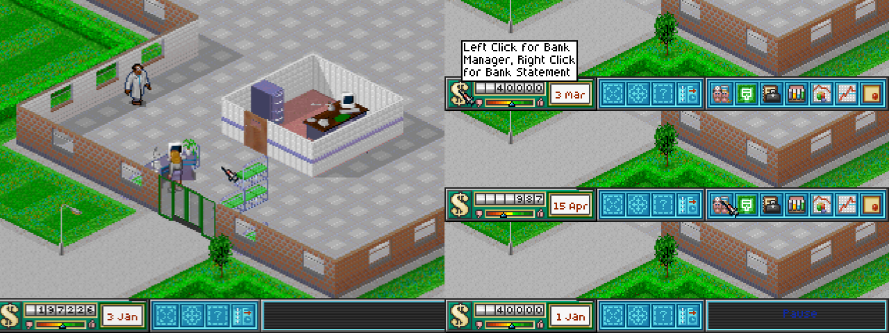
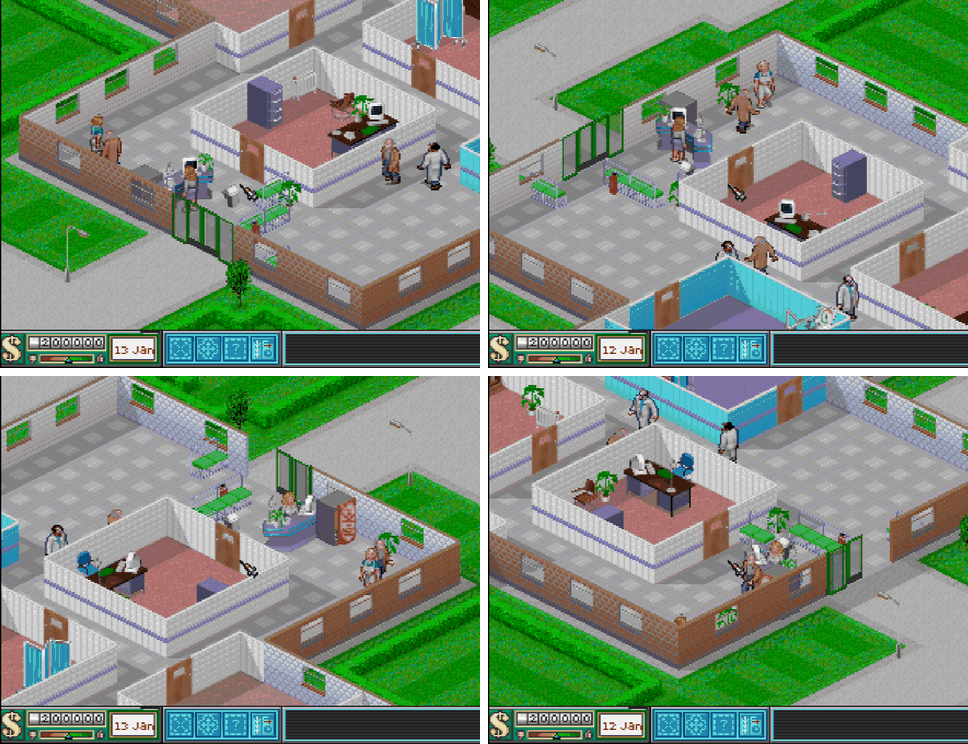
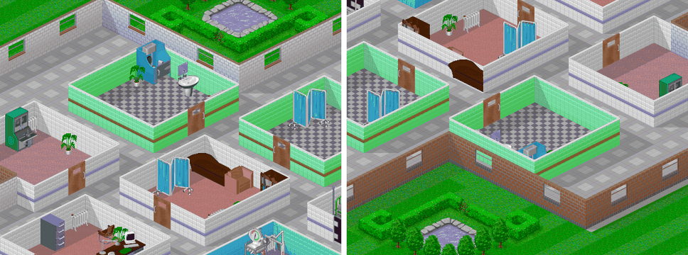
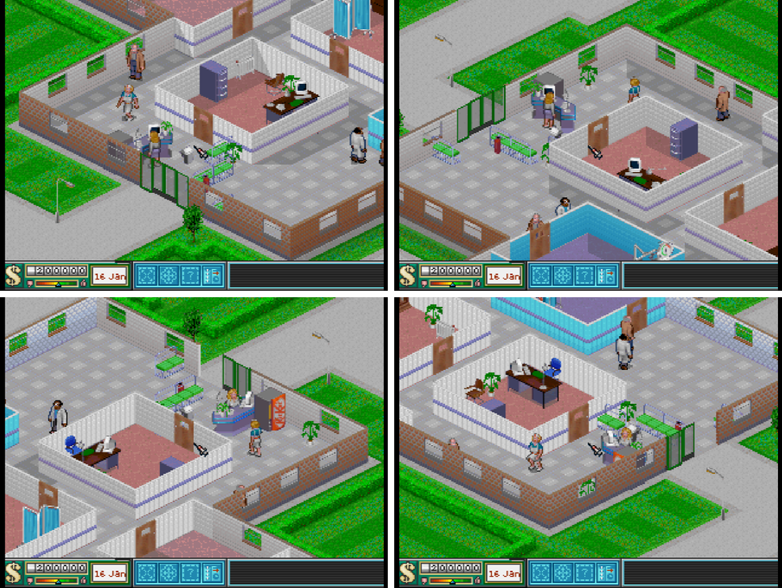
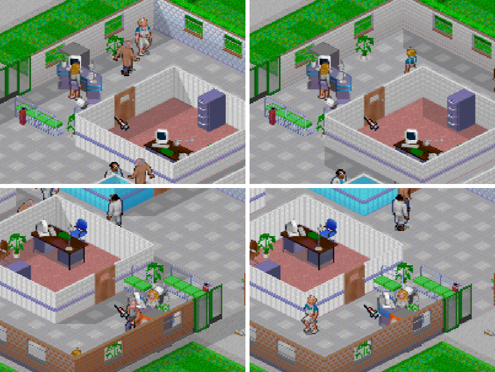
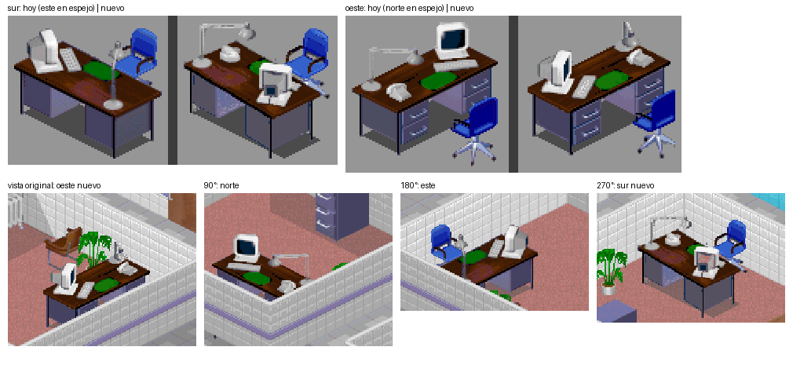

# Fase 6 — Juego base: el nivel 1 jugable

Fecha de inicio: 2026-10-27. Estado: **hitos 6.1, 6.2 y 6.2b hechos, el importador de arte nuevo y los pasos 1 y 2 del hito 6.3** (los objetos en el mapa y amueblar el pasillo). Plan, hitos y criterios: [`06_plan.md`](06_plan.md).

## Hito 6.1 — Puntero y panel

**Hecho.** En la ROM, el hospital tiene el panel inferior de Theme Hospital y un puntero que mueve el stick o el ratón de N64:
- **el panel sale igual que en CorsixTH.** A 640 × 480, con los gráficos de alta resolución, el motor dibuja lo mismo que CorsixTH en 11 estados: dinero, fecha y reputación distintos, en pausa, con los botones de gestión a la vista, con un botón hundido y con descripciones;
  - **letras y recuadros: 0 píxeles distintos de 14.222;**
  - **piezas del panel: ninguna difiere en más de 7 de 255.** CorsixTH las dibuja con filtrado lineal (ver abajo);
- **en la N64 se dibuja como la referencia:** el RDP y el rasterizador de referencia dan 0 píxeles distintos en 5 estados de la interfaz, en la ROM de pruebas;
- **cuesta 0,95 ms de CPU por fotograma** el panel con el puntero, dentro de los 1,5 ms del plan. Con una descripción a la vista, de 1,4 a 1,9 ms;
- **CorsixTH no tiene el panel de baja resolución.** El de la N64 sale de los gráficos de `DATAM`, que el juego de PC traía para su modo de 320 × 200 (ver «La disposición de 320»).



*A la izquierda, la ROM normal en ares con el hospital del hito 4: el panel inferior y el puntero en el centro. A la derecha, el panel de 320 × 240 dibujado con el rasterizador de referencia (`th64sim panel baja`): la descripción del banco, los botones de gestión con el puntero encima y la pausa.*

### Qué hay

| Parte | Fichero | De CorsixTH |
|---|---|---|
| Ventanas, paneles y botones: el sprite hundido mientras se pulsa, la pulsación que pasa al botón por el que se arrastra, los botones de dos estados y las zonas con descripción | [`ui/ui.c`](../motor/ui/ui.c) | `window.lua`: `addPanel`, `makeButtonOnPanel`, `onMouseDown`, `onMouseUp`, `onMouseMove`, `getTooltipAt` |
| Texto con las fuentes de mapa de bits: una línea, varias con corte en los espacios y las descripciones con su recuadro | [`ui/texto.c`](../motor/ui/texto.c) | `bitmap_font::draw_text` y `draw_text_wrapped` (`th_gfx_font.cpp`), `l_font_draw` y `l_font_draw_tooltip` (`th_lua_gfx.cpp`) |
| Formato de las cadenas: `%%`, `%s`, `%d`, `%1%` y `%2:months%` | [`ui/texto.c`](../motor/ui/texto.c) | `TH.stringProxy.format` (`string_extensions.lua`) |
| UTF-8 a CP437 | [`ui/texto.c`](../motor/ui/texto.c) | `next_utf8_codepoint` y `unicode_to_codepage_437` (`th_strings.cpp`) |
| El panel inferior: el banco, el dinero, la reputación, la fecha, los botones de construir, amueblar, editar y contratar, la barra de información con «Pause», los 7 botones de gestión al pasar el puntero, la puerta de los faxes y las descripciones | [`ui/panel_inferior.c`](../motor/ui/panel_inferior.c) | `UIBottomPanel` (`bottom_panel.lua`) |
| El puntero: el stick con aceleración, el ratón y el desplazamiento de la vista en el borde de la pantalla | [`ui/puntero.c`](../motor/ui/puntero.c) | `GameUI:onMouseMove` y `tick_scroll_mult` (el borde) |
| La capa de la N64: las hojas de baja resolución, los mandos leídos en cada barrido y el dibujo por el mismo camino que el mapa | [`platform/n64/interfaz.c`](../motor/platform/n64/interfaz.c) | — |

Los botones del panel se hunden y los de dos estados se quedan pulsados, pero todavía no abren nada: las ventanas llegan con los hitos siguientes.

**En la ROM normal**, con el hospital:
- el stick mueve el puntero: zona muerta de 8, y de 1 a 8 píxeles por fotograma, que crecen con el cuadrado de la inclinación. Con Z mantenido, 2,5 veces más deprisa;
- A y B son los botones izquierdo y derecho del ratón;
- los botones C y la cruceta desplazan la vista. También el puntero al tocar un borde: de 6,5 a 13 píxeles por fotograma en 0,9 s, lo que hace CorsixTH a 640 × 480;
- la descripción sale tras 16 fotogramas con el puntero encima (los 30 ticks de 18 ms de CorsixTH). Al pasar a otro botón, la nueva sale sin esperar;
- Start pausa, L alterna entre x1 y x8, y R enseña los datos de depuración.

**El ratón de N64.** libdragon lee los mandos en cada barrido (60 por segundo), y `joypad_poll` solo copia la última lectura. El ratón da el movimiento desde la lectura anterior, así que leyendo a 30 fps se perdería la mitad. `interfaz.c` lee los mandos en cada barrido, acumula el movimiento y el bucle toma de ahí los botones. No se ha podido probar: ares corre sin dispositivo de entrada.

### La comparación con CorsixTH

[`captura_panel.lua`](../bench/scenarios/captura_panel.lua) carga el nivel 1 en CorsixTH, deja solo el panel inferior y lo captura en 11 estados. Fija el dinero, la reputación y la fecha, y lleva el puntero, los botones del ratón y la descripción con los métodos de las propias ventanas. `th64sim panel alta` dibuja lo mismo con la interfaz del motor y los gráficos de alta resolución, y [`comparar_panel.py`](../tools/hito6/comparar_panel.py) compara donde pinta la interfaz ([`tools/hito6/panel.sh`](../tools/hito6/panel.sh)):

| Píxeles de la interfaz, en 11 capturas | Cuántos | Iguales | A 1–2 | A 3–7 | A más de 7 |
|---|---:|---:|---:|---:|---:|
| Letras y recuadros: dinero, fecha, «Pause» y descripciones | 14.222 | **14.222** | 0 | 0 | 0 |
| Piezas del panel | 328.027 | 220.373 (67,2 %) | 107.581 | 73 | **0** |

- **CorsixTH dibuja las piezas de las ventanas con filtrado lineal.** Cada píxel sale mezclado con sus vecinos: un mismo color de la paleta acaba como dos o tres colores distintos. Las letras van sin filtrar (`thdf_nearest`) y salen idénticas, igual que los suelos y paredes del mapa en el hito 2.
- **Una pieza descolocada daría diferencias grandes en bloque**, y no hay ninguna de más de 7. Eso cubre:
  - el termómetro de la reputación (un sprite de 7 × 7);
  - la puerta de los faxes;
  - los botones hundidos;
  - los 7 botones de gestión.
- **Las descripciones usan otra paleta en CorsixTH** (`Pref01V.pal`, texto negro sobre blanco). El rasterizador de referencia admite ahora una paleta por hoja.
- **Una trampa del arnés:** poner la fecha en la hora 0 del 1 de enero hace que CorsixTH vuelva a abrir la presentación del nivel. Las capturas usan la hora 1.

### La disposición de 320

CorsixTH nunca usó el panel de `DATAM`, y no es el de alta reducido a la mitad: sus piezas tienen otras proporciones. El fondo con el dinero, la reputación y la fecha mide 89 × 25 píxeles, frente a 166 × 48. La disposición sale de los propios gráficos:
- **las piezas van una detrás de otra**, como en la de 640: 21 + 89 + 21 + 18 + 18 + 21 = 188 píxeles, y la barra de información rellena hasta 320 (3 + 25 × 5 + 4). Los 7 botones de gestión ocupan de 188 a 320;
- **las cifras del dinero van en las casillas del fondo**, en x = 22 + 7·i, y = 4. La fuente FONT100M trae la casilla dibujada en cada cifra, y encaja píxel a píxel con las del fondo;
- **el termómetro** va de x = 31 a 62, y la marca (5 × 4) se mueve 33 píxeles, frente a 65 en la de 640;
- **la fecha** va centrada en la libreta, de x = 78 a 105, y la puerta de los faxes, en la ranura de x = 96 a 107.

| Fuente | 640 (CorsixTH) | 320 (N64) |
|---|---|---|
| Dinero | Font05V | FONT100M (cifras en casillas) |
| Fecha | Font16V | FONT101M (roja), con el espacio de 2 píxeles: el suyo mide 1, y «3 Jan» salía pegado. «28 Sep», la fecha más ancha, ocupa justo los 27 píxeles de la libreta |
| Barra de información | Font01V | FONT132M (blanca) |
| Pausa | Font124V | FONT131M (azul) |
| Descripciones | Font00V con `Pref01V.pal` | FONT130M (negra), con la paleta del juego |

Las 5 fuentes de `QDATAM` encajan una a una con las 5 que usa CorsixTH. Como no hay con qué comparar, la disposición de 320 se ha revisado a ojo en los 11 estados (`th64sim panel baja`).

### Comprobaciones

| Qué | Contra qué | Resultado |
|---|---|---|
| El panel inferior a 640 × 480, 11 estados | Capturas de CorsixTH | Letras y recuadros: **0 de 14.222 píxeles distintos**. Piezas: 0 a más de 7 |
| La interfaz en la N64, 5 estados (pausa, botones de gestión, botón hundido, dos descripciones) | El rasterizador de referencia, en la ROM de pruebas | **0 píxeles distintos** |
| Lo que ya había: mapa, humanoides y hospital | La referencia, en la ROM de pruebas | 0 píxeles distintos, como antes |
| `tools/motor_check.sh` | Pruebas, huellas y píxeles | Todo bien: 60.233 comprobaciones, 0 fallos. Ahora también comprueba la interfaz |

### Coste y memoria

| Dato | Valor |
|---|---|
| CPU del panel y el puntero, por fotograma | 0,95 ms (60–65 elementos, 25–33 cargas de textura) |
| Con una descripción de 3 líneas | 1,93 ms (120 elementos, 86 cargas: una por letra) |
| Hojas de la interfaz en RAM: panel, punteros y 5 fuentes | 91 KiB |
| Textos en inglés en RAM | 257 KiB |
| Código: `ui/` y `interfaz.c` | 15 KiB, y 10 KiB de datos estáticos (la lista de dibujo de la interfaz) |
| Relleno de la caché de instrucciones | Pasa a 0 B en las ROM normal, de horas y de pruebas: con el código nuevo ya no chocan `dibujar` y rdpq |

**Los textos se pasan del presupuesto.** La fase 4 contaba 0,10 MiB para los textos de un idioma, y `english.trg` ocupa 257 KiB en RAM: lleva toda la tabla `_S` de CorsixTH, con sus claves. Basta con las cadenas que use el juego.

### Pendiente

- **Probar el ratón de N64** en la consola: ares no tiene dispositivo de entrada.
- **Recortar los textos** a las cadenas que se usan (257 KiB frente a 0,10 MiB).
- **Las letras cuestan una carga de textura cada una:** 86 cargas en una descripción de 3 líneas. Si las ventanas de gestión, con mucho texto, se pasan de tiempo, habrá que juntar las letras de una fuente en una textura o guardar el texto ya dibujado.
- **La barra de información** (lo que hay bajo el puntero en el mapa) llega cuando el puntero sepa señalar casillas, en el hito 6.2.
- **El español:** las fuentes de baja resolución no tienen Á, Í ni Ó (fase 4).

## Hito 6.2 — Las cuatro vistas y el menú de la ROM de prueba

**Hecho.** La cámara gira 90° con la cruceta, como en RollerCoaster Tycoon, en la ROM y en el PC:
- **el hospital girado sale como CorsixTH lo dibujaría girado.** CorsixTH no gira la cámara, así que se gira el hospital dentro de CorsixTH y se compara con el motor. En 40 capturas (10 zonas del nivel 1 en las 4 vistas, con las 8 salas del nivel), **ningún píxel del mapa difiere en más de 5 de 255** (11.116.959 de 11.117.094 iguales), y los objetos, en más de 7 (el filtrado lineal de CorsixTH, como en el hito 3);
- **la vista original no cambia:** 200 listas de dibujo idénticas a las de antes (hospitales de los hitos 4 y 5, 10 cámaras, 5 momentos, 320 × 240 y 640 × 480), y cuesta lo mismo;
- **en la N64 se dibuja como la referencia:** el RDP y el rasterizador de referencia dan 0 píxeles distintos en las tres vistas giradas, y la lista de dibujo de cada una es la misma que en el PC;
- **girar no encarece la lista de dibujo:** con 50 pacientes, 3,6–3,8 ms en las vistas giradas frente a 4,1 ms en la original;
- **la ROM arranca en un menú** que abre el hospital del hito 4, el del hito 5, un hospital con las 8 salas del nivel 1 para ver las vistas, y el visor de niveles. Desde la partida se vuelve al menú.



*La ROM en ares, con el hospital de las vistas (las 8 salas del nivel 1) a las 300 horas, en las cuatro vistas. Arriba, la original y girada 90°; abajo, 180° y 270°. La consulta, la recepción, la entrada y los bancos son los mismos en las cuatro.*

### Qué hay

| Parte | Fichero |
|---|---|
| La geometría de las vistas: casillas, direcciones, desplazamientos y la cámara, que gira sin mover lo que hay en el centro de la pantalla | [`vista/girar.c`](../motor/vista/girar.c), `th_view_rotate` en [`vista/vista.c`](../motor/vista/vista.c) |
| La pieza girada de cada bloque del mapa: suelos, paredes y decorado (ver abajo) | [`vista/girar.c`](../motor/vista/girar.c) |
| El mapa girado: para cada casilla de la vista, el suelo, las paredes de sus bordes norte y oeste con la cara que ve la cámara, el decorado y las sombras recalculadas, como `th_map_update_shadows` | `th_rot_map_update` en [`vista/girar.c`](../motor/vista/girar.c) |
| La lista de dibujo de la vista girada: el mismo orden de CorsixTH, leyendo el mapa girado. El bucle de una línea de casillas se compila dos veces, una para cada mapa, y la vista original no paga nada | `scene_line` en [`vista/vista.c`](../motor/vista/vista.c) |
| Los objetos, las personas y la basura girados, con los sustitutos | [`vista/objetos.c`](../motor/vista/objetos.c) |
| El puntero que señala casillas en las cuatro vistas (`Map:ScreenToWorld`) | `th_view_pick` en [`vista/vista.c`](../motor/vista/vista.c) |
| El menú, el giro con la cruceta y la casilla bajo el puntero | [`platform/n64/main.c`](../motor/platform/n64/main.c) |

**Cómo se gira.** La rotación r lleva la casilla (x, y) del mundo a (127 − y, x) con r = 1, y la dirección d a d + r. El núcleo no sabe nada de esto, como se decidió en la fase 4: solo la vista lee el mapa girado.
- **Suelos.** Los que no tienen dirección se quedan como están. Los que la tienen se describen por familias. Al girar, se busca la pieza con la descripción girada; si no está, la que la tiene en espejo, dibujada en espejo; y si tampoco, la más parecida:
  - **césped y camino con bordillo** (bloques 6 a 14 y 61 a 63): por lo que hay en cada esquina, como en «marching squares». Las 14 combinaciones que se usan están todas;
  - **el estanque** (59, 60, 65, 68, 77 a 80): igual, con agua y césped. Están las 8 orillas;
  - **las carreteras** (41 a 58): en los 12 niveles van todas de norte a sur. Giradas 90°, son la misma pieza en espejo; giradas 180°, la pieza con las marcas al otro lado. 4 marcas de aparcamiento no tienen pareja y salen al revés.
- **Paredes.** Van por bordes. Cada bloque es de un juego de `walls/*.lua` (las salas blancas, amarillas, azules y verdes, y las de fuera del hospital), con su cara (la de dentro o la de fuera de la sala), su borde y, en las ventanas de dos casillas y las puertas batientes, su mitad. Al girar:
  - el borde pasa al borde girado;
  - si en la vista es el sur o el este de la casilla, es el norte o el oeste de la vecina, y la cámara lo ve desde el otro lado: cambia la cara;
  - las mitades cambian si el borde se recorre al revés en pantalla.
  Son 83 bloques: 56 de las salas, 18 de las paredes de fuera y 8 pilares del final de una pared.
- **Decorado** (setos, árboles, farolas): va en su casilla. Los setos se describen por los bordes por los que siguen; los 11 tipos que se unen están todos. Los 4 setos con algo encima van solos, con su espejo.
- **Sombras.** Se recalculan con las paredes de la vista, igual que las calcula CorsixTH. En el oráculo las calcula el propio CorsixTH, así que esto queda comprobado. *Desde el hito 6.2b ya no: el sol no gira con la cámara ([abajo](#hito-62b--el-sol-fijo)).*
- **Objetos.** Se colocan como CorsixTH los colocaría en el hospital girado: con la orientación girada, en el sitio en el que su huella cubre las casillas giradas. Las puertas, en el borde girado.
- **Personas.** Van en su posición girada, con la animación que mira a la dirección girada. Caminar, estar quieto, llamar a una puerta y cruzarla van por parejas (norte y este, con su espejo), como en `walk_anims`. Quien usa un objeto se coloca como lo haría `use_object` con el objeto girado. La basura solo cambia de casilla.

### Los sustitutos

**Un objeto que solo se dibujó de cara a la cámara** (40 de los 60; 13 en las salas del nivel 1, ver el [plan](06_plan.md#las-cuatro-vistas)) quedaría de espaldas en 2 de las 3 vistas giradas. En esas dos se pone con la orientación opuesta, de frente, sobre las mismas casillas. Quien lo usa va al otro lado de su huella, donde lo pondría ese objeto.

**Las demás piezas sin dibujo:**
- las animaciones de las necesidades (vomitar, orinar, bostezar, mirar el reloj, dar golpecitos con el pie) solo miran al este o al sur: si tocaría mirar al norte o al oeste, se usa la dirección opuesta;
- las farolas tienen el brazo hacia el norte o el oeste, y en las demás vistas se quedan como están.

En el hospital de las vistas, los sustitutos son 10 objetos en la vista girada 90° y 12 en la de 180°.



*Los aseos (arriba) y la psiquiatría (abajo), en la vista original y girados 180°. Girado, el váter y el lavabo quedan contra la pared de delante y salen de frente, casi tapados por ella; en la psiquiatría, el diván también sale de frente. Es lo que hay que mirar: si estos sustitutos se pueden aceptar o hace falta dibujar las espaldas.*

### La comparación con CorsixTH

**Cómo se monta.** [`captura_girada.lua`](../bench/scenarios/captura_girada.lua) carga en CorsixTH una partida con un hospital y lo gira:
- quita a las personas y los objetos del mapa;
- vuelve a poner las casillas, llevando cada pieza a su sitio girado. Es la lógica contraria a la del motor, que busca, para cada casilla de la vista, lo que le toca. Las paredes se giran con las tablas de `walls/*.lua` de CorsixTH;
- crea de nuevo los objetos, con `World:newObject`, en la casilla y con la orientación girada, o la opuesta (el sustituto). Los dibuja CorsixTH;
- deja que CorsixTH calcule las sombras, y hace una captura de 640 × 480.

Lo único que sale del motor es la pieza girada de los suelos, del decorado y de los pilares, que CorsixTH no sabe girar ([`tools/hito6/vistas.sh`](../tools/hito6/vistas.sh)).

**El hospital.** Es el nivel 1 con sus 8 salas, creado en CorsixTH ([`crear_vistas.lua`](../bench/scenarios/crear_vistas.lua)): 55 objetos, entre ellos 12 de los que solo miran a la cámara (de 10 tipos) y las puertas batientes de la enfermería. Las 10 zonas cubren:
- las salas;
- la recepción y la entrada;
- los dos estanques y los setos del jardín;
- las carreteras de tres bordes del mapa.

[`comparar_giro.py`](../tools/hito6/comparar_giro.py) separa tres zonas: las entidades (con 2 píxeles alrededor), las sombras y el resto del mapa.

| 40 capturas (10 zonas × 4 vistas) | Píxeles | Iguales | A 1–2 | A 3–5 | A más de 5 |
|---|---:|---:|---:|---:|---:|
| Mapa: suelos, paredes y decorado | 11.117.094 | **11.116.959** | 97 | 38 | **0** |
| Sombras | 627.996 | 46.191 | 581.725 | 80 | **0** |
| Entidades (objetos) | 542.910 | 455.310 | 83.628 | 3.972 (de 3 a 7) | **0** a más de 7 |

- **Las diferencias del mapa** son píxeles sueltos en el borde de una sombra, de 3 a 5 de 255, y alguno junto a un objeto que una pared tapa en el motor.
- **Las sombras** difieren por el redondeo de la mezcla, como en el hito 2.
- **Las entidades** difieren por el filtrado lineal con el que CorsixTH dibuja las animaciones, como en el hito 3.

**Lo que encontró el oráculo.**
- **Un error que también estaba en la vista original.** Los objetos partidos en columnas, cuya primera parte no está en su casilla de origen, se dibujaban desplazados: la cama mirando al sur, el carro de paradas, el sofá mirando al sur y el ultraescáner. CorsixTH coloca cada parte respecto a la primera (`Object:setPosition`) y suma el desplazamiento de la animación. En los hospitales de los hitos 4 y 5 no había ninguno, así que no salía.
- **Las puertas batientes** (la enfermería) no se cargaban en el núcleo: la de la derecha es la puerta de su sala (`room.door`) y ahora cuenta como puerta. Como en CorsixTH (`SwingDoor` es una `Door`), las dos van en la lista temprana mirando al norte.

**Las personas no están en el oráculo:** CorsixTH no puede ponerlas en un hospital girado. Se han revisado a ojo en las cuatro vistas, con el hospital del hito 5 a las 2.200 horas: caminando, en la cola, sentadas en los bancos, en la consulta y tras el mostrador.

### En la N64

| Qué | Contra qué | Resultado |
|---|---|---|
| El hospital del hito 4 tras 3.000 horas, en las tres vistas giradas | El rasterizador de referencia, en la ROM de pruebas | **0 píxeles distintos** de 230.400 |
| Sus tres listas de dibujo | `th64sim lista --giro=r` con la misma cámara | **Las mismas huellas** (`tools/motor_check.sh`) |
| La vista original | Las listas de antes del hito | 200 de 200 iguales |
| Las vistas, en el PC | Las pruebas del núcleo | 940 comprobaciones nuevas, 0 fallos: las rotaciones se deshacen, girar dos veces es sumar los giros, las piezas vuelven a la misma tras 4 giros |
| `tools/motor_check.sh` | Pruebas, huellas y píxeles | Todo bien: 61.173 comprobaciones, 0 fallos. Ahora también comprueba las vistas giradas y que la ROM normal arranca en el menú |

### Coste y memoria

Medido en la ROM de medida (ares), con el hospital del hito 5 a la hora 3.833: 50 pacientes, 71 entidades en pantalla.

| Dato | Original | Giradas (90°, 180°, 270°) |
|---|---:|---:|
| Lista de dibujo, por fotograma | 4,07 ms | 3,64 / 3,74 / 3,77 ms |
| Pasar la simulación a entidades, por tick (en la corrutina) | 0,41 ms | 1,05 / 0,92 / 0,88 ms |
| Hacer el mapa girado, al girar | — | 37,9 / 36,9 / 42,4 ms |

- **La lista no se encarece.** La vista girada tiene casi los mismos elementos (de 518 a 543, frente a 535) y lee el mapa girado, de 6 B por casilla, en lugar del mapa del mundo, de 16.
- **Pasar la simulación a entidades cuesta el doble** en las vistas giradas. Al principio costaba seis veces más, por buscar la huella de cada objeto en las reglas en cada instantánea; ahora se guarda mientras el objeto no cambie. A velocidad Normal hay un tick cada 1,6 fotogramas: +0,3 ms por fotograma.
- **Hacer el mapa girado tarda unos 40 ms**, una vez al girar: se pierde un fotograma. Son 16.384 casillas a unas 100 instrucciones cada una. Habrá que rehacerlo también cuando cambie el mapa, al construir (hito 6.3).

| Memoria | Cuánto |
|---|---|
| El mapa girado (6 B por casilla), en el heap, solo mientras la vista está girada | **96 KiB** |
| Tablas de piezas giradas y colocaciones guardadas | 8 KiB estáticos |
| Código nuevo | unos 14 KiB: 6 del giro del mapa, 5,5 de los objetos y las personas, y el menú |
| Heap usado con 8 MiB, con un hospital cargado | 2.813 KiB de 6.738 (2.909 con la vista girada) |
| **La demo (4 MiB)** | Las vistas giradas piden 96 KiB más mientras están activas: unos 4,1 MiB sin recortes y unos 3,7 con los recortes aceptados. Si no caben, en la demo se puede quitar el giro o hacer el mapa girado por trozos (hito 6.10) |

### El menú de la ROM de prueba

La ROM normal arranca en un menú con texto de depuración: el hospital del hito 4, el del hito 5, el de las vistas y el visor de niveles. La cruceta o el stick eligen y A abre. Desde el hospital, Start pausa y, en pausa, Z vuelve al menú; desde el visor, Start. Al volver, la simulación acaba el tick que tuviera a medias y se suelta la memoria de la vista girada.

**Los controles nuevos:**
- la cruceta izquierda y derecha gira la cámara, en el hospital y en el visor;
- la cruceta arriba y abajo y los botones C siguen desplazando la vista;
- con los datos a la vista (R), la casilla bajo el puntero se resalta en azul y sale su número en el mundo, en cualquiera de las cuatro vistas.

**En el hospital, la cámara gira cuando lo hacen las entidades.** Las entidades salen de la instantánea que toma la simulación al acabar cada tick. Si la simulación está a medio tick, la instantánea girada llega con el tick siguiente; si no, al momento, también en pausa. Así no se dibuja un fotograma con el mapa girado y las personas sin girar.

**La ROM de capturas** (`make HORAS=N MODO=m GIRO=r`) abre un modo con la cámara girada sin pasar por el menú: así se han hecho las capturas de arriba.

### Pendiente

- **Los sustitutos.** Eduardo los vio el 2026-10-28 y pide dibujar las espaldas, con IA, y poder colocar en las cuatro direcciones los objetos que hoy solo miran a la cámara ([plan](06_plan.md#arte-nuevo-las-espaldas-con-ia)). El conversor admitirá hojas de sprites propias.
- **La barra de información** (lo que hay bajo el puntero): el puntero ya señala casillas en las cuatro vistas. Falta señalar las personas y los objetos, que llega con sus ventanas (hito 6.4).
- **El mapa girado** cuesta un fotograma al girar. Si al construir en una vista girada (hito 6.3) se nota, se puede rehacer solo la zona que cambia.
- **Las personas usando objetos sustitutos** van al otro lado de la huella: pueden quedar al otro lado de una pared. Solo se ve en las dos vistas en que el objeto es un sustituto.

## Hito 6.2b — El sol fijo

**Hecho.** Eduardo vio en las capturas del hito 6.2 que la luz giraba con la cámara: las sombras caían siempre hacia el mismo lado de la pantalla. Ahora **el sol de Theme Hospital, al suroeste, se queda quieto en el mundo** en las cuatro vistas, sin arte nuevo:
- **las sombras son las del mundo**, en las mismas casillas en las cuatro vistas, dibujadas con su forma girada;
- **cada pared se dibuja con la luz que le toca**: la pieza normal o la de su pareja en espejo, según la cara que ve la cámara esté al sol o a la sombra;
- **el hospital girado sigue saliendo como CorsixTH lo dibujaría girado**, ahora con las paredes con la luz de la vista: en 40 capturas, ningún píxel del mapa difiere en más de 5 de 255;
- **la vista original no cambia** (200 listas de dibujo idénticas a las de antes), y en la N64 las vistas giradas salen como la referencia (0 píxeles distintos);
- de paso, **los suelos y setos en espejo de la N64 caen donde deben**: con los gráficos de baja resolución quedaban una columna a la izquierda.



*La ROM en ares, con el hospital de las vistas a las 300 horas, en las cuatro vistas (arriba, la original y girada 90°; abajo, 180° y 270°). Con el sol al suroeste, en la vista de 90° todas las paredes están a la sombra y en la de 270°, todas al sol.*



*La consulta, girada 90° (arriba) y 270° (abajo): a la izquierda, el hito 6.2, con la luz girada; a la derecha, con el sol fijo. Arriba, la sombra de la sala pasa del lado izquierdo al derecho y las paredes quedan a la sombra; abajo, las paredes quedan al sol y las sombras caen detrás de las paredes de delante, donde no se ven.*

### Dónde está el sol

**En los datos**:
- las paredes de borde oeste proyectan sombra hacia el este y hacia el norte (`update_shadows` de CorsixTH: media casilla en la propia, la entera al norte y la esquina);
- las piezas de borde norte, cuya cara mira al sur, están pintadas más claras que las de borde oeste, cuya cara mira al este: 169 frente a 129 de brillo medio en las azules (bloques 86 y 87) y 165 frente a 128 en las de ventana (94 y 95).

El sol está al suroeste, como vio Eduardo («dan la sensación de ser las 2 o 3 de la tarde»).

**Con la cámara girada r veces**, la cámara ve de cada pared la cara que mira al sur o al este de la vista: en el mundo, la que mira al sur o al este menos r. Están al sol las que miran al sur o al oeste:

| Vista | Caras que se ven (en el mundo) | Paredes de borde norte de la vista | Paredes de borde oeste de la vista |
|---|---|---|---|
| 0, la original | sur y este | al sol: la pieza norte | a la sombra: la pieza oeste |
| 1 (90°) | este y norte | a la sombra: la pieza oeste en espejo | a la sombra: la pieza oeste |
| 2 (180°) | norte y oeste | a la sombra: la pieza oeste en espejo | al sol: la pieza norte en espejo |
| 3 (270°) | oeste y sur | al sol: la pieza norte | al sol: la pieza norte en espejo |

### Qué hay

| Parte | Fichero |
|---|---|
| La regla de la luz (`th_rot_wall_flip`) y la pareja en espejo de cada pared (`th_wall_mirror`) | [`vista/girar.h`](../motor/vista/girar.h), [`vista/girar.c`](../motor/vista/girar.c) |
| El mapa girado: las sombras del mundo y, en cada borde, la pieza con la luz de la vista. Ya no recalcula las sombras con las paredes de la vista | `th_rot_map_update` en [`vista/girar.c`](../motor/vista/girar.c) |
| La media sombra girada, las paredes en espejo, la sombra sobre una pared oeste y la corrección de los espejos de baja resolución | [`vista/vista.c`](../motor/vista/vista.c) |
| El bloque 226, la sombra sobre una pared oeste, generado por el conversor | `con_sombra_oeste` en [`tools/conv/hojas.py`](../tools/conv/hojas.py) |
| El oráculo, con la luz de la vista y sin sombras | [`captura_girada.lua`](../bench/scenarios/captura_girada.lua), [`tools/hito6/vistas.sh`](../tools/hito6/vistas.sh) |
| Las pruebas del sol | `test_sol` en [`tests/test_vista.c`](../motor/tests/test_vista.c) |

**Las paredes.** La pareja en espejo de una pared es la misma pieza en el otro borde (norte u oeste), con la mitad de pantalla cambiada, porque en espejo la izquierda pasa a la derecha. Las 82 paredes tienen pareja. ¿Tiene la pareja en espejo la forma de la pieza? Contando los píxeles opacos, con los sprites alineados por el pie:
- **en `DATA`**, 64 de las 82 son idénticas. Las otras 18 difieren en menos de un 7 %: las puertas batientes (52 de 780 píxeles), las paredes divisorias de fuera (32 de 1.888) y un pilar de dentro (12 de 680);
- **en `DATAM`**, 40 son idénticas, entre ellas todas las lisas de las salas. Las otras 42 difieren en 2 a 26 píxeles, como mucho un 14 % en las puertas batientes: el arte de baja resolución no es simétrico en las ventanas y en los ladrillos de fuera.

El oráculo de CorsixTH no ve estas diferencias, porque CorsixTH dibuja la misma pareja en espejo: son lo que se aleja la pareja de una pieza dibujada a propósito para ese borde.

La luz depende solo de la vista y de si el borde es norte u oeste. Así que el mapa girado guarda ya la pieza que se dibuja, y la vista la pone en espejo en los bordes que toca: no hace falta ninguna bandera más por casilla.

**Las sombras.** Son las del mundo (`th_map_update_shadows`, como CorsixTH), y el mapa girado las copia a la casilla de la vista. La sombra entera (el bloque 74, todo el rombo) es igual en todas las vistas. Las demás cambian de forma:
- **La media sombra.** En el mundo es el triángulo de las esquinas noroeste, suroeste y noreste: el bloque 75, la mitad de arriba del rombo. Con la cámara girada, ese triángulo es la mitad derecha del rombo (vista 1), la de abajo (2) o la izquierda (3). Se dibuja el bloque 74 recortado a esa mitad, con los recortes que ya tenía la lista de dibujo.
- **La sombra sobre la pared** (el bloque 156) cae en la cara sur de la pared norte del mundo, junto a la esquina noroeste. Esa cara solo se ve en la vista original y en la 3, donde es una pared oeste de la vista con la esquina a la izquierda. Para esa vista, el conversor añade el **bloque 226**: el 156 cortado y desplazado columna a columna, la misma altura sobre el pie de la pared y la misma distancia a la esquina. Ocupa 1,6 KiB en la N64 (32 × 51 píxeles). En las vistas 1 y 2 esa cara queda de espaldas y no se dibuja.

**Los espejos de baja resolución.** El espejo de un sprite le da la vuelta dentro de su rectángulo: la columna c pasa a la w − 1 − c.
- En `DATA` el rombo de una casilla ocupa las columnas 1 a 62 de 64, así que coincide con su espejo.
- En `DATAM` ocupa de la 1 a la 31 de 32, y el espejo quedaba una columna a la izquierda: los suelos y los setos en espejo del hito 6.2 (carreteras y bordillos en las vistas giradas) no casaban con sus vecinos en la N64. Ahora se dibujan una columna a la derecha. La columna se mide en el bloque 74 al cargar la hoja.
- Las paredes no la necesitan: su pareja en espejo casa sin moverla, en las dos resoluciones.

### Comprobaciones

| Qué | Contra qué | Resultado |
|---|---|---|
| El hospital de las vistas girado, sin sombras (40 capturas: 10 zonas × 4 vistas) | CorsixTH, con el hospital girado y en cada pared la pieza con la luz de la vista (la pareja en espejo, por los nombres de `walls/*.lua`) | Mapa: **11.744.796 de 11.745.090 píxeles iguales**, 219 a 1–2, 75 a 3–5, **ninguno a más de 5**. Entidades: 467.432 de 542.910 iguales, ninguno a más de 7 (el filtrado de CorsixTH, como en el hito 6.2) |
| Las sombras con la cámara girada | Las del mundo, en una sala, una pared suelta y una esquina sintéticas: pruebas del núcleo | En las tres vistas, las mismas casillas con sombra que en el mundo; la sombra sobre la pared, solo en la vista 3 y sobre la pared que toca |
| La luz y las parejas | Las pruebas del núcleo | Para cada vista y cada borde, la pieza dibujada tiene la luz de su cara; las 82 parejas se deshacen |
| La vista original | Las listas de dibujo del hito 6.2 | **200 de 200 iguales** (hospitales de los hitos 4 y 5, 10 cámaras, 5 momentos, 320 × 240 y 640 × 480) |
| Las tres vistas giradas en la N64 | El rasterizador de referencia, en la ROM de pruebas | **0 píxeles distintos** de 230.400; las listas, las mismas que en el PC |
| `tools/motor_check.sh` | Pruebas, huellas y píxeles | Todo bien: **208.743 comprobaciones, 0 fallos** (147.570 nuevas, casi todas de las sombras casilla a casilla) |

**Las sombras no se pueden comparar con CorsixTH:** CorsixTH las calcula con las paredes que tiene delante, así que en el hospital girado salen con la luz girada. El oráculo las quita en los dos lados: CorsixTH las calcula sin paredes y después se vuelven a poner las paredes, y el motor dibuja con `--sin-sombras`. Que se dibujan donde toca (la sombra entera, los recortes de la media sombra y el bloque 226) se ha revisado a ojo, en las capturas de arriba y en las de `vistas.sh`, que deja también la vista del motor con sombras.

### Coste y memoria

ROM de medida en ares, con el hospital del hito 5 a la hora 3.833 (50 pacientes, 71 entidades en pantalla), como en el hito 6.2:

| Dato | Original | Giradas (90°, 180°, 270°) | En el hito 6.2 |
|---|---:|---:|---|
| Lista de dibujo, por fotograma | 3,89 ms | 3,64 / 3,89 / 3,83 ms | 4,07; 3,64 / 3,74 / 3,77 ms |
| Hacer el mapa girado, al girar | — | **32,8 / 31,7 / 37,8 ms** | 37,9 / 36,9 / 42,4 ms |

- **El mapa girado se hace unos 5 ms antes:** ya no recalcula las sombras, solo las copia.
- **La lista de dibujo cuesta lo mismo.** Las paredes en espejo pasan por el camino con banderas, algo más lento, y las vistas 2 y 3 suben 0,06–0,15 ms. En la vista original no cambia nada del código: su diferencia con el hito 6.2, como el +10 % de pasar la simulación a entidades en todas las vistas, es la disposición del código en la caché de instrucciones, que cambia al crecer.
- **La ROM de pruebas volvía a tener el choque de la caché de instrucciones** del hito 4 de la fase 5 (`dibujar` con una función de rdpq): `motor_check.sh` lo detectó y su relleno pasa de 0 a 4.576 B. Las demás ROM no chocan.
- **Memoria:** el bloque 226 (1,6 KiB en la hoja de bloques) y la tabla de parejas (256 B). El mapa girado sigue en 6 B por casilla: dos banderas del hito 6.2 que solo servían para recalcular sombras dejan sitio a la de la sombra sobre la pared oeste.

### Pendiente

- **Que Eduardo mire las vistas con el sol fijo**, sobre todo la de 90°, con todas las paredes a la sombra. Si queda demasiado oscura, se puede probar un tono intermedio.
- **Los objetos y las personas llevan su luz pintada**, de un sol al suroeste en la vista original: en las giradas no casa del todo, pero se nota mucho menos que en las paredes. Sin arte nuevo no se puede hacer más.
- **Más adelante**, si se quiere: la sombra según la hora, el día y la noche, las estaciones… (apuntado en el [plan](06_plan.md#el-sol-fijo-hito-62b)).

## Arte nuevo: el importador

**Hecho.** Las vistas que Theme Hospital no dibujó, o dibujó en espejo, se pueden hacer fuera del juego (a mano o con IA) y meterlas en el motor sin tocarlo. El primer caso es el **escritorio de la consulta** en sur y oeste, que el juego dibuja con el este y el norte en espejo: el ordenador cambiaba de lado al girar la cámara. Eduardo los sacó con PixelLab (rotación de 8 vistas) a partir del norte y el este originales.

- **El arte nuevo no va al repositorio:** se deriva del arte de TH. Los PNG viven en `$TH64_WORK/arte` con un manifiesto (`arte.json`) que dice qué objeto, qué orientación y qué imágenes ([`tools/arte`](../tools/arte/README.md#el-arte-nuevo)). La imagen de abajo es una vista previa, como las capturas de los demás hitos.
- **El conversor lo añade al final** de la hoja de sprites y de las tablas de animación, así que no cambia ningún índice del juego, y apunta en las reglas de cada objeto qué animación usar en cada orientación. Esos tres pasos (`graficos`, `animaciones` y `reglas`) van siempre juntos, para que salgan del mismo manifiesto; por eso los tres necesitan siempre CorsixTH y `lua5.4`, como las reglas.
- **La vista la dibuja sin espejo** en la vista original y en las giradas, si la animación está en las tablas cargadas. Si no lo está, vuelve al espejo de siempre: así los gráficos del oráculo de CorsixTH, que se hacen sin arte, siguen comparándose igual.
- **La simulación no cambia:** la animación de reposo de un objeto solo la usa la vista.



*Arriba, el sur y el oeste del escritorio: lo que dibuja hoy el juego (el este y el norte en espejo) y el arte nuevo, ya en los colores del juego y con su sombra semitransparente. Abajo, el escritorio de la consulta del hospital de las vistas en las cuatro vistas, con los gráficos de alta resolución: está orientado al oeste, así que la vista original y la de 270° enseñan el arte nuevo, y el ordenador queda siempre a la izquierda del médico.*

### Cómo se convierte una vista

[`importar.py`](../tools/arte/importar.py), en cada resolución (`DATA` para el oráculo, `DATAM` para la N64):
1. **La referencia** es lo que el juego dibuja hoy en esa orientación: la animación de reposo o la de su espejo, con sus piezas opacas y sus sombras de suelo por separado. Del dibujo se quitan las motas (manchas sueltas de hasta 16 píxeles a más de 6 de las manchas del dibujo, contadas en el PNG que se da) y se comprueba la escala: tiene que medir entre 1/1,5 y 1,5 veces lo que el juego dibuja hoy.
2. **El color de sombra.** PixelLab recibe la sombra del escritorio como un gris opaco, (81, 81, 81), y la devuelve igual. Tiene color de sombra lo que está más cerca de ese gris que de cualquier color opaco del objeto.
3. **La posición** es la que más casa con la silueta de la referencia, sin lo que tiene color de sombra, buscando hasta 12 píxeles en cada dirección. Los desplazamientos se guardan como en las tablas de TH: con origen en (141, 186) y a la escala de 640, también en `DATAM`, y con el redondeo hacia cero del motor.
4. **La sombra pintada se quita:** las manchas de color de sombra que tocan la huella de la sombra de la referencia, enteras, aunque se salgan de ella, y las migas sueltas que quedan en su borde (hasta 3 píxeles, o 12 si la imagen sale de la baja ampliada al doble). Queda la sombra de la referencia, semitransparente. Si el objeto usa el mismo gris que su sombra (la «sombra ambigua»: 4 de los 6 objetos con sombra de suelo, 16 de sus 24 orientaciones), lo que cae sobre la silueta de la referencia se queda, porque puede ser del objeto.
5. **Los colores** pasan a los de los sprites opacos del objeto: 88 en `DATA` y 77 en `DATAM`, del escritorio.
6. **La animación nueva** es un fotograma con las sombras de la referencia (ya sin espejo) y el sprite nuevo.

Basta con la imagen de una de las dos resoluciones: la que falte sale de la otra, sin sus motas. La baja es la alta recortada a su caja con lados pares y reducida a la mitad exacta, así que no depende del margen del PNG; la alta es la baja ampliada al doble. Con el escritorio, la de baja resolución sale de la de alta.

| Escritorio | Sur | Oeste |
|---|---:|---:|
| Sprite en `DATA` / `DATAM` | 93 × 87 / 47 × 43 | 94 × 87 / 47 × 44 |
| Silueta frente a la referencia, sin el color de sombra (intersección sobre unión), `DATA` / `DATAM` | 0,773 / 0,774 | 0,793 / 0,779 |
| Sombra pintada quitada, `DATA` / `DATAM` | 541 / 105 píxeles | 523 / 104 píxeles |
| … de ella, fuera de la huella de la referencia | 110 / 19 | 1 / 4 |
| Migas del borde quitadas | 10 / 11 | 4 / 3 |
| Animación y sprite nuevos | 5186 y 4397 | 5187 y 4398 |

La silueta casa en un 77–79 %: el arte nuevo no es el espejo, así que la silla y el ordenador están en otro sitio, pero las patas apoyan en el mismo sitio. Con los arreglos (colocarlo sin el color de sombra, quitar el borde de la sombra y reducir a la mitad exacta), el sprite final casa mejor con la referencia: 0,775 y 0,783 en el sur (`DATA` y `DATAM`) y 0,794 y 0,781 en el oeste, frente a 0,757, 0,766, 0,781 y 0,764 con la primera versión.

**La vuelta completa** (`importar.py --comprobar`) prueba el importador con el arte del juego: cada orientación de cada objeto, con su sombra pintada en opaco, pasa por el importador como si fuera arte nuevo de esa orientación, y tiene que salir el mismo sprite en el mismo sitio. Son 216 orientaciones de 59 objetos, 98 de ellas en espejo. 24 tienen sombra de suelo. Otras 10, de 5 objetos, tienen partes semitransparentes que no son sombra: el cristal de 4 puertas y los rotores del helicóptero. El importador las rechaza. Las 206 restantes pasan por cuatro pruebas:
- **tal cual**;
- **con ruido**, lo que trae el arte de verdad: el borde de la sombra hasta 3 píxeles fuera de su huella, migas sueltas de 1 a 3 píxeles junto a él y una mota lejos del dibujo, en diagonal;
- **al doble**, solo en `DATAM`: el dibujo con ruido de la baja, sacado al doble como una alta que sale de la baja (sin sus motas), contra la misma escala al doble;
- **la escala**: el dibujo al doble y a la mitad tiene que dar el error de escala.

| Vuelta completa | `DATA` | `DATAM` |
|---|---:|---:|
| Orientaciones que salen iguales, píxel a píxel y en su sitio, tal cual | **206 de 206** | **206 de 206** |
| … con ruido | **206 de 206** | **206 de 206** |
| … al doble | | **206 de 206** |
| … y que dan el error de escala al doble y a la mitad | **206 de 206** | **206 de 206** |
| Rechazadas (cristal o rotores) | 10 | 10 |
| Quitado con ruido: sombra pintada (de ella, fuera de la huella), migas y motas | 18.626 (6.978), 131 y 206 píxeles | 6.706 (3.822), 66 y 206 píxeles |
| Con la primera versión del importador (las 216, tal cual) | 190 de 216 | 194 de 216 |

Las que fallaban con la primera versión eran justo aquellas en las que un gris de lo semitransparente es también un color opaco del objeto: las 16 con sombra de suelo ambigua y 10 de cristal o rotores (6 en `DATAM`). La sombra no se quitaba (546 píxeles de sombra opaca en la mesa de operaciones, 342 en el billar, 509 en el ecógrafo) o se quitaba solo en parte (las puertas), y el helicóptero salía en otro sitio.

Para saber si la prueba mide algo, se estropea el importador a propósito, en `DATAM`, y se cuentan las orientaciones que siguen saliendo bien:

| Estropeado | Tal cual | Con ruido | Al doble | Escala |
|---|---:|---:|---:|---:|
| Nada | 206 | 206 | 206 | 206 |
| Sin las manchas enteras (solo lo que cae en la huella) | 206 | 182 | 182 | 206 |
| Creciendo la sombra un solo paso | 206 | 182 | 182 | 206 |
| Sin migas | 206 | 182 | 182 | 206 |
| Migas de 1 píxel como mucho | 206 | 188 | 188 | 206 |
| Las migas sin crecer con la imagen | 206 | 206 | 182 | 206 |
| Sin quitar las motas | 206 | 0 | 0 | 206 |
| Sin proteger la sombra ambigua | 194 | 194 | 194 | 206 |
| Sin límite de escala | 206 | 206 | 206 | 0 |
| Colocando el dibujo con la sombra pintada dentro | 206 | 206 | 206 | 206 |

Lo único que no nota es lo último: con el mismo dibujo que la referencia, el sitio bueno gana igual. Eso lo dice el escritorio (arriba).

### Comprobaciones y coste

| Qué | Resultado |
|---|---|
| `tools/motor_check.sh` con el arte | Todo bien: 208.743 comprobaciones, 0 fallos; la huella de la simulación, la misma (`d38fbaef`, y `8fefaa13` el hospital del hito 4); reglas y textos, 39 de 39 ficheros (37 de reglas y 2 de textos) iguales en el núcleo y en el conversor. Las vistas giradas de la N64, 0 píxeles distintos de la referencia y las mismas listas que en el PC. Lo que cambia frente a la primera versión del importador son los píxeles de entidades de las dos vistas que enseñan el escritorio nuevo: la original del hito 4, con el oeste nuevo (5.161 → 5.163), y la de 270°, con el sur nuevo (4.959 → 4.950): primero sin la raya del borde de la sombra y después con la mitad exacta |
| El oráculo de CorsixTH de las vistas (40 capturas), con las reglas con arte y los gráficos de alta sin arte | **Las mismas cifras que antes del importador:** 11.744.796 píxeles del mapa iguales de 11.745.090 y 467.432 de entidades de 542.910; 0 capturas con diferencias fuera de lo esperado. El informe sale idéntico, línea a línea, al de la primera versión |
| Las reglas frente a CorsixTH (`comparar_reglas.py`), con arte | Iguales: 60 de 60 objetos, 23 de 23 salas, 34 de 34 enfermedades, 9 de 9 diagnósticos y 36 de 36 niveles. La clave `arte` no cuenta: CorsixTH no la tiene |
| Hoja `MSPR-0` | 4.397 → 4.399 sprites, +4.192 B (1.216.736 B) |
| Tablas de animación | 5.186 → 5.188 animaciones, +60 B (481.098 B) |
| Heap de la ROM normal con 8 MiB | 2.445 → 2.449 KiB |

Los hospitales de prueba tienen el escritorio al oeste (el del hito 4 y los dos del de las vistas) o al sur (el del hito 5), así que la ROM ya enseña el arte nuevo en la vista original. De las rondas de arreglos (abajo), la segunda no cambió ningún asset, y la tercera solo los dos sprites de baja del escritorio, por la mitad exacta: 1.491 bytes de la hoja `MSPR-0`. Las tablas y las reglas salen idénticas byte a byte, y el oráculo de CorsixTH no los usa (dibuja con los gráficos de alta sin arte), así que sus cifras siguen valiendo.

### Las revisiones

**La primera** (3 revisores: el importador, el motor y la documentación) encontró 15 problemas distintos. Se verificaron por separado 6 (en 8 verificaciones) y todos eran reales; el del borde de la sombra se confirmó después con las mismas cifras. Están todos atendidos:

| Problema | Arreglo |
|---|---|
| Pedir solo uno de los pasos `graficos`, `animaciones` o `reglas`, o hacerlo con otro manifiesto, desincronizaba la hoja, las tablas y las reglas sin aviso: el armario desaparecía (598 píxeles distintos) o salía con el arte del escritorio (1.726) | Los tres pasos van siempre juntos |
| La vuelta al espejo del motor solo mira las tablas, no la hoja de sprites | Con los tres pasos juntos, la hoja y las tablas ya no pueden separarse |
| La sombra pintada no se quitaba si su gris era también un color opaco del objeto (26 orientaciones de 34 con partes semitransparentes) | El gris de la sombra no cuenta como opaco al buscarla; la silueta de la referencia protege el objeto |
| El borde de la sombra pintada que salía de la huella se quedaba como una raya oscura: 72 y 30 píxeles en el sur, 14 y 12 en el oeste | Se quitan las manchas enteras y las migas |
| En los objetos sin sombra de suelo la sombra pintada se queda entera | No hay con qué reconocerla: documentado (hay que borrarla del PNG) |
| La posición se buscaba con la sombra pintada dentro | Se busca sin el color de sombra |
| `comparar_reglas.py` daba 59 de 60 objetos con arte | No cuenta la clave `arte` |
| `conv.py` y `alta.py` pedían numpy y Pillow aunque no hubiera arte | numpy, solo con arte; Pillow, con arte y, como antes, para el paso `fuentes` y `--vistas` |
| `graficos` y `animaciones` necesitan CorsixTH y `lua5.4`, y no se decía | Documentado; si falta alguno, se dice antes de escribir nada |
| Una imagen a otra escala (1.200 × 1.200) gastaba 6 GB antes de fallar con un error de numpy | Error en 4 s, con 132 MiB: «mide 13.6 veces lo que el juego dibuja hoy» |
| Un manifiesto con solo la imagen de baja resolución paraba el importador y `alta.py --arte` | La alta sale de la baja ampliada al doble |
| Dos entradas del mismo objeto y orientación metían en la ROM una animación sin usar | Error: vistas repetidas |
| La imagen de este documento lleva los sprites nuevos, píxel a píxel | Se queda, como las capturas de los demás hitos: es una vista previa, no el arte (los PNG y el manifiesto no se suben) |
| Este documento: las 39 reglas eran 37 de reglas y 2 de textos, faltaban las animaciones de la enfermera en el este, y la «silueta» incluía la sombra pintada | Corregido |

Al arreglarlo apareció uno más: la referencia dibujaba los elementos con capa, que el motor no dibuja en un objeto (la luz del visor de rayos X). Ya no los dibuja.

**La segunda** revisó esos arreglos (3 revisores y 9 verificaciones). Dio 15 hallazgos, que son 10 problemas distintos; se verificaron por separado 7 (en 9 verificaciones) y todos eran reales. Están todos atendidos:

| Problema | Arreglo |
|---|---|
| Lo semitransparente no siempre es sombra: el cristal de 4 puertas y los rotores del helicóptero (10 orientaciones) se tomaban por sombra pintada, y se cambiaban por los de la referencia en el sitio de la referencia | Solo son sombra los sprites de sombra de suelo (580 y 2536); esas 10 vistas se rechazan con un error claro |
| La comprobación de escala no veía ni el doble ni la mitad: la planta de `DATA` puesta como baja entraba al doble | Escala en los dos sentidos |
| Una mota suelta en el PNG movía el dibujo (18 píxeles más arriba) y agrandaba el sprite | Las motas se quitan antes de colocarlo |
| `--comprobar` no ejercitaba el borde, las migas ni las motas | La segunda pasada, con ruido, y la prueba de estropearlo a propósito |
| Con solo la baja, la alta ampliada conservaba el borde de la sombra (cada miga, 4 píxeles) | Las migas y las motas crecen con la imagen |
| `graficos` y `animaciones` necesitan CorsixTH y `lua5.4` aunque no haya arte (van con `reglas`), y la documentación decía «con arte» | Corregido; se comprueba antes de escribir nada |
| Sin `lua5.4` salía una traza de Python | Mensaje claro, en `conv.py` y en el importador |
| Un paso mal escrito dejaba escritos los anteriores y sin hacer los añadidos | Los pasos se comprueban antes de empezar y van siempre en el mismo orden |
| Los errores del manifiesto o de un PNG salían como trazas, a veces sin decir qué objeto | Un error en una línea, con el objeto, la orientación y la resolución |
| La documentación decía que Pillow solo hace falta con arte | Corregido (arriba) |

**La tercera** comprobó esos arreglos uno a uno, repitiendo los escenarios de la segunda (3 comprobadores y 9 verificaciones): los 10 quedaron bien. Dio otros 13 hallazgos, que son 12 problemas distintos (uno lo encontraron dos comprobadores); se verificaron por separado 5 (en 6 verificaciones) y todos eran reales. Están todos atendidos, con uno más que encontró la vuelta nueva:

| Problema | Arreglo |
|---|---|
| Con solo la alta (el manifiesto del escritorio), la baja decidía las motas en sus propios píxeles: el mismo PNG daba sprites distintos en la ROM y en el oráculo (en 46 de 72 casos de prueba) | Las motas se deciden una vez, en el PNG que se da, y se quitan antes de sacar la otra resolución |
| Una mota lejos del dibujo daba el error de escala en vez de quitarse | La comprobación gruesa cuenta lo opaco, no la caja; la mota se quita antes de medir la escala |
| En un objeto diminuto (la ratonera de `DATAM`, 3 × 4) no había mancha «del dibujo» y la mota no se quitaba (lo encontró la vuelta nueva) | Si no hay manchas grandes, el dibujo es la mancha mayor |
| Las motas se medían desde la mancha mayor, no desde el dibujo: se quitaba una pieza pegada a otra parte suelta | Se miden desde todas las manchas del dibujo |
| La baja no era la mitad exacta (93 → 46) y cambiaba con el margen del PNG (cuatro sprites distintos con 0 a 3 píxeles de margen) | Recortada a su caja con lados pares y reducida a la mitad exacta. Cambian los dos sprites de baja del escritorio |
| `--comprobar` ponía un borde de 1 píxel y migas de 1: no notaba crecer la sombra un solo paso ni migas de 1, que estropean el escritorio; tampoco probaba la escala ni la alta sacada de la baja | Ruido como el del arte de verdad, y las pasadas «al doble» y «escala» (tabla de arriba) |
| `conv.py` decía «lo que falte se dice antes de escribir nada», pero sin Pillow, numpy, g++ o el SoundFont escribía media conversión y salía una traza | Lo comprueba todo antes de escribir nada |
| Un PNG roto o enorme salía como traza, sin decir qué fichero | Un error en una línea, con el objeto y la ruta del PNG |
| Con solo la baja, el error de escala hablaba de la alta y de un tamaño que el PNG no tiene | El error dice de dónde sale la imagen («sacada de la baja ampliada al doble») |
| Este documento: «lo único que no nota» la prueba, «sin quitar las motas salta el error de escala», los 53 objetos que conservan la sombra pintada (son 48: los otros 5 se rechazan) y los 9 verificados de la segunda | Corregido |

### Lo que no cubre todavía

- **El objeto en uso.** Mientras alguien usa un objeto, el objeto no se dibuja: lo dibuja la animación de la persona, que lo lleva dentro, como en CorsixTH. Las animaciones del médico sentado al escritorio (56, 72, 718 y 64 en norte; 58, 74 y 66 en este) y las de la enfermera (3240, 3256 y 3248 en norte; 3242, 3258 y 3250 en este) llevan los sprites del escritorio y de la silla. Así que con alguien sentado vuelve el escritorio en espejo. Arreglarlo es el problema de la gente usando objetos: animaciones de uso nuevas, o separar el escritorio de la persona en las que ya hay. Tampoco pasan a la animación nueva los elementos con capa, como la luz del visor de rayos X durante la operación.
- **Los objetos sin sombra de suelo** (48 de los 59, como el banco, el váter o la recepción; los otros 5 sin sombra se rechazan, abajo): no hay huella con la que reconocer una sombra pintada, así que se queda en los colores del objeto. Hay que mirar la vista previa y, si sobra, borrarla del PNG.
- **Las partes semitransparentes que no son sombra** (el cristal de las puertas de la entrada y de vaivén, y los rotores del helicóptero): esas 10 vistas se rechazan. Convertirlas pide sacar del dibujo esas partes como un sprite semitransparente propio.
- **Los objetos partidos en columnas** (cama, banco, carro de paradas, sofá y ultraescáner en alguna orientación) se dibujan recortados por columnas. En la N64, un sprite que no cabe en la TMEM (2.048 téxeles) va por `rdpq_tex_blit`, que no recorta. El importador rechaza esos casos hasta que el sprite se parta.
- **Colocar en cuatro direcciones** los objetos que solo tienen norte y este necesita sus huellas al sur y al oeste (hito 6.3); hasta entonces, su arte nuevo no se usa porque la vista pone el sustituto.

## Hito 6.3, paso 1 — Los objetos en el mapa

**Hecho.** El núcleo ya sabe qué ocupa cada objeto en el mapa, como CorsixTH. Es la base para construir (los pasos siguientes, en el [plan](06_plan.md#construir-hito-63-por-pasos)):
- **cada casilla lleva su lista de objetos**, como `map_tile.objects` de CorsixTH, y **las puertas de la entrada se colocan al cargar el nivel** (`World:createMapObjects`). Las de una parcela sin dueño esperan a que se compre;
- **el módulo nuevo `objects.c` ocupa y libera casillas con la huella de cada objeto**, como `Object:setTile` y sus variantes de las puertas, y repite `resetSideObjects` e `isTilePartOfNearbyObject`;
- **con solo sus salas y sus objetos, el núcleo rehace los 52 hospitales exportados de CorsixTH: 851.968 casillas, 0 distintas**, con todas las columnas de `getCellFlags`;
- **los 12 niveles recién cargados salen iguales que en CorsixTH: 0 casillas distintas.** Antes, 103 casillas junto a las puertas de la entrada quedaban fuera de la comparación;
- **la huella de la simulación incluye ahora el mapa, los objetos y las salas.** La simulación es la misma: las trazas de tres hospitales son idénticas a las de antes;
- **una revisión adversarial encontró 5 fallos más, que ya están arreglados** ([La revisión](#la-revisión)). Ninguno se notaba en los hospitales de hoy: salían al cargar partidas con dos objetos en una casilla, al vender o mover objetos y al comprar parcelas.

### Qué hay

| Parte | Fichero |
|---|---|
| La lista de objetos de cada casilla: añadir al final, quitar el primero igual (`removeObjectType`), vaciarla (`eraseObjectTypes`), hasta 5 por casilla y 64 casillas con más de uno. Qué casillas tienen lista en `world.objects` (un bit por casilla). Los objetos del nivel, colocados al cargar o al comprar la parcela, que dice cuáles coloca. La huella del mapa, con las salas y las listas | [`core/include/th/map.h`](../motor/core/include/th/map.h), [`core/src/map.c`](../motor/core/src/map.c) |
| Ocupar y desocupar según la clase: los objetos normales, los de borde (`SideObject`), las puertas (`Door`), la puerta doble (`SwingDoor`) y las de la entrada (`EntranceDoor`). También `resetSideObjects`, `isTilePartOfNearbyObject`, el primer objeto de una casilla (`getObject`) y el objeto de un objeto del nivel (`World:_createMapObject`) | [`core/include/th/objects.h`](../motor/core/include/th/objects.h), [`core/src/objects.c`](../motor/core/src/objects.c) |
| `th_object` pasa a `objects.h`, con su clase, si cortó el paso (`set_passable_flags`), si es la hoja maestra y su orden en la casilla (`world.objects`) | `objects.h` |
| `findObject` de cualquier tipo (thob 0) e `isReachableFromHospital` | [`core/src/path.c`](../motor/core/src/path.c) |
| La huella de la simulación, con el mapa, los objetos y las salas. La carga de un escenario deja las listas de cada casilla como las deja CorsixTH al cargar una partida (`World:resetAnimations`) | `th_sim_hash` y `load_object_lists` en [`core/src/sim.c`](../motor/core/src/sim.c) |
| El exportador de escenarios saca además el sitio de cada objeto en la lista de su casilla y las casillas que tienen lista | [`exportar_escenario.lua`](../bench/scenarios/exportar_escenario.lua) |
| `th64sim banderas` (rehace un hospital y lo compara) y `th64sim mapa --comparar` | [`platform/pc/th64sim.c`](../motor/platform/pc/th64sim.c) |
| La comparación entera, de una vez (unos 17 s) | [`tools/hito6/banderas.sh`](../tools/hito6/banderas.sh) |
| En CorsixTH: el nivel recién cargado con todas las columnas, y las rarezas | [`celdas_nivel.lua`](../bench/scenarios/celdas_nivel.lua), [`rarezas_objetos.lua`](../bench/scenarios/rarezas_objetos.lua) |
| Las pruebas: ocupar y desocupar con definiciones escritas en JSON, y la lista de la casilla y los objetos del nivel | [`tests/test_objects.c`](../motor/tests/test_objects.c), [`tests/trg_json.c`](../motor/tests/trg_json.c), [`tests/test_map.c`](../motor/tests/test_map.c) |

**Cómo se rehace un hospital** (`th64sim banderas`). Se carga el nivel y se le ponen, del volcado de CorsixTH, solo las capas (suelo y paredes), la bandera `room` y el número de sala: las paredes y las salas son del paso 3. Después:
1. se rehace el tránsito;
2. se colocan los objetos del escenario en el orden de `world.entities`. Las puertas de la entrada ya las puso el mapa al cargar;
3. tras las puertas de cada sala, se rehace el tránsito y se llama a `resetSideObjects`, como al terminar una sala en CorsixTH;
4. se comparan las 16.384 casillas con el volcado.

Todo lo demás lo calcula el núcleo: `passable`, `buildable` y sus cuatro bordes, el tránsito, las puertas, `tall`, `doNotIdle` y el primer objeto de cada casilla.

### Las rarezas de CorsixTH que se copian

Para que las banderas salgan iguales una a una, se copian también los fallos. Los cuatro primeros se han visto en CorsixTH con `rarezas_objetos.lua`, que coloca y quita objetos en el nivel 1, y las pruebas del núcleo esperan lo mismo:
1. **`resetSideObjects` con dos objetos de borde en la misma casilla.** Recorre la lista de la casilla con `ipairs` mientras la cambia: el primero pasa dos veces y el segundo ninguna. Con un radiador y un extintor, el primer objeto de la casilla pasa a ser el extintor (thob 43). Si antes se rehízo el tránsito (al terminar una sala), el que no pasa pierde su corte: en CorsixTH, el borde del radiador vuelve a dejar pasar.
2. **Dos radiadores en el mismo borde, uno a cada lado.** Solo el primero apunta que cortó el paso. Al quitarlo, el borde se abre aunque el otro siga ahí, hasta el siguiente `resetSideObjects`.
3. **`isTilePartOfNearbyObject` solo mira el primer objeto de cada casilla.** Si en el origen de un banco hay antes un radiador, la casilla de uso del banco no cuenta como suya: al quitar otro banco que la compartía, vuelve a ser construible.
4. **Las casillas de uso compartidas** (dos bancos frente a frente) siguen sin construir al quitar uno de los dos. Esto no es un fallo: es para lo que sirve la búsqueda anterior.
5. **La búsqueda solo llega a 10 pasos.** Un objeto con la casilla de uso más lejos no la protege (las pruebas lo comprueban con uno inventado).
6. **La papelera mirando al este ocupa el borde oeste.**
7. **Al desocupar, se restauran todas las casillas de la huella**, también las opcionales que no se ocuparon.

**Lo que no es igual:**
- CorsixTH recorre las casillas en `resetSideObjects` en el orden de `pairs()` de una tabla de Lua, y el núcleo, por su índice. Solo cambia algo con dos objetos de borde que cortan el mismo borde desde las dos casillas: cuál de los dos apunta el corte.
- Al comprar una parcela, CorsixTH crea sus puertas de la entrada en el orden de `pairs()`, y el núcleo, en el del fichero. Cada puerta está en su casilla, así que solo cambia su orden en `world.entities`.

### Comprobaciones

| Qué | Contra qué | Resultado |
|---|---|---|
| Los 12 niveles recién cargados | Los volcados de CorsixTH del hito 2: capas, 13 banderas, parcela y objeto | **196.608 casillas, 0 distintas.** Antes, 103 casillas junto a las puertas de la entrada quedaban fuera de la comparación |
| El nivel 1 recién cargado | `getCellFlags` entero: 17 banderas, sala, parcela, primer objeto y dueño | **16.384 casillas, 0 distintas** |
| 52 hospitales rehechos desde sus salas y objetos: 40 de la campaña del hito 4, el de su README, 10 de la del hito 5 y el de las vistas | Los volcados de CorsixTH (`celdas.tsv`), con todas las columnas | **851.968 casillas, 0 distintas.** 718 objetos (104 puertas de la entrada y 614 colocados por el núcleo, 10 de ellos de borde) y 59 salas. El de las vistas tiene 8 salas, una con puerta doble, y 53 objetos de 25 tipos |
| Las rarezas 1 a 4 | CorsixTH (`rarezas_objetos.lua`) | Las cuatro, como esperan las pruebas |
| Dos objetos en una casilla, en una partida cargada (la de la revisión: radiador y extintor, guardada tras `resetSideObjects`) | CorsixTH, en los cuatro casos de la revisión: vender uno, vender el otro, y rehacer el tránsito con y sin un `resetSideObjects` antes | **Los cuatro, iguales**: banderas, primer objeto, lista de la casilla y orden de `world.objects`. Antes de los arreglos fallaban tres |
| La simulación | El motor de antes, en los hospitales de los hitos 4 (3.000 horas) y 5 (9.000 horas) y en el de las vistas (2.000 horas) | **Trazas idénticas** (pacientes, dinero, días y acciones), también tras los arreglos. Solo cambia la huella: hito 4, 8fefaa13 → **be247db1**; hito 5, b5d2aeee → **6f4b8530**; vistas, 8f86d688 → **08b587f9** |
| Pruebas del núcleo | — | **209.104 comprobaciones, 0 fallos** (283 nuevas con el paso y 78 más con los arreglos) |
| `tools/motor_check.sh` | Pruebas, huellas y píxeles, en el PC y en la N64 | Todo bien, también tras los arreglos: **209.104 comprobaciones, 0 fallos** también en la N64 y con ASan y UBSan. La huella de referencia (d38fbaef) y la del hito 4 (be247db1), iguales en el PC y en la N64. **0 píxeles distintos** en todas las comparaciones de dibujo, y las listas de las vistas giradas, iguales |

Las pruebas encontraron un fallo antes de esta tabla: la puerta de la entrada colocada por `objects.c` entraba dos veces en la lista de su casilla.

### La revisión

Después del commit, una revisión adversarial buscó diferencias con CorsixTH desde cuatro ángulos: la huella de los objetos, las puertas, el mundo (`world.objects` y sus búsquedas) y el C. Un verificador por ángulo intentó refutar cada hallazgo, probándolo en CorsixTH y en el núcleo. De **12 hallazgos se confirmaron 6**; sin los repetidos, **5 fallos**. Los cinco están arreglados, cada uno con su prueba, y las pruebas fallan si se deshace el arreglo: de **8 mutaciones** de los arreglos, **las 8 se detectan**.

| Fallo | Arreglo |
|---|---|
| **`resetSideObjects` se saltaba los objetos de borde de una casilla con la lista de tipos vacía.** Al cargar un escenario, la lista solo traía el primer objeto, así que al vender el radiador de una casilla con radiador y extintor, el extintor dejaba de cortar su borde | El recorrido va por los objetos de borde, no por la lista de tipos. Y la carga rehace las listas como `World:resetAnimations`, con todos los objetos en el orden de `world.entities` |
| **El orden de `world.objects` de cada casilla salía, al cargar, del de `world.entities`.** No es el mismo tras `resetSideObjects`, ni en los objetos dobles: la esclava de la mampara de rayos X va antes que la maestra en `world.entities` y después en `world.objects` | El exportador saca el sitio de cada objeto en la lista de su casilla («orden») y la carga reparte con él el orden de los objetos de cada casilla |
| **Una casilla que tuvo un objeto volvía a admitir basura cuando el objeto se iba.** En CorsixTH, `world.objects` deja ahí una lista vacía que nunca se borra, y `Patient:setTile` no tira basura donde hay lista | Un bit por casilla (2 KiB) dice si tiene lista. Se abre al colocar, mover o adoptar un objeto y al tirar basura, y no se cierra. El exportador saca también esas casillas («listas») |
| **`th_sim_object_at` devolvía objetos que ya no estaban en el mapa**: al quitar un objeto, el núcleo deja en él su casilla vieja | Solo mira los objetos del mapa y, si hay varios, el primero de `world.objects`, como `getObject`. El recuento de extintores y el dibujo también se saltan los que no están en el mapa |
| **Al comprar una parcela, sus puertas de la entrada no tenían objeto**, así que `isTilePartOfNearbyObject` no las veía: en el nivel 2, quitar un banco junto a una de ellas dejaba construible una de sus casillas de paso | `th_map_set_parcel_owner` dice qué objetos del nivel coloca, y `th_object_init_map_object` crea el objeto de cada uno, como hace `World:setPlotOwner` |

Además, el traductor de JSON de las pruebas truncaba sin avisar las listas de más de 64 elementos (ahora falla), y la prueba de las casillas opcionales no comprobaba que solo cambiase la primera que vale ni la rareza 7 (ahora sí).

**En los hospitales de hoy, ninguno de los cinco cambia nada**: ninguno vende ni mueve objetos, compra parcelas o tiene dos objetos en una casilla. Para comprobarlo, **51 de los 52 hospitales se han vuelto a exportar** con el exportador nuevo:
- salen con las mismas casillas y el mismo escenario;
- tienen **705 objetos y 705 listas**, con **0 listas sin objeto** y **0 casillas con varios objetos**.

El que falta es el hospital del README del hito 4: su partida guardada no es la que se exportó entonces, y el exportador falla en ella con una sala sin casilla de puerta.

**No se arregla todavía**: si se llena la tabla de casillas con varios objetos, el objeto queda fuera de la lista y solo lo cuenta `thob_lost`. Hoy no puede pasar: la interfaz de CorsixTH no deja poner dos objetos con el mismo origen, salvo los objetos dobles. Con la basura en las listas (paso 2), los vómitos sí se amontonan, así que habrá que medirlo y tratarlo entonces.

### Coste y memoria

- **El mapa:** 2.724 B más (265.072 B). La tabla de casillas con más de un objeto ocupa 512 B; la de objetos del nivel, 160 B, y el bit de las listas de `world.objects`, 2.048 B.
- **Los objetos:** `th_object` pasa de 20 a 24 B, 384 B más con los 96 de la simulación (215.744 B).
- **La ROM:** el mapa estático pasa de 256 a 258 KiB, y el montón libre, de 6.854 a 6.851 KiB.
- **La simulación cuesta lo mismo en la N64.** En la ROM de pruebas, con los arreglos y frente al `motor_check` de antes del paso:
  - el hospital del hito 4 tarda 6,12 ms por tick de media en sus 3.000 horas (antes, 6,09 ms) y 49,2 ms el tick más largo (antes, 47,6 ms);
  - en los 275 ticks del recorrido, 0,626 ms (antes, 0,631 ms);
  - la temperatura entre fotogramas baja de 9,71 a 9,65 ms.

  Por tick solo cambian el buscador de objetos, que ahora recorre la lista de la casilla, y la basura de los pacientes, que mira un bit en vez de recorrer los objetos y la basura. Las diferencias son de un 1 a un 3 %, y van en los dos sentidos.
- **Construir aún no se ha medido en la N64.** Ocupar y desocupar es barato. Lo que puede costar es desocupar una casilla de paso (una búsqueda de hasta 10 pasos) y `resetSideObjects`, que recorre todos los objetos una vez por cada casilla con objetos de borde. Solo pasa cuando el jugador hace algo, así que se medirá con las órdenes (paso 2).

### Pendiente

- ~~**La basura no entra todavía en las listas de su casilla**~~: entra desde el [paso 2](#hito-63-paso-2--amueblar-el-pasillo), con la tabla de casillas con varias cosas más grande.
- **La simulación sigue cargando las banderas que calculó CorsixTH.** Podría rehacerlas como `th64sim banderas`, pero de los objetos de borde no se sabe si cortaron el paso. Cambiará con las órdenes, cuando el motor mueva objetos.

## Hito 6.3, paso 2 — Amueblar el pasillo

**Hecho**, con su [revisión adversarial](#la-revisión-1) (7 fallos, arreglados). El núcleo aplica las órdenes de amueblar el pasillo como las ventanas de CorsixTH, y una batería las compara una a una:
- **las órdenes**: comprar, colocar, cerrar, coger, vender y deshacer. Copian `UIFurnishCorridor`, `UIPlaceObjects` y `Object:onClick`, con sus comprobaciones: casilla a casilla, el bloqueo de zonas en el modo 2, los objetos de borde, las casillas de uso exclusivas y alguien delante;
- **el dinero**: lo que se paga y se devuelve, con el valor del hospital;
- **la cola de órdenes**: cada orden se aplica al empezar el tick de su hora;
- **la batería**: CorsixTH aplica una lista de órdenes llamando a lo mismo que su interfaz, y `th64sim construir` la repite con el núcleo. **Las 175 órdenes del pasillo del nivel 1 dan lo mismo en los dos**: el resultado, el motivo, el dinero, las 16.384 casillas tras cada orden y los objetos; también las 32 de la lista de la revisión y las 265 de la del tope;
- **la basura entra en las listas de su casilla**, y colocar un objeto encima la quita (`prepareFootprintTilesForBuild`);
- **el tope del motor**: 254 objetos (CorsixTH no tiene tope). Lo que no cabe se rechaza con el motivo `lleno`, sin gastar nada, y cada objeto y cada persona llevan su orden de alta en `world.entities`.

### Qué hay

| Parte | Fichero |
|---|---|
| Las órdenes, sus comprobaciones y sus motivos de rechazo; la ventana de colocar; el dinero; la cola | [`core/include/th/build.h`](../motor/core/include/th/build.h), [`core/src/build.c`](../motor/core/src/build.c) |
| Crear y quitar objetos en marcha (`th_sim_new_object`, `th_sim_destroy_object`, `th_sim_object_fits`), con las colas de los mostradores, que se reutilizan, y el orden de alta de objetos y personas (`entity_seq`), que es el de los ticks. Quitar la basura de una casilla. La huella, con el valor del hospital, la ventana de colocar y la cola | [`core/src/sim.c`](../motor/core/src/sim.c) |
| La huella de una definición, `isTileExclusivelyPassable`, ocupar y desocupar sueltos (para comprobar el sitio nuevo de un objeto cogido) y la basura en `world.objects` | [`core/src/objects.c`](../motor/core/src/objects.c) |
| La batería en CorsixTH: el intérprete de órdenes y el guion, que escribe el punto de partida y, orden a orden, el resultado, el dinero, las casillas que cambian y los objetos | [`bench/lib/ordenes.lua`](../bench/lib/ordenes.lua), [`bench/scenarios/construir.lua`](../bench/scenarios/construir.lua) |
| La lista del pasillo: 175 órdenes escritas a mano, cada caso con un comentario que dice qué prueba. La de la revisión: 32 órdenes con lo que la del pasillo no distinguía. La del tope: 265 órdenes que llenan los 254 huecos del núcleo | [`tools/hito6/ordenes/pasillo.tsv`](../tools/hito6/ordenes/pasillo.tsv), [`revision.tsv`](../tools/hito6/ordenes/revision.tsv), [`capacidad.tsv`](../tools/hito6/ordenes/capacidad.tsv) |
| `th64sim construir`, que repite la lista con el núcleo y la compara; todo junto, `construir.sh` | [`platform/pc/construir.c`](../motor/platform/pc/construir.c), [`tools/hito6/construir.sh`](../tools/hito6/construir.sh) |
| El exportador de escenarios, compartido por `exportar_escenario.lua` y la batería. Ahora saca también los dueños de las parcelas, la basura y los objetos cogidos | [`bench/lib/escenario.lua`](../bench/lib/escenario.lua) |
| Las pruebas de las órdenes, sin datos del juego | [`tests/test_build.c`](../motor/tests/test_build.c) |

### Lo que se copia de CorsixTH

- **Una ventana cierra a la otra.** Las dos son «main» (`UI:addWindow`). Por eso comprar con la ventana de colocar abierta la cierra primero, aunque la compra se rechace después: lo comprado y sin colocar se devuelve al 100 %, y lo cogido se vende.
- **Con la ventana de colocar abierta no se puede coger nada.** La ventana apaga los clics sobre el mundo, y el clic derecho gira el plano. Es el motivo `otra_ventana`.
- **Comprar n es pulsar n veces «+».** Cada pulsación mira el dinero (el saldo tiene que llegar al total) y el tope de 99. Si falla una, no se compra nada: `sin_dinero`, o `maximo` si se piden más de 99.
- **Cerrar y vender son lo mismo en el pasillo**, `close(false)`: devuelven lo comprado y venden lo cogido. **Deshacer**, `close(true)`, devuelve lo comprado y pone lo cogido en su sitio, sin comprobar nada. Mover y girar son gratis.
- **Un objeto cogido sigue en el mapa**, invisible, con sus banderas. Al comprobar su sitio nuevo, las casillas se miran sin su huella antigua, pero el bloqueo de zonas se mira con ella.
- **Alguien delante** (`anyHumanoidObscuringArea`): alguien en la casilla, o en una vecina sin diagonal caminando hacia ella; y también un vecino cuyo caminar no tiene camino (`path_x`), que es el que no llegó a empezar.
- **La sala de un objeto es la de su casilla** (`Entity:getRoom`), también al sacarlo de una sala. **Un mostrador busca recepcionista** al crearlo y al moverlo (`ReceptionDesk:setTile` → `checkForNearbyStaff`), y **un objeto nuevo va al final de `world.entities`**: hace su tick detrás de la gente que ya existía.
- **Lo que no se copia:** `World:onTick` recorre `world.entities` con `ipairs`, y un paciente que desaparece dentro de su propio tick (`destroyEntity` hace `table.remove`) deja sin tick esa hora a la entidad siguiente de la lista: en 1.000 horas de la partida «mediano», en 3 de 4 salidas. Es un fallo de CorsixTH, no del original, así que el núcleo recorre una copia de la lista y todas las entidades hacen su tick. Las comparaciones de los hitos 4 y 5 son estadísticas y no lo ven.
- **Las rarezas de las comprobaciones**:
  - `isIsolated` deja la huella pasable el resto de la comprobación;
  - comprobar un objeto de borde deja el tránsito de las dos casillas a 1, no como estaba;
  - la papelera al este ocupa el borde oeste;
  - una casilla mala invisible (la de uso del banco) no cuenta en `casillas:n`, y entonces el motivo es `bloqueo`;
  - una casilla de uso compartible se salta la regla de una sola cosa por casilla.

### Comprobaciones

| Qué | Contra qué | Resultado |
|---|---|---|
| La lista del pasillo: 175 órdenes (comprar 38, colocar 96, coger 19, cerrar 14, vender 4 y deshacer 4) | CorsixTH, con `tools/hito6/construir.sh` | **175 de 175 iguales**: el resultado y el motivo, el saldo, el valor del hospital, `money_in`, `money_out`, los 330 movimientos de dinero, las 16.384 casillas tras cada orden y la lista de objetos. **0 casillas distintas** al final. Son 130 aceptadas y 45 rechazadas por 10 motivos (`casillas:n` 16, `bloqueo` 10, `sin_ventana` 5, `sin_dinero` 4, `sin_objeto` 3, `no_se_puede` 2, `orientacion` 2, `maximo`, `no_es_de_pasillo` y `otra_ventana` 1) |
| La lista de la revisión: 32 órdenes (comprar 10, colocar 13, coger 5, cerrar 1, vender 1 y deshacer 2) con lo que la del pasillo no distinguía de un núcleo mutado | CorsixTH, con `construir.sh` | **32 de 32 iguales** (28 aceptadas), **0 casillas distintas** al final |
| La lista del tope: 265 órdenes que llenan los 254 huecos del núcleo (252 objetos de pasillo más las 2 puertas de la entrada: 178 plantas, 45 radiadores y 29 extintores), venden uno del medio y colocan otro, y deshacen y mueven con los 254 vivos | CorsixTH, con `construir.sh` | **265 de 265 iguales** (264 aceptadas), **0 casillas distintas**: la planta nueva ocupa el hueco en el núcleo y va la última en CorsixTH, y la lista de objetos coincide gracias al orden de alta. Con 7 colocaciones más, el núcleo da `lleno` desde la 253, donde CorsixTH acepta |
| La batería misma | Tres ejecuciones; el punto de partida más los cambios; el saldo con sus movimientos | **Los 9 ficheros iguales byte a byte**; el inicio más los 139 cambios da el final, con **0 casillas distintas**; cada saldo es el anterior más sus movimientos |
| `persona`, el tope, la sala, el mostrador y la cola de órdenes | Pruebas del núcleo (la batería no tiene gente) | Alguien en el origen, en una vecina caminando hacia él o en una vecina con un caminar sin camino rechaza la orden; en diagonal o caminando hacia otro sitio, no. Con 254 objetos, `lleno` sin gastar nada; el hueco de lo vendido se reutiliza y coger toma el último de `world.entities`. La sala sigue a la casilla. Un mostrador nuevo o movido reserva a la recepcionista libre. La cola aplica cada orden en su hora |
| Pruebas del núcleo | — | **209.656 comprobaciones, 0 fallos**, también con ASan y UBSan (101 nuevas de las órdenes, 78 del paso 1 y 364 de la revisión) |
| La simulación | El motor de antes, en los hospitales de los hitos 4 (3.000 horas) y 5 (9.000 horas) y en el de las vistas (2.000 horas) | **Trazas idénticas**, con la basura en las listas de su casilla, y también tras los arreglos de la revisión, que no cambian la huella: hito 4 a5fe99fa, hito 5 eab975f2, vistas a383ae25 |
| Las banderas del paso 1 | `tools/hito6/banderas.sh` | 12 niveles, el nivel 1 completo y **52 de 52 hospitales con 0 casillas distintas**, también tras los arreglos |
| El exportador | El de antes, con 3 partidas; una del nivel 2 con la parcela 2 comprada | Mismos ficheros, más los campos nuevos. La parcela comprada se carga con su dueño y volver a comprarla no repite sus puertas. Con basura, el núcleo rechaza el escenario |
| `tools/motor_check.sh` | Pruebas, huellas y píxeles, en el PC y en la N64 | Todo bien, también tras los arreglos de la revisión: **209.656 comprobaciones, 0 fallos** también en la N64 y con ASan y UBSan; la huella de referencia (d38fbaef) y la del hito 4 (a5fe99fa), iguales en el PC y en la N64; **0 píxeles distintos** en todas las comparaciones de dibujo. Dos arreglos por el camino: la ROM de pruebas necesita relleno para que el dibujo no choque con rdpq en la caché de instrucciones (10.944 B con el paso y 14.496 con la revisión; las otras tres ROM no chocan), y las pruebas de las órdenes guardan su estado en el montón (unos 825 KB en memoria estática dejaban sin memoria la comparación de la interfaz) |

### La revisión

Después del commit del paso, una revisión adversarial buscó diferencias con CorsixTH desde cuatro ángulos: la batería (qué no cubre y qué compara mal), colocar (el sitio y sus comprobaciones), la ventana (comprar, coger, vender y deshacer) y el C. Un verificador por ángulo intentó refutar cada hallazgo, probándolo en CorsixTH y en el núcleo. De **23 hallazgos se confirmaron 17**; sin los repetidos (los cuatro ángulos dieron con el tope de objetos), **7 fallos**, uno de ellos de la herramienta de comparación. Los seis descartados: tres son el `handleRemovedObject` pendiente (coger o vender un objeto que alguien usa o reserva; [abajo](#pendiente-4)), dos son coste (la temperatura tras cada orden e `isTileExclusivelyPassable`, apuntados ya para medir en el paso 7) y uno, cobertura de las pruebas, que se ha añadido. Los siete están arreglados, cada uno con su prueba, y las pruebas fallan si se deshace el arreglo: de **9 mutaciones** de los arreglos (los siete deshechos, `lleno` comprobado antes que alguien delante y solo 8 mostradores en la lista), **las 9 se detectan** (entre 1 y 9 fallos cada una).

| Fallo | Arreglo |
|---|---|
| **Con los 96 huecos de objetos llenos, colocar se aceptaba sin crear nada**: quitaba la basura de la casilla, gastaba la unidad pagada y no ponía objeto. Y en cuanto el índice más alto llegaba al tope, lo nuevo iba al hueco de lo vendido, con lo que el orden de `s->obj` dejaba de ser el de `world.entities`, que es el que usan coger («el último con ese origen») y la comparación de objetos. CorsixTH no tiene tope: siempre añade al final. La partida de referencia «mediano» ya tiene 96 objetos | El tope sube a **254**, el máximo con índices de 8 bits («lleno» tiene 305: necesitará índices de 16 bits). Cada objeto y cada persona llevan su **orden de alta** (`entity_seq`), que es el de `world.entities`: coger toma el de mayor alta con ese origen y la comparación ordena por él. Colocar uno nuevo sin hueco se rechaza con el motivo nuevo **`lleno`**, después de las comprobaciones de CorsixTH y sin tocar nada; mover no lo necesita. Un escenario con más objetos que huecos ya no se carga a medias: `th_sim_init` da −29 |
| **`th64sim construir` comparaba solo los 64 primeros movimientos de dinero de cada orden**, sin comprobar cuántos había: en la lista del pasillo, 86 de los 330 movimientos quedaban sin comparar (la orden 4 tiene 80, y la 167 y la 169, 99) | Hasta 256 por orden (el peor caso son 99 devoluciones, lo cogido vendido y la compra), con error si se pasa, y se compara también la cuenta. La prueba de la revisión, cambiar el movimiento 80 de la orden 4, ahora sale `DISTINTA` |
| **Comprar 0 con el saldo en negativo daba `sin_dinero`**: en CorsixTH son cero pulsaciones de «+», y `confirm` solo cierra la ventana | La cantidad 0 se acepta antes de mirar el saldo |
| **Un objeto de pasillo sacado de una sala activa conservaba la sala** (`room`): `placeObject` solo la escribía si la casilla nueva tenía sala, pero el campo es la sala de la casilla (`Entity:getRoom`), que es lo que exporta la batería y lo que carga el escenario | Siempre la de la casilla, también 0. La pertenencia a `room.objects` de la sala vieja, que CorsixTH no limpia al mover, es otra cosa (paso 3) |
| **Alguien delante: un vecino cuyo caminar no llegó a empezar** (sin camino, o a su propia casilla) **no tapaba**. `isObscuringArea` da true si la acción no tiene `path_x`; el núcleo miraba `path_len` y `cur`, que son del humanoide y guardan los del paseo anterior. En la partida del hito 5 pasa entre 64 y 86 veces en 9.000 horas (según la semilla), con entre 11 y 33 colocaciones que el núcleo aceptaba y CorsixTH rechaza con `persona` | Un caminar sin `TH_AS_STARTED` (que `walk_start` pone tras guardar el camino y conserva al reiniciar, como `path_x`) tapa |
| **Un mostrador comprado no buscaba recepcionista** (`ReceptionDesk:setTile` → `checkForNearbyStaff`): con una recepcionista libre, el mostrador se quedaba sin atender y no llegaba nadie (en CorsixTH, 2 visitantes en 1.500 horas; en el núcleo, 0). Y el tick de los mostradores iba siempre antes que el de las personas, cuando un mostrador comprado en marcha va al final de `world.entities` | Al crear y al mover un mostrador (también al deshacer) busca a la recepcionista libre más cercana. Los ticks van en el orden de alta, con los mostradores y las personas mezclados por `entity_seq`; al cargar, los objetos van antes que la gente, como hasta ahora, así que las trazas no cambian |
| **Solo cabían 8 mostradores** (`desks[8]`): el noveno entraba en el mapa, pero nunca atendía ni hacía tick, y gastaba una cola | La lista tiene sitio para tantos mostradores como colas (24, compartidas con las puertas). Un mostrador sin cola libre no cabe: `lleno` al colocar y −30 al cargar |

Lo que ninguna prueba cubre todavía: el orden de los ticks con un mostrador comprado en marcha (ni las trazas de los hitos 4 y 5 lo distinguen: con los mostradores otra vez antes o después de toda la gente salen idénticas; se verá con gente, en el paso 7) y la carga de un escenario con más objetos que huecos (−29) o más mostradores que colas (−30).

Una segunda revisión, solo sobre el diff de los arreglos y desde tres ángulos (la fidelidad a CorsixTH, el C y la cobertura), no encontró fallos de C ni diferencias en los arreglos: las pruebas, las tres listas y 9.000 horas del hito 5 salen limpias con ASan, UBSan y valgrind, y 31 órdenes más de sonda (deshacer y mover un mostrador cogido, 99 devoluciones en una orden, comprar 100) dan lo mismo que CorsixTH. Encontró un desglose mal contado en este documento, que `lleno` frente a `persona` no tenía prueba (añadida, con la de los mostradores de más de 8) y la diferencia de `ipairs` de arriba.

**No se arregla todavía**, porque es el `handleRemovedObject` pendiente y hoy ningún camino del juego aplica órdenes con gente (`th_build_apply` solo lo llaman `th64sim construir` y las pruebas): coger o vender un objeto que alguien usa o reserva. La revisión le puso números: en el hospital del hito 5 (semilla 1, hora 2.600), vender el banco de (63,75), reservado por un paciente que va hacia él, deja su `USE_OBJECT` apuntando a un hueco vacío; al llegar, `use_phase` lee `phase_names[105]`, fuera de límites (UBSan lo marca). Y coger el único mostrador deja a la recepcionista atendiéndolo y siguen llegando pacientes, cuando en CorsixTH `onPickUp` rehace la lista de mostradores y no llega nadie.

### Coste y memoria

- **El mapa:** 266.864 B, 1.792 más que con el paso 1. La tabla de casillas con varias cosas crece a 128 casillas de 16: en el hito 5, sin bedeles, los vómitos amontonan hasta 10 cosas en una casilla, y 19 casillas tienen más de una en 9.000 horas. Lo que no cabe se cuenta (`thob_lost`); en esas corridas, 0.
- **La simulación:** 224.040 B, 8.296 más que con el paso 1. Son la ventana de colocar, la cola de 16 órdenes y el orden de cada basura en su casilla (2.448), y con la revisión, los 254 objetos en vez de 96 con su orden de alta (`th_object` pasa de 24 a 28 B: 7.112 B en total), el orden de alta de cada persona y la lista de 24 mostradores (5.848).
- **En el PC:** `th64sim construir` repite y compara las 175 órdenes en 2,2 s, casi todo en comparar el mapa entero tras cada orden.
- **La ROM:** el mapa estático pasa a 260 KiB, y el montón libre de la ROM normal, de 6.851 a 6.792 KiB: 25 KiB por el paso y 34 por la revisión, casi todo de las dos listas de entidades de la vista, que crecen con los objetos (de 928 a 1.402 entradas de 40 B cada una).
- **La simulación cuesta lo mismo en la N64**, con la basura en las listas y con los arreglos de la revisión: el hospital del hito 4 tarda 6,11 ms por tick de media en sus 3.000 horas (con el paso 1, 6,12) y 47,5 ms el tick más largo (49,2); en los 275 ticks del recorrido, 0,639 ms (0,626); la temperatura entre fotogramas, 9,64 ms (9,65).
- **En la N64, una orden aún no se ha medido.** Lo que puede costar: el bloqueo de zonas (una búsqueda de camino por cada par de vecinas), `isTileExclusivelyPassable` (una búsqueda de hasta 10 pasos por casilla de la huella) y la temperatura, que tras cada orden vuelve a mirar el mapa entero. Se medirá con la interfaz (paso 7).

### Pendiente

- **Los pacientes no se enteran todavía de lo que se construye.** Coger o vender un objeto que alguien usa o reserva (`Humanoid:handleRemovedObject`, con `Bench:resetUsageAndReservaton` y `ReceptionDesk:resetUsageAndReservaton`, que suelta a la recepcionista y reparte su cola) y el aviso de un banco nuevo (`Hospital:objectPlaced`) quedan para cuando se construya con gente: la batería no tiene humanoides. Mientras tanto, vender un banco reservado deja una acción apuntando a un hueco vacío ([la revisión](#la-revisión-1)).
- **Más de 254 objetos** piden índices de 16 bits en las acciones, las colas, las salas y la ventana de colocar: el hospital «lleno» de las mediciones tiene 305.
- **Las ratoneras.** CorsixTH las hace cada día según la basura ([plan](06_plan.md#theme-hospital-64-no-corsixth-64)), y colocar encima las quita. El motor aún no las tiene.
- **Los escenarios con basura o con un objeto cogido** se exportan, pero el núcleo los rechaza hasta que sepa cargarlos.
- **El orden de los mostradores.** CorsixTH los recorre con `pairs(world.objects)`, y el orden cambia cuando se abren listas nuevas; el núcleo usa el de creación. Con un empate de puntuación, un paciente puede ir a otro mostrador. Es otra diferencia de `pairs()`, como las del paso 1.
- **La vista previa de la interfaz** no puede usar el buscador de la simulación, que puede estar a medias. Necesitará una búsqueda propia (paso 7).

## Hito 6.3, paso 3 — Las salas rectangulares

**Hecho**, con su [revisión adversarial](#la-revisión-2) (26 hallazgos desde cinco ángulos: 2 de peso, 9 medianos y 11 menores atendidos; 6 refutados). El núcleo construye una sala rectangular como `UIEditRoom` de CorsixTH, y la batería del paso 2 lo compara orden a orden:
- **la obra** (`th_obra`): el plano, la puerta, las ventanas, despejar, los objetos de la sala y confirmar, con las comprobaciones de CorsixTH (el plano: el tamaño mínimo, las casillas, el recorte al borde del mapa y las zonas que quedarían sin acceso; la puerta: la pared, las casillas de dentro y de fuera, los objetos y los usos exclusivos delante, y la doble de la enfermería con sus dos hojas; las ventanas: la pared y la puerta) y diez motivos de rechazo nuevos (`no_disponible`, `pequena`, `zonas_inaccesibles`, `fase`, `posicion`, `puerta_invalida`, `ventana_invalida`, `no_es_de_sala`, `faltan_objetos` y `lleno`);
- **las paredes**, por tramos y con los cinco juegos de paredes de `walls/*.lua` en las reglas (`defs.paredes`, 2.212 B más en `definiciones.trg`): la pared y la ventana del vecino se respetan, la fachada mira si toca una ventana (`external_window_check`) y las puertas son objetos (`door`, `swing_door_right` y `swing_door_left`);
- **el dinero**: los objetos obligatorios se cobran al entrar en la fase de objetos y la sala al confirmar (`build_cost` menos los obligatorios, apunte `build_room:<sala>`); atrás desde los objetos lo devuelve todo y lo vuelve a cobrar al levantar la sala;
- **la sala** entra en `world.rooms` al levantarla (el número es el mayor más uno) y `markRoomAsBuilt` la activa al confirmar: construida, activa, el ánimo que da, y los avisos al personal que esperaba una sala de personal y a los pacientes que esperaban aseos;
- **la batería**: **322 órdenes del nivel 1, 322 iguales en CorsixTH y en el núcleo**: las 8 salas enteras, la enfermería con su puerta doble por los cuatro lados, los planos, puertas, ventanas y objetos rechazados, atrás desde cada fase, dejar la obra de todas las maneras y el dinero hasta dejar el saldo en −10;
- **el oráculo de las paredes**: los 52 hospitales exportados de CorsixTH y los 4 estados finales de la batería (con ventanas, paredes compartidas y la doble por los cuatro lados), levantados por el núcleo con sus paredes y sus puertas desde el nivel vacío, **917.504 casillas iguales, capas incluidas**.

### Qué hay

| Parte | Fichero |
|---|---|
| La obra y sus fases (`UIEditRoom`): el plano y sus comprobaciones, la puerta y las ventanas (`screenToWall`, `setDoorBlueprint`, `setWindowBlueprint`), despejar, `finishRoom` (las paredes por tramos, `check_external_window`, las puertas como objetos, `markRoom`, `resetSideObjects`), la fase de objetos (la tienda, colocar, coger y el acceso a la puerta), confirmar, y deshacer (`cancel`, `removeRoom`, `returnToDoorPhase`, `abortRoom`, `verifyOrAbortRoom`); `th_build_rebuild_room` para el oráculo | [`core/include/th/build.h`](../motor/core/include/th/build.h), [`core/src/build.c`](../motor/core/src/build.c) |
| Las salas en marcha: `th_sim_new_room` (`World:newRoom`, `Room:initRoom`), `th_sim_room_mark_built` (`markRoomAsBuilt`, `Room:roomFinished`), el tick de la obra (despejar), y la carga de una sala sin puerta y de las parcelas compradas de un escenario sin casillas | [`core/src/sim.c`](../motor/core/src/sim.c) |
| El plano en el mapa (`TH_TILE_BLUEPRINT` guarda si la casilla era transitable), marcar y desmarcar una sala | [`core/include/th/map.h`](../motor/core/include/th/map.h), [`core/src/map.c`](../motor/core/src/map.c) |
| Los juegos de paredes en las reglas (`paredes`: `inside_tiles`, `outside_tiles`, `window_tiles` y los batientes de cada uno) | [`tools/conv/reglas.lua`](../tools/conv/reglas.lua), [`tools/conv/reglas.py`](../tools/conv/reglas.py) |
| La batería en CorsixTH: las órdenes de las salas en el intérprete y `salas.tsv` en el guion; el exportador admite una sala sin puerta | [`bench/lib/ordenes.lua`](../bench/lib/ordenes.lua), [`bench/scenarios/construir.lua`](../bench/scenarios/construir.lua), [`bench/lib/escenario.lua`](../bench/lib/escenario.lua) |
| La lista de las salas: 322 órdenes escritas a mano, cada caso con un comentario que dice qué prueba y qué da en CorsixTH | [`tools/hito6/ordenes/salas.tsv`](../tools/hito6/ordenes/salas.tsv) |
| `th64sim construir` compara también las salas (`salas.tsv`), la fase en la que queda la obra y que no queda ninguna abierta; los objetos y las salas en todas las órdenes, contra la última foto de CorsixTH; el cambio del valor de cada movimiento de dinero; las dos hojas de una puerta doble, como pareja sin orden | [`platform/pc/construir.c`](../motor/platform/pc/construir.c) |
| El oráculo de las paredes: `th64sim salas` y la parte 4 de `banderas.sh`, también con los estados finales de la batería; avisa de una sala con más ventanas de las que admite el motor | [`platform/pc/th64sim.c`](../motor/platform/pc/th64sim.c), [`tools/hito6/banderas.sh`](../tools/hito6/banderas.sh) |
| Las pruebas de las salas, sin datos del juego: definiciones sintéticas de consulta, enfermería y sala de personal con los juegos de paredes blanco y de fachada, y la tienda con un opcional no investigable (se vende) y otro investigable (no), los dos con `StartAvail` 0 | [`tests/test_build.c`](../motor/tests/test_build.c) |
| El arnés de CorsixTH: tras «fin», lo que un gancho del guion escriba en un fichero ya cerrado termina la ejecución en vez de colgarla | [`bench/lib/th64.lua`](../bench/lib/th64.lua) |

### Lo que se copia de CorsixTH

- **Las fases de la obra** son las de `UIEditRoom`: `walls` (el plano), `door`, `windows`, `clear_area` y `objects`. Cada orden vale solo en su fase (`fase`), y con una obra abierta no se puede vender ni deshacer (`no_se_puede`: restricción del vocabulario).
- **El plano** (`setBlueprintRect`) se recorta al mapa, el ancho y el alto se miran por separado contra `minimum_size` (`pequena`: el C pinta malas todas las casillas, por eso se mira antes) y, si no, cuentan las casillas que no son construibles, del jugador o están en otra sala (`casillas:n`). Al confirmarlo, el plano deja de ser transitable y, si el anillo de alrededor queda partido (`checkReachability`), vuelve al plano (`zonas_inaccesibles`). **Con el plano rechazado la obra sigue abierta** en la fase del plano, como la ventana en la interfaz: la orden siguiente la encuentra ahí.
- **La puerta y las ventanas** solo valen donde las da el puntero (`screenToWall`): sin esquinas, y la doble de la enfermería desde la tercera casilla al norte y la segunda en los demás lados (`posicion`). Después, `setDoorBlueprint`: una pared que exista, las casillas de dentro y de fuera del jugador, sin objeto delante (salvo basura) ni uso exclusivo de otro objeto, y las dos hojas de al lado en la doble (`puerta_invalida`); `setWindowBlueprint`: una pared que exista y no sea la puerta (`ventana_invalida`). Tras una inválida, el puntero sale del borde y la marca del tramo se quita.
- **Las paredes** (`finishRoom`): cada tramo que no es de la fachada recibe el bloque de su juego: `inside_tiles` en los tramos de dentro (norte y oeste), siempre, aunque el vecino ya hubiera puesto pared; `outside_tiles` en los de fuera (sur y este, en las casillas del vecino), salvo que ya tengan pared, que se deja; y `window_tiles` del juego nuevo donde se pide ventana o donde la que había era ventana (en la batería, los aseos verdes sobre la pared este blanca de la consulta). La fachada solo cambia si toca una ventana (`check_external_window`). Las dos hojas de la doble van en el tramo de la puerta y en el anterior, y el siguiente lleva la pieza `nothing`.
- **El dinero** sigue a CorsixTH apunte a apunte: `enterObjectsPhase` cobra los obligatorios uno a uno (`buy_object`, en el orden de `pairs(objects_needed)`: en la batería, alfabético con `__pairs`, y el núcleo lo compara como conjunto), `confirm` cobra `build_cost − Σ obligatorios` (`build_room:<sala>`) y sube el valor del hospital en todo `build_cost`; `cancel` desde los objetos (`returnToDoorPhase` → `removeRoom`) destruye lo colocado y lo devuelve (`sell_object`), lo cogido dentro de la obra se «vende» a precio entero, y la lista entera se vuelve a cobrar al levantar la sala (`objects_backup`); `removeRoom` barre también los objetos de pasillo que la sala tapaba (un radiador en su borde, que el plano admite).
- **Dejar la obra** es `GameUI:setEditRoom(false)` → `verifyOrAbortRoom`: termina la sala si está en los objetos con todo lo obligatorio colocado y, si no, la abandona (`abortRoom`: cancela hasta el plano, cierra y la sala sale de `world.rooms`). Es lo que hacen los botones del panel (construir y amueblar) y Escape, y lo que hacen aquí `sala`, `comprar` y `cerrar` con una obra abierta. `UIEditRoom:close()` a secas, que dejaría la sala en `world.rooms` sin levantar, **no lo llama nunca la interfaz**; sí el constructor del arnés (`bench/lib/builder.lua`), y por eso 8 de los 52 hospitales exportados traen una sala sin puerta, que el núcleo carga como tal (ocupa su número y nada más).
- **La sala de cada objeto es la de su casilla** (`Entity:getRoom`), también la de los objetos de pasillo que una sala nueva tapa; las puertas conservan la suya (`Door:getRoom`: la hoja maestra la sala, la esclava ninguna, porque `Room:initRoom` solo pasa la maestra por `setupDoor`). **Coger en una obra** solo vale con lo que está en la sala y no es su puerta (`setWorldHitTest(self.room)`).
- **El número de la sala** es `#world.rooms + 1`: el mayor más uno, también tras abandonar la última.
- **Las rarezas que se copian**: una silla al sur puede dejar su uso compartible sobre la casilla de paso de la puerta; el archivador sobre el escritorio da `casillas:2`; una máquina de bebidas delante de la puerta la invalida (uso exclusivo) y un banco no (uso compartible).
- **Lo que no se copia:**
  - **el orden de las dos hojas de la puerta doble en `world.entities`**: en `finishRoom` las crea `pairs(blueprint_wall_anims)`, el orden de iteración de una tabla de Lua con claves enteras, que depende de las coordenadas (la clave módulo el tamaño de la tabla: en la enfermería de la batería, la esclava va antes en la puerta norte y la maestra en las otras tres). El núcleo crea siempre la esclava antes, y `th64sim construir` compara la pareja sin orden;
  - **el aviso a los pacientes que buscan sala** (`seek_room`): en la batería no hay gente, así que no lo ejercita; el núcleo lo hace desde la tanda A de la demo (`th_sim_notify_new_room` y `th_sim_notify_staff_change`, con `removeMessage`);
  - **despejar con gente**: CorsixTH deja la obra en `clear_area` hasta que nadie pise el rectángulo ampliado; el núcleo lo mira en cada tick y termina la sala cuando queda libre, sin mandar a nadie fuera;
  - **el doble reembolso** de CorsixTH al bajar la cantidad de un objeto ya pagado en la tienda de la obra (`purchaseItem(i, -1)`, decisión pendiente de Eduardo): las bajadas quedan fuera del vocabulario (`comprar_sala` solo sube).

### Comprobaciones

| Qué | Contra qué | Resultado |
|---|---|---|
| La lista de las salas: 322 órdenes (colocar 73, puerta 48, sala 42, ventana 37, fin_ventanas 25, comprar_sala 20, fin_sala 15, comprar 15, atras 15, recoger 13, cerrar 6, vender 5, quitar_ventana 5 y deshacer 3) | CorsixTH, con `tools/hito6/construir.sh` | **322 de 322 iguales**: el resultado y el motivo, la fase de la obra, el saldo, el valor del hospital, `money_in`, `money_out`, los 206 movimientos de dinero (14 de ellos `build_room`; importe, motivo y cambio del valor), las 16.384 casillas tras cada orden, y la lista de objetos (3.144 apuntes en 100 fotos) y las salas de `world.rooms` (326 apuntes en 50 fotos) tras cada orden. **0 casillas distintas** al final. Son 218 aceptadas y 104 rechazadas por 17 motivos (`fase` 15, `posicion` 15, `casillas:n` 14, `ventana_invalida` 13, `no_se_puede` 7, `puerta_invalida` 7, `pequena` 5, `sin_dinero` 5, `sin_ventana` 5, `bloqueo` 3, `no_disponible` 3, `no_es_de_sala` 3, `sin_objeto` 3, `faltan_objetos` 2, `zonas_inaccesibles` 2, `maximo` 1 y `no_es_de_pasillo` 1); 14 salas construidas y el saldo en −10 |
| Las tres listas del paso 2 | CorsixTH, con `construir.sh`, con el intérprete y el núcleo nuevos | **175, 32 y 265 iguales**, como antes |
| La batería misma | Dos ejecuciones de CorsixTH | **Los 10 ficheros iguales byte a byte**, también `salas.tsv` y los 1.969 cambios de casillas |
| Las paredes y las puertas de los 52 hospitales exportados (40 de la campaña del hito 4, el de su README, 10 de la del hito 5 y el de las vistas) y de los 4 estados finales de la batería de construir, levantadas por el núcleo desde el nivel vacío | Los volcados de CorsixTH, con todas las columnas de `celdas.tsv`, capas incluidas (`banderas.sh`, parte 4) | **56 de 56, 917.504 casillas iguales**: 73 salas levantadas con 75 puertas (la enfermería de las vistas y la de la batería, con su doble) y 11 ventanas, 918 objetos colocados y 8 salas sin puerta (las que deja el constructor del arnés). El estado final de la lista de las salas aporta lo que los hospitales de las campañas no tienen: ventanas, paredes compartidas y la doble por los cuatro lados. La parte 3 también en 56 de 56 (1.105 objetos), y las partes 1 y 2 como antes. Con un nivel sintético de dos parcelas, la parcela comprada se compra al cargar el vacío (0 casillas distintas al inicio). Antes, con datos sintéticos: un hospital de 5 salas (los cinco juegos de paredes, puertas a los cuatro lados y la doble), **563 valores de 187 casillas deducidos a mano de `finishRoom`, 0 distintos**, y 8 ventanas puestas a mano, deducidas las 8 |
| Pruebas del núcleo | — | **210.631 comprobaciones, 0 fallos**, también con ASan y UBSan (974 nuevas: el plano, la puerta en los 8 bordes, la doble por los cuatro lados, las ventanas, `fin_ventanas` bloque a bloque, la tienda (también con `StartAvail` 0 y con la lista llena) y coger en la obra, confirmar, cerrar y atrás desde cada fase, y el tope de salas). De **6 mutaciones** del núcleo (la esclava con la pieza `nothing`, `markRoom` sin `room`, confirmar sin `checkEnableConfirm`, la doble desde la segunda casilla, la pared del vecino sobrescrita y atrás sin devolver), **las 6 se detectan** |
| La simulación | El núcleo del paso 2, en los hospitales de los hitos 4 (3.000 horas) y 5 (9.000 horas) y en el de las vistas (2.000 horas) | **Trazas idénticas** (pacientes, dinero, días y acciones). Cambia la huella, que ahora lleva la obra, `door2` y `built` de cada sala: hito 4 dfa30a3b, hito 5 938dde83, vistas 8f7508fc (las de antes del arreglo del primer paciente, [abajo](#el-primer-paciente-la-discrepancia-del-hito-4-resuelta)) |
| `tools/motor_check.sh` | Pruebas, huellas y píxeles, en el PC y en la N64 | Todo bien: **210.631 comprobaciones, 0 fallos** también en la N64 y con ASan y UBSan; la huella de referencia (d38fbaef) y la del hito 4 (dfa30a3b), iguales en el PC y en la N64; **0 píxeles distintos** en todas las comparaciones de dibujo, y las listas de las vistas giradas iguales en el PC y en la N64. Sin choques en la caché de instrucciones con el relleno del paso 2 (14.496 B) |

**Los escenarios se han vuelto a generar.** Un reinicio del contenedor a mitad del paso borró todo lo que no estaba en el repositorio (los datos del juego, las herramientas, `motor/assets` y los resultados de las campañas). Las campañas regeneradas son estadísticamente las mismas, pero no byte a byte: el constructor del arnés recorre tablas con `pairs`, y Lua 5.4 siembra el orden en cada ejecución; el núcleo del paso 2 da c58615db en la semilla 1 del hito 4 regenerada, donde antes daba a5fe99fa. Con ellas, la campaña del hito 5 sigue en **17 de 17 cifras con \|t\| < 2**, pero la del hito 4 pasa de 17 de 17 a **10 de 17**: el motor atiende un 5 % menos de pacientes en 9.000 horas (23,3 frente a 24,5 consultas por semilla; t = −2,7), con todo lo que cuelga de eso (diagnosticados, cobros, saldo). Las trazas del núcleo antes y después del paso son idénticas, así que no es de este paso: es una diferencia con CorsixTH que las campañas de antes no enseñaban. La causa se encontró y se arregló al día siguiente: [el primer paciente](#el-primer-paciente-la-discrepancia-del-hito-4-resuelta).

### La revisión

Una revisión adversarial desde cinco ángulos: la fidelidad del intérprete a la interfaz, el contrato de formatos entre los dos lados, la lista, el oráculo de las paredes (C y shell) y la paridad del núcleo con CorsixTH, y un escéptico por hallazgo de peso o mediano. En total, **26 hallazgos distintos** (2 de peso, 10 medianos y 14 menores). Los dos primeros ángulos dieron 11 antes de correr la batería; se comprobaron a mano contra CorsixTH y están todos atendidos, y los dos de peso explican la única orden que la batería daba distinta antes de arreglarlos:

| Fallo | Arreglo |
|---|---|
| **`sala` y `cerrar` con una obra abierta modelaban `UIEditRoom:close()`**, un camino que la interfaz no recorre nunca sobre una obra sin terminar (el panel y Escape pasan antes por `setEditRoom(false)` → `verifyOrAbortRoom`), y que dejaba en `world.rooms` una sala sin levantar, que corría el número de las siguientes. El intérprete, el núcleo y la lista lo daban por bueno | Los dos lados hacen lo que la interfaz: terminar la sala si se puede y, si no, abandonarla (`abortRoom`). Las 7 salas que seguían a la cerrada sin terminar pasan a ser la 8 a la 14 |
| **La sala de un objeto de pasillo que una sala nueva tapa seguía siendo 0** en el núcleo (`o->room` solo se escribía al colocar): CorsixTH la saca de la casilla. Era la única orden distinta de la batería (el radiador bajo la enfermería) | `finish_room` da la sala a todo lo que queda dentro del rectángulo, salvo las puertas |
| `th64sim construir` no comparaba la fase en la que queda la obra (`detalle`) ni que no quede ninguna abierta al final | Las compara |
| Con el plano rechazado el núcleo dejaba la obra abierta y el intérprete la cerraba; la lista no lo medía (tras cada plano rechazado venía otra sala o un comprar) | Los dos la dejan abierta, como la interfaz; la lista añade un `atras` y un `cerrar` tras planos rechazados |
| La tienda de la obra admitía cualquier `objects_additional` con `AvailableForLevel`; CorsixTH exige además que esté descubierto (en el nivel 1 no cambia nada) | También `StartAvail`, como `room_discovered`; la segunda mitad lo afinó (abajo) |
| La lista nunca abandonaba una obra con objetos colocados ni con uno cogido dentro | 11 órdenes más en la enfermería: coger el escritorio, comprar y colocar una planta, atrás (se devuelven los cuatro: +325) y volver a levantarla (se cobran los cuatro) |
| La fila del README describía el comportamiento viejo de `sala` y `cerrar`; las cabeceras de `construir.c` y `construir.sh` decían «paso 2» | Reescritas |

El límite de uso de la sesión cortó los otros tres ángulos y la verificación, que se relanzaron con el núcleo ya corregido: **15 hallazgos más**. Los escépticos que llegaron a correr refutaron 6 de la primera mitad porque describían el árbol anterior al commit que los arregló (una confirmación más, por otro camino, de que están arreglados) y confirmaron 1; el límite volvió a cortar la verificación de los otros 14, que se comprobaron a mano contra HEAD (12 atendidos, 2 ya resueltos con la primera mitad). Lo atendido:

| Fallo | Arreglo |
|---|---|
| **La tienda de la obra exigía `StartAvail` a todos los opcionales**; CorsixTH solo a los que tienen `research_category`, los únicos con entrada en `research_progress` (`research_department.lua:54-61`). Un opcional no investigable con `StartAvail` 0 (la videoconsola de la sala de personal en el nivel 5, `FULL05.SAM`) se vende en CorsixTH desde el principio y el núcleo lo rechazaba con `no_es_de_sala`. En el nivel 1 no se da | `StartAvail` solo para los investigables; `room_discovered` sigue mirándolo en todos los obligatorios, como `World:getAvailableRooms`. Una prueba con un sofá (se vende) y un analizador (no), los dos con `StartAvail` 0 |
| La lista no cogía dentro de la obra el objeto del pasillo que la sala tapa (el radiador bajo la enfermería), ni probaba `sala` o `comprar` rechazadas con una obra abierta: el panel cierra la obra antes de mirar nada (`bottom_panel.lua:736-739` y `760-763`) | 9 órdenes más: coger el radiador tapado y volverlo a colocar dentro; `sala cardiogram` (`no_disponible`), que abandona la obra y devuelve el sofá (+150), y `comprar skeleton` (`no_es_de_pasillo`), que la abandona sin dinero. Las 322 dan lo mismo |
| El oráculo de las paredes no servía para un hospital con una parcela comprada: el escenario vacío no trae casillas y `th_sim_init` solo apuntaba el dueño, así que la parcela seguía siendo césped y la comparación habría fallado con el núcleo bien | Sin casillas, la parcela se compra al cargar (`th_map_set_parcel_owner`, como `Map:setPlotOwner`); comprobado con un nivel sintético de dos parcelas: 0 casillas distintas al inicio |
| Ninguno de los 52 hospitales exportados tiene ventanas ni paredes compartidas, y solo uno tiene puerta doble: la deducción de ventanas y la pared heredada solo se contrastaban con expectativas escritas a mano | `banderas.sh` suma a las partes 3 y 4 los estados finales de las 4 listas de la batería, salidos de la interfaz de CorsixTH (el de las salas: 14 salas, 15 puertas, 11 ventanas, paredes compartidas y la doble por los cuatro lados): 56 de 56 |
| `dinero.tsv` se comparaba por importe y motivo, sin el cambio del valor de cada movimiento (en el paso 4, `abortRoom` con la sala pagada devuelve la mitad y baja el valor entero); `objetos.tsv` y `salas.tsv` solo en las órdenes en que CorsixTH cambiaba su lista, y no al final | El cambio del valor entra en la igualdad de cada movimiento; los objetos y las salas se comparan en todas las órdenes contra la última foto de CorsixTH, que vale hasta la siguiente |
| La lista de la obra (12 filas) podía quedarse sin sitio en silencio: `window_add` devuelve −1 y `comprar_sala` cobraba antes de mirarlo, y `removeRoom` perdería un objeto al devolverlo | 16 filas (los 9 tipos de una sala, psiquiatría e investigación, más los 7 objetos de pasillo que puede tapar: así no se llena), `lleno` antes de cobrar, y `fin_ventanas` comprueba que caben los obligatorios |
| Una sala con más de 32 ventanas se recortaba en silencio en el oráculo, y el escenario vacío conservaba la basura, que `th_sim_init` rechaza (−28) | El oráculo avisa y cuenta el error, `th_build_rebuild_room` devuelve −1 con más ventanas de las que caben, y el vacío va sin basura |
| Menores: la variable muerta `slave` de `remove_room` (la condición de CorsixTH es `obj.master`, para los objetos de pareja del paso 6); el orden de las dos hojas de la doble, una decisión propia, sin documentar; `pausa` y el número de sala con huecos sin anotar | Comentarios en `room_walls`, `remove_room`, `build.h` y `th_sim_new_room`; el número con huecos (paso 4) y `pausa` (paso 7), en Pendiente |

Los 5 valores que el guion sintético del revisor daba por distintos (una pared compartida entre una sala verde y otra blanca) eran suyos, no del núcleo: `finishRoom` deja la pared que ya existe solo en los tramos de fuera (sur y este, en las casillas del vecino); los de dentro (norte y oeste) se pintan siempre con el juego de la sala nueva, y la batería lo mide con CorsixTH de verdad (los aseos verdes sobre la pared este blanca de la consulta: bloques 89 y 141 en la columna 61).

### Coste y memoria

- **La simulación:** 226.024 B, 1.984 más que con el paso 2: la obra (240 B), la lista de colocar con 16 filas en vez de 12 (64 B), `door2` y `built` en las 32 salas (128 B) y 16 colas más (de 24 a 40, para las puertas de 32 salas y los mostradores).
- **Las reglas:** `definiciones.trg` pasa a 340.892 B (+2.212, los cinco juegos de paredes).
- **En el PC:** la lista de las salas tarda unos 25 s en CorsixTH y unos 9 s en `th64sim construir` (casi todo en comparar el mapa entero tras cada orden); `banderas.sh` entero, con la parte 4 y los 56 hospitales, 28 s.
- **La ROM:** el montón libre de la ROM normal pasa de 6.792 a 6.762 KiB (−30 KiB: la obra, la lista de colocar, las 32 salas y las 40 colas de la simulación, y las listas de entidades de la vista); el mapa estático sigue en 260 KiB.
- **La simulación cuesta lo mismo en la N64:** el hospital del hito 4 tarda 6,10 ms por tick de media en sus 3.000 horas y 47,69 ms el tick más largo (con el paso 2, 6,11 y 47,5, en el escenario de antes); la temperatura entre fotogramas, 9,62 ms (9,64).

### Pendiente

- **Editar y vender salas** (paso 4): `abortRoom` con la sala pagada devuelve la mitad, y `Room:initRoom` con una sala que ya existe (mover una sala) no se han copiado.
- **Las salas de cualquier forma** (paso 6) piden la máscara y la decisión de Eduardo sobre el tamaño mínimo.
- **Despejar con gente** y **el aviso a quien busca sala**: con gente, en el paso 7.
- **El doble reembolso de CorsixTH** al bajar cantidades en la tienda de la obra: decisión pendiente de Eduardo (propuesta: no copiarlo).
- **El número de una sala con huecos** (paso 4): CorsixTH da `#world.rooms + 1`, y con una sala vendida en medio el `#` de Lua es una búsqueda de borde que puede devolver menos que el mayor; el núcleo da el mayor más uno. Decidir entonces si se copia `luaH_getn` o se fija la regla propia.
- **`pausa`** (`world.user_actions_allowed`), que el intérprete devuelve con el juego en pausa, no es un motivo del núcleo: lo sabrá la interfaz de la ROM (paso 7).
- ~~La campaña del hito 4 regenerada da 10 de 17 cifras dentro del azar~~ **Resuelto el 2026-11-27**: al núcleo le faltaba la llegada forzada del primer paciente ([abajo](#el-primer-paciente-la-discrepancia-del-hito-4-resuelta)); con ella, 17 de 17.
- **Las campañas no son reproducibles byte a byte** (el `pairs` del constructor del arnés): si hace falta que lo sean, el constructor tendrá que recorrer sus tablas en un orden fijo, como hace ya la batería.

## El primer paciente: la discrepancia del hito 4, resuelta

**Hecho** el 2026-11-27. La campaña del hito 4 regenerada daba **10 de 17 cifras** con \|t\| < 2 (recepción, consulta, diagnosticados, a casa, cobros, dinero de la consulta y saldo, todas con el motor por debajo: un 5 % menos de consultas en 9.000 horas). La causa es una línea de CorsixTH que el núcleo no tenía, y con ella las dos campañas vuelven a **17 de 17**.

### La causa

`PlayerHospital:onEndDay` (`player_hospital.lua:484-494`) hace, al acabar **cada día**: si el hospital puede recibir pacientes (`canAcceptPatients`: abierto y con un mostrador atendido, `hospital.lua:2324`) y aún no ha venido ninguno (`num_visitors == 0`), llama a `spawnPatient` sin esperar a las llegadas programadas (`spawn_dates`). El primer paciente de una partida llega, por tanto, al acabar el día en que el hospital queda abierto con recepcionista. El `end_day` del núcleo empezaba con «Hospital:onEndDay no hace nada que pese en el hito 4» y pasaba al `tickDay` de los humanoides.

Cómo se vio:

| Vista | CorsixTH | Motor (sin el arreglo) |
|---|---|---|
| Hora de llegada del paciente 1 (40 semillas / 400 corridas) | 47 en las 40 (el tick que cierra el primer día: la partida empieza a la hora 2) | Ninguna en la 47; la más temprana, la 51 |
| Llegadas en el mes 1 | 6,22 ± 1,07 | 5,16 ± 1,16 |
| Llegadas en los meses 2 a 6 | 22,96 | 23,22 |
| Diferencia por semilla (CorsixTH − media de sus 10 corridas) | — | +0,79 llegadas de media, mediana +1,0; 28 semillas positivas y 12 negativas: un desplazamiento general de un paciente, no unas pocas semillas |

Todo el déficit es el mes 1 y vale un paciente. **La campaña antigua ya lo tenía**: sus cifras (`05_prototipo.md`) eran todas negativas con t entre −0,8 y −1,5; con un déficit real de un paciente la t esperada de la recepción es −2,2 (error típico 0,445), así que su 17 de 17 fue una tirada favorable de 1,1 errores típicos, y la campaña regenerada lo destapó. No cambió nada más: ni el arnés, ni CorsixTH (`0.70.1`, Lua 5.4), ni los hospitales en lo que el motor trata distinto (sin ratoneras ni basura; el mostrador, la puerta y los perfiles cambian, y el motor sigue esos cambios: `t_recepcion` 67,1 frente a 67,4, sueldos 1.181 frente a 1.181).

### El arreglo

Seis líneas al principio de `end_day` (`core/src/sim.c`), en el mismo orden que CorsixTH (`hospital:onEndDay` antes de `World:onEndDay`):

```c
if (s->hosp.opened && staffed_desk(s) && s->hosp.num_visitors == 0)
    spawn_patient(s);
```

`staffed_desk` ya era `hasReceptionDesk(true)` (recepcionista o reservado) y `spawn_patient` lleva sus guardas. El paciente nuevo entra en el bucle de `tickDay` del mismo día, como en CorsixTH (`world.entities` con `entity.ticks`).

| Qué | Antes | Con el arreglo |
|---|---|---|
| Campaña del hito 4 (40 semillas × 10 corridas, 9.000 h) | 10 de 17; consulta 24,5 frente a 23,3 (t −2,67), saldo 879 frente a 723 (t −2,84) | **17 de 17**: llegadas 29,2 frente a 29,1 (t −0,06), consulta 24,5 frente a 24,1 (−0,98), saldo 879 frente a 811 (−1,26); la t mayor, 1,54 (`h_vomit`) |
| Mes 1 del hito 4 | 6,22 frente a 5,16 | 6,22 frente a **6,20** |
| El paciente 1 del hito 4 | Nunca en la hora 47 | En la 47 en las 400 corridas; **en 35 de 40 semillas coincide hora a hora** con CorsixTH en llegada, cola y recepción (semilla 1: 47, 1019 y 1103). Las 5 que no, difieren en ±27 h, lo que dura un vómito (un suceso al azar que cada generador sortea distinto) |
| Campaña del hito 5 (10 semillas × 10) | 17 de 17 | **17 de 17** (llegadas 89,3 frente a 87,5, t −0,77; consulta 33,0 frente a 33,5); la hora 47, en 100 de 100 |
| Pruebas | 210.631 | **210.631, 0 fallos**; la huella de referencia sigue en d38fbaef |

### Un fallo preexistente que el arreglo adelantaba

Al llegar antes el primer paciente, el hospital de las vistas (8 salas, 9 empleados) pisaba antes un fallo que ya estaba: **el núcleo se caía cuando un paciente entraba en una sala que no es la consulta** (`SIGSEGV` en la hora 2.875 con `vistas.trg`; UBSan: `humanoid.c:1135`, índice 255 en `th_object[254]`). `command_entering_patient` buscaba una silla, en una sala de hinchado no hay, y encolaba `use_object` sin objeto. Como las salas de tratamiento y de diagnóstico no se simulan hasta el hito 6.5, para los pacientes que buscan sala **las salas que el núcleo no modela cuentan como no construidas** (`find_modeled_room`, `humanoid.c`): el paciente sigue el camino de CorsixTH cuando la sala no existe (fax de «sin tratamiento», 60 días de espera y a casa). `vistas.trg` aguanta ahora 5.000 horas con 4 pacientes.

### Huellas nuevas

| Hospital | Antes | Ahora |
|---|---|---|
| Hito 4, semilla 1, 3.000 h | dfa30a3b (9 pacientes) | **a800c6f0** (12) |
| Hito 5, semilla 1, 9.000 h | 938dde83 (91) | **8f00cfc9** (89) |
| Vistas, semilla 1, 2.000 h | 8f7508fc (1) | **5f170e3d** (2) |
| Referencia (`huella 1 10000`) | d38fbaef | d38fbaef |

`tools/motor_check.sh` no lleva huellas fijas (compara el PC con la N64), así que no cambia, y sigue en verde con el arreglo: 210.631 comprobaciones también en la N64, la huella del hito 4 a800c6f0 igual en el PC y en la N64, 0 píxeles distintos en todas las comparaciones; el hospital del hito 4 tarda ahora 6,19 ms por tick de media en la N64 (49,5 ms el más largo), con 12 pacientes en 3.000 horas donde antes había 9. Los documentos de arriba citan las huellas de antes donde describen el paso 3.

### Qué hay

- `core/src/sim.c`: la llegada forzada en `end_day`. `core/src/humanoid.c`: `find_modeled_room`.
- [`tools/oraculo_hito4/por_mes.py`](../tools/oraculo_hito4/por_mes.py): las llegadas por mes de juego, CorsixTH frente al motor. Es la vista que delató la causa en un vistazo.
- Para la demo jugable ([`06_plan.md`](06_plan.md#la-demo-jugable-el-orden-cambia)): es lo que hace que en una partida nueva el primer paciente llegue al acabar el día en que hay mostrador y recepcionista, en vez de esperar hasta un mes a la primera llegada programada.


## La demo jugable, tanda A — contratar en el núcleo, el escenario, el plano y el framework de ventanas

El plan de la demo ([`06_plan.md`](06_plan.md#la-demo-jugable-el-orden-cambia)) reparte el trabajo en siete piezas; las cuatro primeras no se pisan y se hicieron a la vez (2026-11-27), cada una en su worktree con un implementador, un revisor adversario y un arreglador (12 agentes, 2,6 M de tokens, 92 minutos; por el límite de uso de Fable corrieron en Opus). Se integraron aplastadas en cuatro commits (74e4db8, c432f1e, da4c6f1, 7a30235) más el de la integración (f5b3d66), que resuelve los roces entre piezas. El contrato de la tanda B (las ventanas y la ROM) es `motor/ui/ventanas.h` (5c8ef51).

### Qué hay

- **Pieza 1, el núcleo** (`core/src/sim.c`, `build.c`, `sim_rooms.c`, `humanoid.c`; `tests/test_build.c`): el mercado de candidatos de `World:makeAvailableStaff` y `StaffProfile:randomise` (`th_staff_profile`, `th_sim.available` por clase, `TH_SIM_CANDIDATES` 12: el máximo en los 36 niveles es 9), regenerado en `th_sim_init` y en `end_month` con un generador propio sembrado por la semilla del escenario, la `Seed` de `staff_levels` y el mes, sin tocar `s->rng`. `TH_ORD_CONTRATAR` (`UIHireStaff:hire` y `UIPlaceStaff:onMouseUp` de una vez): `dir` la clase, `qty` el índice del candidato, `def` el **resumen del perfil** (`th_staff_profile_digest`, un hash de todos sus campos), para que la orden contrate a quien vio quien la dio y se rechace (`sin_candidato`) si el mercado cambió de mes o la partida no es la misma. Rechazos, por orden: `sin_candidato`, `sin_dinero` (`balance < sueldo`), `no_se_puede` (`_isValidStaffPlacement`: `th_build_staff_placement`) y `lleno`. Al aceptar: `new_person`, el perfil, `Hospital:addStaff` (el motivo nuevo `TH_MONEY_HIRE_STAFF`, con `who` la persona) y la entrada en la sala o el paseo por el pasillo (la recepcionista busca el mostrador libre más cercano). `Room:onHumanoidEnter` con personal (`room.lua:317-412`); los avisos de `seek_room` (`build_callback`, `staff_change_callback`, con `removeMessage`); las llegadas del primer mes cuando el escenario no trae `spawn_dates`; `discoverDisease` al diagnosticar. De paso, un fallo de `fair_wage`: le faltaban el −30 de junior y el +100 de consultor de `getFairWage` (ningún escenario tenía ninguno: las huellas no cambian).
- **Pieza 2, las herramientas** (`platform/pc/`, `tools/hito6/`): `demo.sh` genera `motor/assets/escenarios/demo.trg` solo de los datos (5.896 B: el nivel 1 como lo dejan `World:new` y `Hospital:new`, 40.000 $, valor 43.525, reputación 500, abierto, sin personal, sin `spawn_dates`); contra el nivel 1 que exportó CorsixTH, 11 campos distintos, todos esperados; los 32 puntos de aparición, iguales. `th64sim partida` repite una lista de órdenes con tick por la cola del núcleo y escribe las líneas del contrato de la ROM; `repetir.sh` saca de un `isviewer.log` la partida grabada y la repite en el PC. El lector de órdenes de la batería es común (`th64sim_leer_orden`).
- **Pieza 3, el dibujo** (`vista/`, `platform/n64/mapa_n64.c`): `th_view_overlays`, la capa «ui» de CorsixTH (una marca por casilla del mundo, hasta 256, pintada tras la pared oeste de su casilla y antes de sus entidades, girada con la cámara, puertas dobles incluidas); `th_view_blueprint` (el plano como `updateRoomBlueprint`: 2(w+h)−1 paredes, suelos 24/67 al 50 %, flechas, rojo donde no vale) y `th_view_edge`; las paletas fantasma `TH_ANIM_PAL_GREY` y `TH_ANIM_PAL_RED` por entidad, que `raster.c` y `mapa_n64.c` (`mapa_n64_dibujar_paletas`, que vuelve a subir la TLUT cuando cambia) honran; `th_vista_objeto_fantasma`, `th_vista_persona_fantasma` y `th_view_entity_on_top`.
- **Pieza 4, el framework** (`ui/`, `platform/n64/interfaz.c`, `tools/conv/`): de `window.lua`, el clic derecho, los botones repetidos (10 y luego 2 ticks de 18 ms), enable/disable, paneles de color, un draw por ventana, 64 paneles y 40 botones; la pila `th_ui_stack` (hasta 4, el reparto de `UI`, la clase `main` exclusiva, `bringToTop`, el margen de 3 px); `th_text_row` y `th_drawlist_loads`; `interfaz.c` carga `DATAM/MUTTON01` como `TH_SHEET_MUTTON` y mete el panel en la pila; `ui/mutton01.h` cataloga 75 piezas de colocar, construir, amueblar y contratar; el conversor recorta la hoja a las piezas 1–78: 109.280 B en vez de 270.840.
- **La integración**: la orden de contratar lleva el resumen en `def`, así que `th64sim partida` lo escribe en hexadecimal en la columna `def_id`, el lector lo lee si la lista lo trae (`contratar <clase> <índice> <x> <y> [<resumen>]`) y, si no, lo toma del mercado del tick en que la orden entra en la cola, que ahora es el suyo; `repetir.py` lo pasa a la lista del PC; los ganchos de dinero escriben `hire_staff:<clase>`.

### Comprobaciones

| Qué | Resultado |
|---|---|
| `test_core` (PC y ASan/UBSan) | 212.470 comprobaciones (antes 210.631: +380 del núcleo, +1.459 del dibujo), 0 fallos; d38fbaef y def515c7 sin cambios |
| `test_ui motor/assets` (nuevo; PC y ASan/UBSan) | 311 comprobaciones, 0 fallos; una ventana de amueblar de 10 filas: 129 elementos, 122 cargas de textura |
| Huellas sin órdenes (semilla 1) | hito4 3.000 h a800c6f0, hito5 9.000 h 8f00cfc9, vistas 2.000 h 5f170e3d: sin cambios |
| Batería de construir, las cuatro listas contra CorsixTH | 175/32/322/265 órdenes iguales, huellas 78fc2652/d3e56866/8e19cfd3/e1a33cf3 |
| Sin superposiciones ni fantasmas | 658 huellas de lista, 320 listas y 160 PPM/PGM iguales byte a byte |
| `demo.sh` | 0 casillas cambiadas; 9.000 h sin personal: 0 pacientes, saldo 40.000, huella 05075edc |
| `th64sim partida` con `ordenes/demo.tsv` (9.050 h) | 13 órdenes, 13 aceptadas; 8 pacientes (5 pasan por la consulta); saldo 36.223; huella f1860651; `repetir.sh` sobre su registro: «bien»; con un resumen cambiado, `sin_candidato` y huella distinta |
| `motor_check` | todo correcto: la ROM de pruebas en ares con 212.470 comprobaciones y 0 fallos, hitos 2 a 6.2 a 0 píxeles; **demo3** (un plano con una casilla mala, una puerta doble y un médico gris) 0 de 76.800 píxeles distintos en los giros 0 y 1, con 4 y 6 TLUT; el hospital del hito 4 a 6,18 ms por tick |
| El panel y el hito 6.1 | 0 píxeles distintos en los 5 estados, con la pila y la hoja recortada |

### Las revisiones

Cuatro revisores adversarios: 26 hallazgos (0 altos, 12 medios, 14 bajos), todos arreglados en el worktree o en la integración salvo lo que se apunta en «Pendiente». Los que valía la pena contar: los avisos de `seek_room` no quitaban el fax pendiente (`removeMessage`: `th_sim_remove_message`); la orden de contratar con solo el índice contrataba a otra persona si el mercado cambiaba (de ahí el resumen); `repetir.py` daba fallos falsos con el número de la orden o con campos que la orden no usa (`canonica()`); una superposición fuera del mapa escrita a mano desbordaba `ovl_bits` (UBSan lo vio); el cambio de TLUT de `mapa_n64.c` no se había ejecutado nunca (la prueba demo3 nació de ahí); `th_drawlist_loads` no contaba las tiras de los sprites de más de 2.048 téxeles ni la recarga tras un relleno; `th_text_row` alineaba la cantidad a la derecha cuando CorsixTH la centra en una caja de 19 px; la pila no subía la ventana que recibía el clic (`bringToTop`); la hoja no estaba recortada.

### Coste y memoria

La lista de dibujo con 20 superposiciones y el plano sube en ares de 2,36 a 3,15 ms (+0,79; el arreglador midió +0,46 en su pasada): por encima del medio milisegundo que pedía el plan, pendiente de medir en la consola y, si hace falta, de evitar el `memset` de los bits por fotograma. El RDP tarda 3,1 ms en esa escena. `th_sim` crece unos 1,5 KiB con los perfiles. La ROM normal usa 2.445 KiB de heap de 6.742 al llegar al menú; MUTTON01 ocupa 109 KiB en RAM descomprimida.

### Pendiente

- La comparación estadística del mercado con el de CorsixTH (títulos, sueldos medios). La campaña de la demo y la batería con `contratar` están hechas ([la tanda C](#la-demo-jugable-tanda-c--la-batería-con-contratar-y-la-campaña-de-la-demo-en-corsixth)).
- **Las tres diferencias que delató la batería con `contratar`** (`tools/hito6/ordenes/personal.tsv`, 2026-11-27), corregidas en el núcleo el mismo día: (1) contratar, aceptado o rechazado, con la ventana de colocar del pasillo abierta: CorsixTH la cierra y devuelve lo no colocado antes de mirar el candidato (`dialogHireStaff`, `bottom_panel.lua:784-787`); (2) con una obra abierta, la abandona o la termina (`setEditRoom(false)`); (3) un clic que no vale más cancelar devuelve el candidato al final de `available_staff` (`place_staff.lua:69-71`). El núcleo hace ahora las tres cosas (`hire_dialog_open` y `candidate_to_end` en `build.c`) y tiene la orden `TH_ORD_DEVOLVER` (cancelar sin colocar), que las ventanas mandan con el derecho o Escape. La lista pasó de parar en la orden 113 a 127 de 127 iguales (huella a9164a19); hasta la revisión, la batería tapaba la (3) volviendo a poner el perfil en su índice, y sin ese apaño la lista anterior de 47 órdenes pasaba de 42 a 25 iguales.
- `staff_change_callback` no tiene efecto con los datos reales mientras las salas de tratamiento no estén modeladas (6.5); quirófano, enfermería e investigación siguen con un solo `staff_member`.
- Las marcas giradas de las puertas dobles no están comparadas con CorsixTH (el nivel 1 no tiene).
- El coste de la lista con superposiciones en la consola.
## La demo jugable, tanda B — las ventanas de la partida y la ROM jugable

Las piezas 5 y 6 del plan ([`06_plan.md`](06_plan.md#la-demo-jugable-el-orden-cambia)) se hicieron a la vez (2026-11-27), en paralelo detrás de un contrato fijado antes, `motor/ui/ventanas.h` (5c8ef51): `th_game_ui`, la única instancia de las ventanas de la partida, con lo que el anfitrión le da (la pila con el panel, las fuentes, los textos, las animaciones), lo que le pasa en cada fotograma (el puntero, los clics que llegaron al mundo, el botón de una ventana o del panel, Escape, la pausa, si la simulación está entre ticks) y lo que devuelve (las órdenes para la cola, las superposiciones, las entidades del plano, los fantasmas, un mensaje para la barra y si suena el rechazo). Seis agentes (implementador, revisor adversario y arreglador por pieza, en Opus), 1,6 M de tokens y 58 minutos; integradas aplastadas en 46fffcd y cf50d99, con la integración en 198cb9c.

### Qué hay

- **Pieza 5, las ventanas** (`ui/ventanas.c`, `ventana_construir.c`, `ventana_amueblar.c`, `ventana_colocar.c`, `ventana_contratar.c`, `obra.c`, `ventanas_int.h`; `tests/test_ventanas.c`; `th64sim ventanas`): las seis ventanas de CorsixTH a 320 × 240 sobre las piezas de MUTTON01, con cada medida de la disposición comentada (decisión 6: no hay referencia). Construir (`UIBuildRoom`: las cuatro categorías, las salas descubiertas con su coste) pasa a la obra (`UIEditRoom`: el plano arrastrado con `th_view_blueprint` y las casillas malas en rojo, `screenToWall` portado sobre `th_view_pick` y `th_view_edge` para la puerta y las ventanas, las fases según `s->obra.phase`, la tienda de la sala con lo que ya tiene, atrás y Escape como `setEditRoom(false)`); amueblar (`UIFurnishCorridor`: los siete objetos de pasillo con «−» y «+» repetidos, precio y total); colocar (`UIPlaceObjects`: la lista `s->place`, el objeto fantasma gris donde no vale, la huella 24/67, girar con el derecho, recoger); contratar (`UIHireStaff`: sin categoría al abrir, las pestañas de dos estados, el candidato con nombre, habilidad, títulos, sueldo y descripción) y colocar personal (`UIPlaceStaff`: la persona fantasma, el derecho y Escape solo cierran). Cada botón y cada clic acaban en una orden `TH_ORD_*`; la vista previa (`th_build_check_cell`, `th_build_staff_placement`, `th_build_edge_check`) solo se consulta entre ticks y, si no, se repite el último resultado. En pausa no sale ninguna orden (decisión 4). Dos consultas nuevas de solo lectura en el núcleo: `th_build_room_available` y `th_build_edge_check`. `th64sim ventanas baja` dibuja la pantalla entera en una lista de estados con el rasterizador de referencia (`tools/hito6/ventanas.sh`: 15 estados sobre `demo.trg`, con el vocabulario de pasos `panel:`, `boton:`, `clic:`, `baja:`, `mueve:`, `sube:`, `esc`, `pausa:`, `tick:`, `puntero:`, `px:`).
- **Pieza 6, la ROM** (`platform/n64/main.c`, `partida.c`, `simulacion.c`): el modo «Partida nueva (nivel 1)» carga `demo.trg` con la semilla 1 en la hora 0 y escribe «TH64 partida nueva». En cada fotograma, `th_game_ui_frame` con la entrada de `interfaz_orden_t` (R es Escape, `sim_idle` es que la corrutina no esté dentro de `th_sim_tick`); las órdenes van a la cola con el tick actual, esperando en un hueco de 8 si la simulación está a medio tick (`th_build_apply` busca caminos y `path.c` tiene puntos de pausa, así que la premisa de empujar a medio tick no se cumplía); el registro «TH64 orden» sale del gancho con el formato exacto de `th64sim partida`, y al salir «TH64 partida: …» con la cola vacía. Las superposiciones y las entidades del plano entran en la escena, los fantasmas encima de todo (`mapa_n64_dibujar_paletas` con las tres paletas), el mensaje de la ventana en la barra tres segundos y el sonido `wrong2` cuando la ventana lo pide. Los mandos de la decisión 3: cruceta arriba para los datos, L recorre ×1, ×2, ×4 y ×8, y para salir al menú Z mantenido un segundo en pausa sin ventana abierta (Z a secas acelera el puntero, también en pausa). La ROM de pruebas repite las 13 órdenes de `demo.tsv` desde una tabla estática por el mismo camino, y `motor_check` (paso 3b) pasa su registro por `repetir.sh`.
- **La integración**: el sonido de rechazo lo decide la ventana (`reject_sound`) solo donde CorsixTH toca `wrong2.wav` (`hire_staff.lua:48` y `135`, `furnish_corridor.lua:106`, `edit_room.lua:935`: la pestaña vacía, contratar o comprar sin dinero, el plano con zonas inaccesibles), nunca con los demás rechazos del núcleo; la ROM avisa a la ventana de las órdenes que no caben en la cola (`th_game_ui_order_dropped`); la decisión 3 del plan dice ya lo que hace la ROM.

### Comprobaciones

| Qué | Resultado |
|---|---|
| `test_core`, `test_ui`, `test_ventanas` (PC y ASan/UBSan) | 212.470, 311 y 152 comprobaciones, 0 fallos |
| `test_ventanas` sobre `demo.trg` | amueblar por el panel, «+» y confirmar → `COMPRAR reception_desk 1`; clic en (62,74) → `COLOCAR`; contratar → `CONTRATAR` con el resumen del candidato 0; construir → arrastre 4 × 4 (16 superposiciones, 15 paredes) → `SALA`, `PUERTA` al sur, Escape → `CERRAR`; en pausa, ninguna orden; la tienda de la sala con lo que ya tiene; el dibujo de cada ventana, dos veces la misma huella |
| `th64sim ventanas baja`, 15 estados | todos dibujados y mirados (el plano con 4 casillas rojas fuera de la fachada, la puerta fantasma, el mostrador válido y gris, la persona fantasma, el aviso en pausa) |
| El panel y el hito 6.1 | 0 píxeles distintos en los 11 estados de `th64sim panel` y en la ROM de pruebas |
| La partida de prueba de la ROM (ares, 3.000 h) | 13 órdenes, 13 aceptadas; huella acd9c19a y saldo 36.826, iguales que `th64sim partida`; las 13 líneas «TH64 orden» idénticas byte a byte; `repetir.sh`: «bien» |
| Huellas sin órdenes y la partida de `demo.tsv` | a800c6f0, 8f00cfc9, 5f170e3d y f1860651, sin cambios |
| La caché de instrucciones | sin choques en las dos ROM (el relleno de la ROM de pruebas pasa de 14.496 a 17.600 B) |

### Las revisiones

Dos revisores adversarios: 17 hallazgos (1 alto, 6 medios, 10 bajos), todos arreglados salvo lo que se apunta abajo. El alto: en colocar personal, Escape y el clic derecho volvían a abrir contratar cuando `UIPlaceStaff` solo cierra. Los medios: `th_game_ui_open` fuera de un fotograma dejaba una obra sin ventana (ahora devuelve −1); la tienda de la sala empezaba a 0 (ahora con lo que ya hay en la lista, `edit_room.lua:569-575`); contratar se abría con la pestaña de médicos elegida cuando CorsixTH la abre sin categoría; Z en pausa sacaba de la partida con el mismo botón que acelera el puntero; ×8 corría en realidad a ×2,1 y el informe lo callaba; y `wrong2` sonaba con cualquier rechazo del núcleo, cuando en CorsixTH un clic con el plano malo no suena.

### Coste y memoria

El coste de cada ventana sola, en elementos de la lista y cargas de textura (`th_drawlist_loads`, en el PC; en la N64 lo mide la tanda B2): construir con lista 129 y 114; la obra 38 a 84 y 32 a 78 según la fase; amueblar 146 y 137; colocar 81 y 75; contratar 84 y 76. Sin ventanas abiertas, el fotograma de la partida en ares a ×1 tarda 18,0 ms de media y 25,5 de máximo (dibujo 5,85, interfaz 1,62, `th_game_ui_frame` 0,023), con 0 saltos. El heap tras cargar `demo.trg`: 2.842 de 6.623 KiB en la ROM normal antes de la interfaz, 3.265 de 3.868 en la de pruebas.

**Los ticks con orden** (el riesgo 1 del plan, confirmado): en ares, comprar y colocar el mostrador cuestan 52,3 ms de tick; sala, puerta, dos ventanas y `fin_ventanas` 92,8; tres `colocar` y `fin_sala` 122,8; contratar 1,9; y cada uno lleva además unos 15,7 ms de pasada de temperatura. Son 2 a 4 fotogramas congelados por cada confirmación; repartirlos con puntos de pausa es la pieza `ticks_orden` de la tanda B2.

**Las velocidades.** L recorre ×1, ×2, ×4 y ×8 (decisión 3 de [`06_plan.md`](06_plan.md#la-demo-jugable-el-orden-cambia)), pero la velocidad pedida no siempre es la real: la simulación repartida (`simulacion.h`) solo usa lo que sobra del fotograma hasta 28 ms y, si va atrasada más de 2·velocidad ticks, no se piden más; el juego va más despacio sin saltar fotogramas. Lo que manda es el coste del tick, sobre todo la pasada de temperatura (`th_sim_temperature_step`, unos 15,7 ms por tick con el hospital de la demo mientras las temperaturas cambian; casi nada cuando se asientan). Por eso la barra de datos (cruceta arriba) enseña, al lado de «x8», la velocidad real medida cada segundo («real x2.1»).

Medido en la ROM de pruebas en ares (`comprobar_partida`, demo.trg con demo.tsv, 4 personas, a partir de la hora 3.000; 18,5 ticks por segundo es ×1):

| Recorrido | Ticks por segundo | Velocidad real |
|---|---|---|
| ×1, 300 fotogramas | 18,4 | ×0,99 |
| ×8 justo después (temperaturas cambiando) | 40,0 | ×2,16 |
| ×2 | 36,8 | ×1,99 |
| ×4 | 73,8 | ×3,99 |
| ×8 otra vez (temperaturas asentadas) | 124,7 | ×6,73 |

Es decir: ×2 se cumple siempre, ×4 casi siempre, y ×8 va de ×2,2 a ×6,7 según lo que cueste la temperatura. Hacer más barata esa pasada (o repartirla entre varios ticks) es lo que falta para que ×8 lo sea de verdad.

### Pendiente

- Las ventanas de verdad en la ROM contra la referencia, su coste en ms y una partida jugada desde las ventanas repetida en el PC: hechas en [la tanda B2](#la-demo-jugable-tanda-b2--las-ventanas-probadas-en-la-rom-y-los-ticks-con-orden-repartidos).
- Vender en la tienda de la sala (bajar de lo que ya hay) necesita una orden del núcleo que no existe; comprar varios objetos de pasillo de una vez se hace de uno en uno (`TH_ORD_COMPRAR` lleva un objeto y abre la lista con él), cuando CorsixTH los mete todos en una lista.
- Las vistas previas de la sala y del objeto en la rejilla de construir y amueblar, el retrato de FACE01 (la hoja no está en los assets), mover o redimensionar un plano ya dibujado, y las puertas dobles en `screenToWall` (el nivel 1 no tiene).
- Jugar con el mando en ares o en la consola: `run_ares.sh` no inyecta entrada; la salida con Z mantenido, la velocidad real en la barra y el aviso con sonido están sin ver a mano.

## La demo jugable, tanda B2 — las ventanas probadas en la ROM y los ticks con orden repartidos

Las dos piezas pendientes de la tanda B (2026-11-27), cada una en su worktree con revisor adversario y arreglos, integradas una tras otra (145f260 y la siguiente).

### Qué hay

- **Las ventanas en la ROM** (`ui/guion.c`, `guion.h`; `platform/n64/main.c`, `interfaz.c`, `partida.c`; `tools/hito6/ventanas_partida.txt`, `ventanas_estados.py`; `tools/motor_check.sh`): el intérprete de los pasos de `ventanas.txt` es ahora C portable, sin libdragon ni `malloc`, con un anfitrión de dos funciones (el fotograma y la hora), y lo usan `th64sim ventanas` y la ROM de pruebas. `comprobar_ventanas` recorre los 15 estados por el camino real de la partida (`ventanas_fotograma`, `partida_mandar_orden`, la simulación repartida, el resultado de cada orden desde el gancho), dibuja la pantalla entera con el RDP y con la referencia y escribe la huella de la lista entera y el registro de cada estado; `ventanas_estados.py` los compara en `motor_check` con los del PC (la referencia pintada en la propia ROM no prueba por sí sola que la ROM llegue al estado del PC: fue el hallazgo medio de la revisión, y al comprobarlo salió un fallo real, la cabecera de la lista con `floor_count` a 0). La referencia se pinta por franjas de 48 filas, porque con `demo.trg` y las ventanas quedaban 395 KiB libres y fragmentados. `comprobar_ventanas_partida` juega `ventanas_partida.txt`, la partida de `demo.tsv` desde las ventanas (las órdenes caen de una en una, porque cada una espera el resultado de la anterior: ticks 0, 1, 2, 50–54, 56–59 y 100, y por eso su huella es cc315406 y no acd9c19a, con el mismo saldo 36.826), y otra vez con los clics por el mando (`interfaz_inyectar_boton` → `interfaz_mandos` → la pila, como un jugador) y la hora troceada (cada hora se empieza y se avanza 0,3 ms, así que el fotograma siguiente cae a medio tick con `sim_idle = 0` y `partida_vaciar` retiene las órdenes): el mismo registro línea a línea que el PC. La vista previa de colocar (`previa` en `ventana_colocar.c`) repite el último resultado mientras no cambien el objeto, la casilla, la orientación ni la hora.
- **Los ticks con orden repartidos** (`core/src/sim.c`, `build.c`, `map.c`; `th/pausa.h`, `map.h`, `sim.h`; `th64sim tramos`; `tests/test_build.c`, `test_map.c`): el riesgo 1 del plan, medido con callgrind en el PC y con la ROM de pruebas en ares. Lo caro era `th_sim_temperature_prepare` (36,4 ms en la N64, el 65 % de las instrucciones de cada orden que cambia el mapa; 5 veces en la demo), las sombras (17,0 ms) y el paso (17,1 ms), y `finish_room` hacía las tres pasadas más una segunda de sombras al poner la puerta: 90 ms seguidos sin pausa. Ahora `th_sim_map_changed` solo apunta el cambio y `th_sim_temperature_flush` lee el mapa en `temp_key` (16 KiB nuevos en `th_sim`, una pausa cada 16 filas) al acabar la orden, cuando `s->place` y `s->obra` ya están al día (el hallazgo bajo del revisor, arreglado en el código); los pesos se calculan en la pasada siguiente, por partes, con una tabla de 16 entradas (27 ms en vez de 36); las pasadas de paso y sombras solo escriben lo que cambia y `mark_room` las hace en una; `finish_room` espera las sombras hasta el final (`th_map_hold_shadows`); una pausa entre orden y orden y otra tras la obra que se termina sola. Todo exacto: nada más lee los pesos ni `temp_key`.

### Comprobaciones

| Qué | Resultado |
|---|---|
| `test_core`, `test_ui`, `test_ventanas` (PC y ASan/UBSan) | 212.578 (+61 de las pausas y las pasadas), 311 y 164 comprobaciones, 0 fallos; d38fbaef |
| `test_ordenes_pausadas` | por `th_sim_tick` con `temp_defer` como la ROM: 276 pausas (96, 32, 72 y 76 en los cuatro ticks, con la obra que se termina sola) y en todas las sombras cuadran con las paredes y ninguna casilla deja pasar a través de una pared; las mutaciones que caza: una pausa dentro de `room_walls` con las sombras en espera (3 pausas mal), quitar la pausa de `th_build_tick`, la pasada fusionada sin sombras (148 mal) |
| `th64sim tramos` con `demo.tsv` | los mismos TSV y la misma huella que `partida` (acd9c19a a 3.000 h); 91, 38, 87, 111 y 39 pausas en los cinco ticks con órdenes |
| Huellas y partidas | a800c6f0, 8f00cfc9, 5f170e3d, f1860651 (36.223), acd9c19a (36.826), cc315406 (36.826) sin cambios; la batería de construir, las cinco listas iguales con las huellas de siempre |
| Los 15 estados en la ROM (ares) | 0 píxeles distintos en los 15 y en la partida desde las ventanas; 15 de 15 con la huella de la lista y el registro iguales a `th64sim ventanas baja`; las dos partidas desde las ventanas (con el guion y con el mando y la hora troceada: 3.057 fotogramas, 278 a medio tick, 2 órdenes retenidas) con el registro del PC y `repetir.sh` «bien» |
| `tools/motor_check.sh` sobre el árbol integrado | Con las dos piezas juntas, el dibujo de la ROM de pruebas volvía a chocar con rdpq en la caché de instrucciones (9 líneas): el relleno pasa de 17.600 a 20.608 B (`relleno_cache.c`); las cuatro ROM (normal, pruebas, `HORAS=0 MODO=4` y `MEDIR=1`) sin choques. La pasada entera, abajo en las cifras finales |

### Coste

En ares, ROM de pruebas, la partida de `demo.tsv` a 3.000 horas, antes → después:

| Tick | Órdenes | CPU del tick | Su pasada de temperatura | Tramo sin pausa más largo |
|---|---|---|---|---|
| 0 | comprar y colocar el mostrador | 51,4 → 27,1 ms | 15,7 → 31,6 ms | 38,2 → 2,1 ms |
| 1 y 100 | contratar | 1,9 → 1,9 ms | 15,8 → 15,8 ms | 0,7 → 0,7 ms |
| 50 | sala, puerta, dos ventanas, `fin_ventanas` | 92,4 → 33,7 ms | 15,7 → 31,7 ms | 90,3 → 19,1 ms |
| 51 | tres `colocar` y `fin_sala` | 121,2 → 47,1 ms | 15,7 → 31,7 ms | 38,2 → 1,7 ms |

La pasada de temperatura de un tick con cambio del mapa sube de 15,7 a 31,6 ms porque ahora lleva dentro los 27 ms de pesos que antes iban en el tick, pero va en trozos de 0,8 ms. El tramo de 19 ms que queda es `room_walls` más `mark_room` (las paredes y la pasada fusionada de paso y sombras), que no se puede partir sin dejar las sombras a medias para el dibujo. La partida jugada fotograma a fotograma con las 13 órdenes pasa de 3 saltos a 0 a ×1 (intervalo peor 98,6 → 29,3 ms) y a ×8 (101,0 → 43,6 ms). Las pasadas enteras en la N64: `prepare` 36,4 → 27,2 ms, sombras 17,0 → 14,5, paso 17,1 → 11,3.

Las ventanas en la ROM a ×1 (media / máximo de `th_game_ui_frame`): amueblar 0,21 / 0,22 ms, construir 0,17 / 0,21, contratar 0,13 / 0,17, colocar con un mostrador en la mano 9,5 / 15,4 (antes de la caché de la vista previa, 15,5 en cada fotograma; lo caro es `th_build_check_cell` con el bloqueo de zonas, unos 15 ms, que se sigue pagando en el fotograma en que acaba un tick: el 60 % a ×1). El fotograma entero con colocar, 20,4 ms de media y 27,8 como mucho, a velocidad real ×1,00 y sin saltos. El heap de la ROM de pruebas con `demo.trg` y las ventanas: 3.298 de 3.683 KiB; la ROM de pruebas gasta 16 KiB más de bss por `temp_key`.

### Las revisiones

Dos revisores adversarios, 11 hallazgos (3 medios, 8 bajos), todos resueltos o documentados. Las ventanas: la comprobación de la ROM no probaba que llegara al estado del PC (ahora las huellas de la lista y el registro por estado, y el fallo real de `floor_count` que salió al comprobarlo); el guion no pasaba por el mando ni por los ticks a medias (ahora la segunda partida); la vista previa de colocar se recalculaba en cada fotograma. Los ticks: `test_ordenes_pausadas` miraba solo 48 pausas y no pasaba por `th_sim_tick` ni por la obra que se termina sola (ahora las 276, con el paso además de las sombras); las pausas de la lectura del mapa caían a media orden (ahora al acabarla); las sombras en espera durante las puertas de `room_walls` (aceptado y documentado: 0 pausas mal en la demo y en la batería) y las 26 pausas de «atrás» con 2 casillas de sombra desfasadas, que ya estaban antes (la demo no deshace obras; documentado en `th/pausa.h` como riesgo de dibujo).

### Pendiente

- `th_build_check_cell` con el bloqueo de zonas (unos 15 ms en la N64) en el fotograma en que acaba un tick con un objeto en la mano: cabe a ×1, pero es lo que manda en el máximo del fotograma.
- Las sombras en espera durante las puertas de `room_walls` y las de «atrás»: un fotograma con 2 casillas de sombra desfasadas si la ROM se suspende ahí; medido, no pasa en la demo ni en la batería.
- Los 15 estados se recorren con el guion sin mando (son los mismos fotogramas que las capturas del PC); el paso del panel entra como botón, no como clic sobre el panel. Jugar con el mando de verdad en ares o en la consola sigue sin probarse (`run_ares.sh` no inyecta entrada).

## La demo jugable, tanda C — la batería con `contratar` y la campaña de la demo en CorsixTH

La pieza 7 del plan ([`06_plan.md`](06_plan.md#la-demo-jugable-el-orden-cambia)), en dos mitades hechas una tras otra (2026-11-27), cada una con su revisor adversario y sus arreglos: primero la batería de construir aprende a contratar y se corre contra el núcleo (pieza 7a, fc81f7a), después CorsixTH juega la partida de la demo con muchas semillas y se compara con el motor con la estadística del oráculo del hito 4 (pieza 7, 45df793). La batería delató tres diferencias reales del núcleo, corregidas el mismo día (5435df7); la campaña deja 7 cifras de 24 con \|t\| entre 2,0 y 2,9 y una de ellas, los diagnosticados, en investigación.

### Qué hay

- **Pieza 7a, la batería con `contratar`** (`th64sim mercado`, `bench/lib/ordenes.lua`, `builder.lua`, `json.lua`, `bench/scenarios/construir.lua`, `platform/pc/construir.c`, `tools/hito6/construir.sh`, `ordenes/personal.tsv`): el mercado de candidatos del núcleo sale en JSON (`th64sim mercado <assets> <nivel|trg> <semilla> <mes>`, con el resumen `th_staff_profile_digest` de cada perfil) y CorsixTH lo mete en `world.available_staff` como `StaffProfile` (`--th64-mercado`), de modo que los dos lados contratan exactamente a la misma persona. La orden `contratar <clase> <índice> <x> <y> [<resumen>]` pasa por la interfaz real de CorsixTH (`dialogHireStaff`, `UIHireStaff:hire`, `UIPlaceStaff:onMouseUp`) y da los mismos motivos que el núcleo (`sin_candidato`, `sin_dinero`, `no_se_puede`); `personal.tsv` apunta, tras cada orden que cambia la plantilla, la clase, la casilla real del alta (leída en `Hospital:addStaff`, tras `setTile` y antes de `onPlaceInCorridor`; en el núcleo, en el movimiento `hire_staff` del gancho de dinero), el sueldo, los títulos y la sala de la que es `staff_member`, y `th64sim construir` lo compara (`comparar_personal`). `construir.sh` saca el mercado antes de lanzar CorsixTH. La lista `personal.tsv` tiene 127 órdenes (35 `contratar`, 3 `devolver`): el mostrador y la recepcionista detrás, otra en el pasillo y una tercera sobre el mostrador reservado (aceptada en los dos lados: `reserved_for` no es `receptionist`), los rechazos (sobre el mostrador, en la calle, el índice que no existe, el resumen que no es, el médico ya contratado), un banco sobre la casilla del médico (`persona`), la consulta con un médico dentro y otro que lo sustituye, la enfermera que sale y el bedel que entra, vaciar las listas (`sin_candidato`), el dinero (ocho salas de hinchado y siete máquinas dejan el saldo en 54; una planta en 49, `sin_dinero` con sueldos de 54 y 82; vender la planta lo deja justo en 54, aceptada; con 0, `sin_dinero`) y lo que el botón de contratar cierra.
- **Las tres diferencias del núcleo**, y su arreglo. En CorsixTH el botón de contratar es `UIBottomPanel:dialogHireStaff` (`bottom_panel.lua:784-787`): antes de mirar nada, `setEditRoom(false)` (termina o abandona la obra abierta) y, como `UIHireStaff` es una ventana «main», cierra la ventana de colocar del pasillo y devuelve lo no colocado. Y cancelar una colocación que no vale (`UIPlaceStaff:close`, `place_staff.lua:69-71`) devuelve el perfil **al final** de `available_staff`, no a su sitio. El núcleo no hacía ninguna de las tres cosas: la primera versión del arnés las tapaba (volvía a poner el perfil en su índice «porque el núcleo no toca el mercado»); el revisor lo señaló como hallazgo alto y, sin la trampa, la batería se apartaba en la orden 26 en vez de en la 43. Decisión 5 del plan, resuelta: el núcleo copia a CorsixTH (`hire_dialog_open` y `candidate_to_end` en `build.c`) y cancelar desde la ventana de colocar personal es una orden nueva, `TH_ORD_DEVOLVER <clase> <índice> [<resumen>]`, que la ROM graba con el resumen y `repetir.py` repite. Pruebas `test_contratar_cierra` y `test_devolver` (+47 comprobaciones); las ventanas (`ventana_contratar.c`) mandan `devolver` con el clic derecho y con Escape fuera de la pausa.
- **Pieza 7, la campaña de la demo** (`bench/scenarios/crear_demo.lua`, `bench/lib/traza.lua`, `tools/hito6/campana_demo.sh`, `final.tsv` en `th64sim hito4` y `partida`, `resumen.py --demo`, `por_mes.py --hora-inicial`): CorsixTH juega la partida de `ordenes/demo.tsv` (el nivel 1 nuevo en full, abierto desde el principio con `Hospital:open`, sin objetivos, emergencias, VIP, terremotos ni epidemias, con el mercado del núcleo y cada orden aplicada en su tick: las del tick 0 antes del primer `World:onTick`, las del tick t tras el `onTick` que deja la hora t, el mismo momento que `th_sim_apply_orders`) con cada semilla, y el motor la misma con `th64sim partida` (la semilla emparejada, que comparte el médico, y nueve más). El guion comprueba que CorsixTH aceptó y rechazó lo mismo que el motor y que lo cobrado al contratar es igual movimiento a movimiento; una semilla hecha se salta solo si su sello (horas, lista, mercados y guiones) es el de ahora.

### Comprobaciones

| Qué | Resultado |
|---|---|
| `test_core`, `test_ui`, `test_ventanas` (PC y ASan/UBSan) | 212.517 (+47 de contratar y devolver), 148 y 164 comprobaciones, 0 fallos; huella de referencia d38fbaef |
| `tools/hito6/construir.sh`, las cinco listas | pasillo 175 de 175 (78fc2652), revisión 32 de 32 (d3e56866), salas 322 de 322 (8e19cfd3), capacidad 265 de 265 (e1a33cf3) y personal **127 de 127** (a9164a19): el resultado, el dinero, las casillas, los objetos, las salas y el personal iguales en CorsixTH y en el núcleo. En CorsixTH, `personal.tsv` da 105 aceptadas y 22 rechazadas (`sin_candidato` 9, `no_se_puede` 5, `sin_ventana` 4, `sin_dinero` 3, `persona` 1), 20 contrataciones, en 13 s; dos ejecuciones, los mismos ficheros byte a byte |
| Mutaciones de la batería | una sala cambiada en `personal.tsv` sale DISTINTA; un núcleo que dé de alta a los bedeles una casilla a la derecha sale DISTINTO en la orden 12; sin el arreglo del núcleo, la primera distinta es la 113 (y con la trampa del arnés, la 43) |
| Huellas sin órdenes y la partida de `demo.tsv` | a800c6f0, 8f00cfc9, 5f170e3d y f1860651 (13 de 13, 8 pacientes, saldo 36.223), sin cambios por la batería, el arreglo del núcleo ni `final.tsv` |
| La partida de prueba de la ROM (ares, 3.000 h) | acd9c19a y 36.826, iguales que `th64sim partida`; `repetir.sh`: «bien» (`motor_check`, paso 3b) |
| La campaña de la demo, 80 semillas de CorsixTH y 800 corridas del motor | las 13 órdenes aceptadas en las 880 partidas, con el mismo tick, resultado y motivo; lo cobrado al contratar igual emparejado en 80 de 80; **17 de 24 cifras con \|t\| < 2**, las otras 7 entre 2,0 y 2,9 (abajo) |
| La campaña corta sobre el árbol integrado (4 semillas × 5 corridas) | sin fallos; 3 cifras con \|t\| ≥ 2 con solo 4 semillas (diagnosticados, vómitos y sus horas), 53 s |
| `tools/motor_check.sh` | Todo correcto tras el arreglo del núcleo: 212.517 comprobaciones también en la N64, la partida de prueba repetida y la ROM normal |

**La campaña** (`campana_demo.sh "$(seq -s ' ' 1 80)" 9050 … 10`; media ± desviación entre corridas; t de Welch, motor − CorsixTH):

| Cifra | CorsixTH | Motor | t |
|---|---|---|---|
| pacientes llegados | 7,1 ± 0,8 | 7,0 ± 0,8 | −0,80 |
| pasan la recepción | 5,7 ± 0,6 | 5,6 ± 0,7 | −0,97 |
| pasan por la consulta | 5,6 ± 0,5 | 5,5 ± 0,7 | −1,99 |
| diagnosticados | 0,6 ± 0,9 | 0,9 ± 1,2 | **+2,83** |
| a casa (todos «kicked») | 5,5 ± 0,6 | 5,4 ± 0,7 | −2,08 |
| pagan la consulta / dinero de la consulta | 5,5 ± 0,6 / 553,8 ± 59,4 | 5,4 ± 0,7 / 538,6 ± 73,7 | −2,12 / −2,12 |
| sueldos pagados | 1.404,2 ± 248,0 | 1.411,3 ± 263,9 | +0,24 |
| lo cobrado al contratar (emparejado: igual en 80 de 80) | 222,4 ± 38,9 | 224,1 ± 42,1 | (+0,37) |
| saldo final − inicial | −3.777,9 ± 300,8 | −3.801,3 ± 314,4 | −0,66 |
| valor del hospital | 46.175 ± 0 | 46.175 ± 0 | 0 |
| reputación | 483,5 ± 1,8 | 483,9 ± 2,2 | +2,08 |
| vómitos / orinadas / basura en el suelo | 1,9 ± 1,2 / 0,1 ± 0,2 / 2,8 ± 1,4 | 1,9 ± 1,3 / 0,0 ± 0,2 / 2,8 ± 1,5 | −0,17 / −0,39 / −0,06 |
| horas-paciente vomitando / orinando | 36,4 ± 26,2 / 0,4 ± 1,8 | 34,7 ± 26,4 / 0,3 ± 1,6 | −0,55 / −0,44 |
| hora del primer paciente | 49 ± 0 | 49 ± 0 | 0 |
| t_llegar / t_recepcion / t_espera_gp / t_consulta / t_tras_gp / t_salir (h) | 1.304 / 83,4 / 195,7 / 136,1 / 8,9 / 1.638 | 1.318 / 83,2 / 196,7 / 136,2 / 9,4 / 1.627 | +0,75 / −0,14 / +1,65 / +0,02 / +2,02 / −0,53 |

Llegadas por mes, CorsixTH frente al motor: 1,91 / 1,94; 0,82 / 0,68; 1,01 / 1,07; 0,99 / 0,95; 1,10 / 1,18; 1,29 / 1,22. Las 7 cifras con \|t\| ≥ 2 son dos grupos:
- **La consulta, a casa, los cobros, el dinero y la reputación** son los mismos 0,13 a 0,15 pacientes, en el corte del final: de los que llegan entre las horas 7.000 y 8.000 (unas 1.580 horas hasta la consulta), pasan por ella antes de la 9.050 el 69 % en CorsixTH (42 pacientes) y el 53 % en el motor; antes de la hora 6.000, todos en los dos lados. Dos desviaciones con 42 pacientes: lo más probable es el azar, y como control, el motor contra sí mismo (300 semillas pequeñas frente a 300 grandes) ya da 4 cifras de 25 con \|t\| ≥ 2.
- **Los diagnosticados y t_tras_gp**: el motor diagnostica más. El progreso medio tras la consulta es casi el mismo (0,563 frente a 0,571), pero llega a 1,0 en el 7,6 % de las 4.294 salidas de la consulta del motor y en el 4,5 % de las 442 de CorsixTH, y el fax de «sin sala de diagnóstico» acaba en «arriesgar» en el 8,6 % frente al 5,7 %; por tramos de la hora, la diferencia se concentra entre las horas 1.500 y 3.000 (1 de 69 a 1,0 en CorsixTH frente al 11,1 % del motor). La fórmula es la misma (`Patient:completeDiagnosticStep`, `patient.lua:197-226`, y `complete_diagnostic_step`, `sim_rooms.c:697-723`), igual que el cansancio del médico y las políticas; emparejado por semilla (el mismo médico), t = +1,13. **Es el azar**: con la sonda del diagnóstico (`crear_demo.lua --th64-sonda=1` y `TH64_SONDA_DIAG` de `th64sim partida`, que no cambian ninguna partida) las entradas de la fórmula son las mismas en los dos lados (el mismo médico, la misma habilidad y atención hora a hora, el cansancio con 0,0000 de diferencia media, MaxDiagDiff igual, ningún consultor, el divisor uniforme) y el único azar de cada consulta es el divisor 1..3. Con las entradas reales, CorsixTH esperaba 30,3 consultas a 1,0 en las 80 semillas de la campaña y tuvo 20 (z −2,30); en 40 semillas nuevas (201 a 240), 23,0 y tuvo 32 (z +2,30), y diagnosticó 1,50 por partida frente a 0,82 del motor (t −2,36, al revés); con 240 semillas, 106 con 104,7 esperadas y 0,946 diagnosticados por partida frente a 0,853 (t −1,05). El camino del fax sigue al de 1,0: cada consulta a 1,0 descubre la enfermedad y los faxes de los siguientes pacientes con ella arriesgan, en los dos lados igual (116 de 116 en CorsixTH). Por el camino, un arreglo del núcleo que no cambia ninguna huella: la opción de arriesgar del fax se decide al mandarlo (`makeNoDiagnosisRoomFax`, `player_hospital.lua:633`), no al contestarlo. Las cifras, en [`tools/hito6/README.md`](../tools/hito6/README.md).

**La semilla de CorsixTH se mezcla.** La primera campaña (40 semillas, `math.randomseed(1..40)` sin mezclar) daba 9 cifras con \|t\| ≥ 2, todas por las llegadas de febrero (0,45 frente a 0,71): `updateSpawnDates` (`world.lua:1150-1171`) puso la llegada de febrero en los días 29 a 31 en 22 de las 40 semillas, cuando la función da el 25 % (medido dentro del juego con 20.000 repeticiones: 25,9 %). Lua 5.4 siembra xoshiro256** con (n, 0xff, 0, 0) y el generador es lineal: con semillas pequeñas y seguidas y una partida que gasta casi los mismos números en todas, los estados salen emparejados. `crear_demo.lua` mezcla la semilla con splitmix64: 8 de 40 y febrero en 0,82 ± 0,50. `crear_hito4.lua` siembra sin mezclar: la campaña del hito 4 podría tener el mismo emparejamiento (sin comprobar).

### Las revisiones

Dos piezas, cada una con un revisor adversario y un arreglador: 12 hallazgos (1 alto, 5 medios, 6 bajos), todos resueltos o explicados.
- **La batería**: el alto, el arnés tapaba la diferencia del candidato al final (arriba). Los medios: la casilla del alta se comparaba desde la orden en los dos lados (ahora, la real de la entidad, y una mutación del núcleo la detecta) y faltaban casos (ahora `sin_dinero` con el saldo por debajo, igual y a 0, y un contratar rechazado con la ventana de colocar abierta; `pausa` no se puede ejercitar porque la batería corre en pausa con `allow_user_actions_while_paused`, y `lleno` es solo del núcleo). Los bajos: un resumen `00000000` se trata como «sin resumen» con aviso y `th64sim_completar_resumen` es común a `construir` y `partida`; la plantilla vacía se marca con una fila de `id` 0; la refactorización de `B.hire` sobre `B.place_staff` solo está comprobada por lectura, porque `crear_hito4.lua` no es determinista ni en la base.
- **La campaña**: los medios, la rama no contenía la pieza 7a (rebasada; solo chocaba el README) y `campana_demo.sh` reutilizaba a ciegas las semillas de la campaña sesgada (ahora el sello; el directorio viejo es `campana_demo_sin_mezclar`). Los bajos: una semilla que falla ya no para el resumen; las esperas tras la consulta medidas de verdad (8 horas los no diagnosticados y los de progreso 1,0; 24 la mayoría de los que se arriesgan, por el fax `no_diagnosis_room` que el arnés contesta); contratar fuera de la t y los sueldos con la nota de que casi toda su dispersión es la del mercado (el primer pago igual emparejado en las 80, los cambios de sueldo los separan en 53); el comentario del reloj (`cerrar_reloj` solo cierra `UIWatch`; la ventana de información del nivel se queda abierta sin pausar).

### Coste

CorsixTH tarda 11,8 s de media por partida de 9.050 horas (80 corridas) y el motor 0,2 s; 40 semillas con 400 del motor, 9 min 30 s; 80 con 800, 20 min. `personal.tsv` en CorsixTH, 13 s; las cinco listas de `construir.sh`, 2 min 28 s. La tanda: 6 agentes, 0,97 M tokens y 1 h 42 min en la segunda ejecución (la primera cayó en el límite de uso de cinco horas a mitad de la campaña; la pieza 7a venía hecha de ella).

### Pendiente

- **Los diagnosticados** (t = +2,83): hecho; es el azar (arriba) y las huellas no cambian.
- La hora de más entre la recepción y la consulta que da CorsixTH y el motor no (lo dejó la revisión de los diagnosticados): hecho; era el tick que se salta al salir alguien de `world.entities` ([abajo](#la-demo-jugable-tanda-c-cierre--el-tick-que-se-salta)), y cambian las huellas del hito 5 y de la partida de `demo.tsv` a 9.050 horas.
- El corte del final (los tardíos que llegan a la consulta, 69 % frente a 53 %) y la dispersión de las llegadas de marzo y abril (CorsixTH casi siempre exactamente una, 79 de 80; el motor, 0 en 16 y 2 en 71 de 800) no están explicados; caben en el azar.
- Un `contratar` en el mes 1 o después (`crear_demo.lua` carga el mercado de ese mes) no está ejercitado; `demo.tsv` solo contrata en el mes 0.
- La comparación estadística del mercado con el de CorsixTH (títulos, sueldos medios): el JSON cuadra con `parseSkillLevel` (enfermeras junior o consultoras según la habilidad), pero `StaffProfile:randomise` no está comparado.
- La revisión adversaria de la demo entera (tanda B3), antes de las cifras finales.

## La demo jugable, tanda C (cierre) — el tick que se salta

Lo dejó la revisión adversaria de los diagnosticados (2026-11-27): en CorsixTH, la espera de la recepción a la consulta (`entra_gp − recepcion`) es a veces una hora más larga que lo normal (186, 194 o 198 horas en vez de 185, 193 o 197; 23 de 450 pacientes en `campana_demo_40`) y en el motor nunca (0 de 4.396). No tenía que ver con los diagnosticados ni con el arnés: **al núcleo le faltaba un efecto de cómo CorsixTH recorre la lista de entidades**, y ya lo tiene.

### La causa

Siguiendo al paciente 3 de la semilla 1 hora a hora (`crear_demo.lua --th64-seguir=3`), el paseo del mostrador a la puerta de la consulta dura 184 horas, 23 casillas de 8, pero en la casilla (59,56) su temporizador se queda a 1 dos horas seguidas, la 5.013 y la 5.014: esa hora no tuvo tick. `World:onTick` hace tick de cada entidad con `ipairs(self.entities)` (`world.lua:923-928`) y `World:destroyEntity` la quita con `table.remove` (`world.lua:1792-1800`). El paciente 2 desaparece por el borde del mapa en su propio tick (`action_spawn_despawn`, `spawn.lua:67-72`), todo lo que va detrás se corre una casilla y `ipairs` se salta la entidad que iba justo detrás de él: el paciente 3. Detrás puede ir también una basura (`Litter` es un objeto de la lista) o un objeto (detrás del paciente 1 va la puerta de la consulta, que se construye después de que llegue), y entonces nadie lo nota. En las 80 semillas, con `saltos.tsv` (`bench/lib/seguir.lua`, que envuelve `World.destroyEntity` y solo lee): los 23 pacientes con la hora de más tienen exactamente un salto en su camino a la consulta y los 413 sin ella, ninguno; las 80 partidas dan el mismo `pacientes.tsv` que sin la sonda.

### El arreglo

`th_sim_tick` (`sim.c:1875-1900`) recorre las personas y los mostradores en el orden de `world.entities` (`entity_seq`) y ahora apunta qué hace tick (`th_sim.tick_seq`). `th_sim_entity_removed` (`sim.c:377`), llamado desde `th_sim_destroy`, `th_sim_remove_litter_at` y `th_sim_destroy_object`, cuenta lo que sale de la lista en la casilla de lo que hace tick o antes, y `after_entity_tick` (`sim.c:1834`) salta, por cada salida, la entidad siguiente por `entity_seq` entre las personas, los objetos y la basura que siguen en el mundo (`next_entity`, `sim.c:1815`). Para eso la basura lleva ahora su `entity_seq` (`th_litter`, `objects.h:73`). Para observarlo, el gancho `th_sim_events.skipped` (`sim.h:376`) y `TH64_SEGUIR=i,j,...` en `th64sim partida` (`seguir.tsv` y `saltos.tsv`, como `--th64-seguir`). La prueba `test_salto_tick` (`test_build.c:2678`) pone tres pacientes en fila y hace desaparecer al primero: sin nada entre los dos primeros, el segundo se queda una hora detrás del tercero; con una basura entre ellos, se salta la basura. Con el salto quitado (una copia mutada del núcleo), falla en `test_build.c:2719` y `:2722`. El relleno de la caché de instrucciones de la ROM de pruebas pasa de 20.608 a 22.816 bytes (`relleno_cache.c`), porque el código creció y `cache_instrucciones.py` daba choques.

### Comprobaciones

| Qué | Resultado |
|---|---|
| El motor con el arreglo (`TH64_SEGUIR=0`, 80 × 10) | la hora de más en 110 de 4.395 pacientes (2,50 %), los 110 con un salto en su camino y los 4.121 normales con ninguno, como CorsixTH; con la sonda, los mismos `pacientes.tsv` que sin ella |
| Lo que falta hasta el 5,11 % de CorsixTH | no es el salto, es cuándo coincide: el paciente i desaparece mientras el i + 1 va a la consulta en el 13,1 % de los pares de CorsixTH (33 de 252, i ≥ 2) y el 8,5 % del motor (205 de 2.418), y las llegadas de CorsixTH son más regulares (marzo: exactamente una en el 99 % de las partidas frente al 89 %; abril, 99 % frente a 93 %); con la coincidencia, el salto cae en el i + 1 en una proporción parecida (sin el paciente 1, 23 de 34 frente a 118 de 213, z +1,4) |
| La campaña de la demo (80 × 10, `diag/arreglo/campana`) | sin fallos, las 80 aceptan las mismas órdenes y cobran lo mismo al contratar; CorsixTH da los mismos 80 `pacientes.tsv` que `campana_demo_40`; 8 de 25 cifras con \|t\| ≥ 2, todas entre 2,00 y 2,77: diagnosticados +2,77 (antes +2,83), t_espera_gp +2,01 (+1,65), a_casa y kicked −2,02 (−2,08), reputación +2,02 (+2,08), cobros y dinero de la consulta −2,04 (−2,12), consulta −2,00 (−1,99); t_tras_gp baja a +1,81 (+2,02) |
| t_espera_gp | 196,9 ± 11,4 frente a 195,7 ± 4,2: la desviación del motor es su cola larga (10 esperas de 400 a 1.146 horas en 4.395; CorsixTH, ninguna por encima de 329 en 450, con 1,0 esperada); sin las esperas de más de 198 horas, 194,24 ± 1,33 frente a 194,25 ± 1,06 (antes del arreglo, 194,20) |
| Las campañas del hito 4 (40 × 10) y del hito 5 (10 × 10), el motor otra vez contra las corridas de CorsixTH que ya estaban | 17 de 17 y 17 de 17 |
| `construir.sh`, las cinco listas | 175, 32, 322, 265 y 127 órdenes iguales que en CorsixTH, 0 casillas distintas; huellas 78fc2652, d3e56866, 8e19cfd3, e1a33cf3 y a9164a19, las de siempre |
| Pruebas | 212.614 comprobaciones, 0 fallos, en el PC, con ASan y UBSan y en la ROM de pruebas en ares (que da además 0 píxeles distintos en todas sus comparaciones y la huella del hito 4 a800c6f0, como el PC; la partida de `demo.tsv` a 3.000 horas, acd9c19a y 36.826, y desde las ventanas cc315406 y 36.826, iguales que el PC, y `repetir.sh` sobre su registro: «bien»); `golden_sim` d38fbaef y `golden_sim_float` def515c7; las cuatro ROM sin choques en la caché de instrucciones; `ninja` desde cero sin avisos con `-Werror` |

### Huellas nuevas

| Partida | Antes | Ahora |
|---|---|---|
| Hito 4, semilla 1, 3.000 h | a800c6f0 | a800c6f0 (sin cambios) |
| Hito 5, semilla 1, 9.000 h | 8f00cfc9 | **de91244b** |
| Vistas, semilla 1, 2.000 h | 5f170e3d | 5f170e3d (sin cambios) |
| `partida` con `demo.tsv`, 9.050 h | f1860651, saldo 36.223 | **618581d6**, saldo 36.238 (8 pacientes) |
| `partida` con `demo.tsv`, 3.000 h (la de la ROM) | acd9c19a, 36.826 | acd9c19a, 36.826 (sin cambios: el primer paciente sale del mapa en la hora 2.485 y detrás de él va la puerta) |

La ROM comprueba la partida de 3.000 horas (`main.c`), que no cambia. Las secciones de arriba citan las huellas de antes donde describen su paso.

### Pendiente

- Las llegadas de CorsixTH son más regulares que las del motor en marzo, abril y mayo (exactamente una en el 99 %, 99 % y 90 % de las partidas, frente al 89 %, 93 % y 82 %): era el pendiente de las llegadas de marzo y abril, que ahora no cabe en el azar (79 de 80 en marzo, con 71 esperadas) y que mueve también cuántas veces coincide el salto de tick con el paseo a la consulta. `update_spawn_dates` (`sim.c`) y `p_random` siguen a `updateSpawnDates` (`world.lua:1140-1172`) y `math.p_random` (`app.lua:251-275`) a la vista; falta medir la entrada, `spawn_rate × population`, mes a mes en los dos lados.
